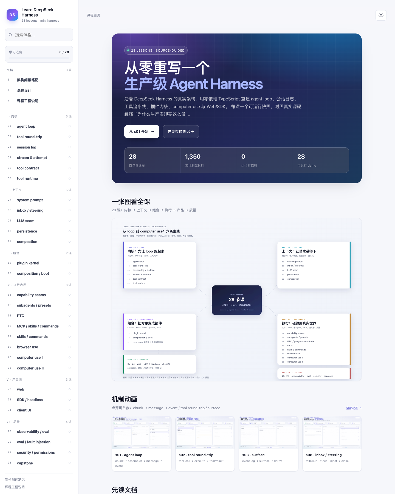
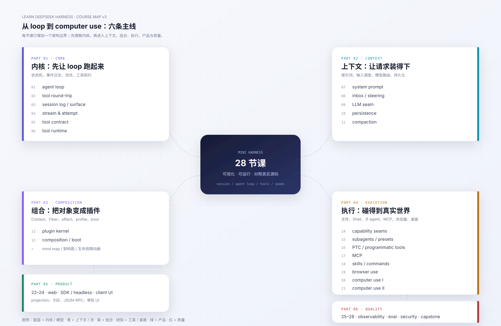

# Learn DeepSeek Harness

这是 `deepseek-harness` 的源码学习项目：**先读懂真实架构，再用 28 课从零重写一个 mini harness**。

- 上游源码（本地 clone，不随仓库提交）：`deepseek-harness/`，版本 `0.2.2-alpha.2`
- 架构阅读笔记：[`docs/00-architecture.zh.md`](docs/00-architecture.zh.md)
- 课程设计（28 课）：[`docs/02-course-v3.zh.md`](docs/02-course-v3.zh.md)
- 课程工程：[`course/`](course/README.md)
- 课程网站：[`site/`](site/README.md)（`node site/serve.mjs`）

**I · 内核**

- 第 1 课：[`s01-agent-loop`](course/lessons/s01-agent-loop/README.md)
- 第 2 课：[`s02-tool-round-trip`](course/lessons/s02-tool-round-trip/README.md)
- 第 3 课：[`s03-session-log`](course/lessons/s03-session-log/README.md)
- 第 4 课：[`s04-streaming`](course/lessons/s04-streaming/README.md)
- 第 5 课：[`s05-tool-contract`](course/lessons/s05-tool-contract/README.md)
- 第 6 课：[`s06-tool-runtime`](course/lessons/s06-tool-runtime/README.md)
**II · 上下文**

- 第 7 课：[`s07-system-prompt`](course/lessons/s07-system-prompt/README.md)
- 第 8 课：[`s08-inbox-steering`](course/lessons/s08-inbox-steering/README.md)
- 第 9 课：[`s09-llm-seam`](course/lessons/s09-llm-seam/README.md)
- 第 10 课：[`s10-persistence`](course/lessons/s10-persistence/README.md)
- 第 11 课：[`s11-compaction`](course/lessons/s11-compaction/README.md)
**III · 组合**

- 第 12 课：[`s12-plugin-kernel`](course/lessons/s12-plugin-kernel/README.md)
- 第 13 课：[`s13-composition-boot`](course/lessons/s13-composition-boot/README.md)
**IV · 执行边界**

- 第 14 课：[`s14-capability-seams`](course/lessons/s14-capability-seams/README.md)
- 第 15 课：[`s15-subagents-presets`](course/lessons/s15-subagents-presets/README.md)
- 第 16 课：[`s16-ptc`](course/lessons/s16-ptc/README.md)
- 第 17 课：[`s17-mcp-skills-commands`](course/lessons/s17-mcp-skills-commands/README.md)
- 第 18 课：[`s18-skills-commands`](course/lessons/s18-skills-commands/README.md)
- 第 19 课：[`s19-browser-use`](course/lessons/s19-browser-use/README.md)
- 第 20 课：[`s20-computer-use-i`](course/lessons/s20-computer-use-i/README.md)
- 第 21 课：[`s21-computer-use-ii`](course/lessons/s21-computer-use-ii/README.md)
**V · 产品面**

- 第 22 课：[`s22-web`](course/lessons/s22-web/README.md)
- 第 23 课：[`s23-sdk-headless`](course/lessons/s23-sdk-headless/README.md)
- 第 24 课：[`s24-client-ui`](course/lessons/s24-client-ui/README.md)
**VI · 质量**

- 第 25 课：[`s25-observability-eval`](course/lessons/s25-observability-eval/README.md)
- 第 26 课：[`s26-eval`](course/lessons/s26-eval/README.md)
- 第 27 课：[`s27-security`](course/lessons/s27-security/README.md)
- 第 28 课：[`s28-capstone`](course/lessons/s28-capstone/README.md)

## 快速开始

```sh
cd course/lessons/s01-agent-loop
cp env.example .env          # 填入 DEEPSEEK_API_KEY
node src/demo.ts             # 真实 DeepSeek 跑一次文本 turn
node --test tests/s01.test.ts # 离线单元测试，不需要 key
```

不需要 `pnpm install`，Node ≥ 24 直接运行 TypeScript。每课都是自包含文件夹：`README.md`、`src/`、`tests/`、`env.example` 都在该课目录内。

开源仓库**不包含**上游 `deepseek-harness/` 和本地练习目录 `course/practice/`。要读真实源码时，在本机单独 clone：

```sh
git clone https://github.com/deepseek-ai/deepseek-harness.git deepseek-harness
```

课程代码和离线测试不依赖这个目录；它只用于对照阅读。

Demo 会打印一次真实 turn 的完整事件序列：

```text
turn/start
step/start
user/message
request/header
assistant/message
tool/call
tool/result
step/end
step/start
assistant/message
step/end
turn/end
```

## 仓库结构

```text
docs/               架构阅读笔记与课程设计
course/lessons/     28 课自包含代码、测试、讲义
course/practice/    本地私有练习（不提交）
site/               课程网站（Markdown 阅读模式）
deepseek-harness/   上游源码 clone（不提交，仅本地阅读）
```

仓库只提交源码：站点不提交 `content.js` 或讲义副本，运行时直接读取 Markdown；仅保留 `docs/assets/course-home.png` 一张首页截图用于文档预览。

## 安全与隐私

- **不要提交 `.env`**。每课的 `env.example` 只有占位符；真实 key 放在本地 `.env`，该文件已被 `.gitignore` 忽略。
- 如果 key 曾经被提交或推到远端：立刻在 provider 侧吊销/轮换，再清理 Git 历史；不要只删当前文件。
- 本仓库忽略 `deepseek-harness/`（第三方 checkout）与 `course/practice/`（个人练习），二者只在你本机存在。
- 课程 demo 会真实执行 shell、写文件、调用模型。请在没有敏感数据的临时工作区运行；mini harness 不是安全沙箱。
- 安全问题请按 [`SECURITY.md`](SECURITY.md) 私下报告，不要开公开 issue。

## 这个项目回答什么

1. 一个生产级 coding agent 的 **agent loop** 到底长什么样？为什么不是「调模型 + 跑工具」的 while 循环？
2. 为什么 DSH 把 **append-only 会话日志** 当作唯一真源，而不是维护 `messages` 数组？
3. 工具、提示词、模型、沙箱、子 agent、UI 如何通过 **capability seam** 和 **插件树** 组合，而不是互相 import？
4. 取消、重试、压缩、恢复、并发、审批这些「工程细节」如何变成可验证的契约？
5. 如何把这些设计**亲手实现一遍**，而不是只读不写？

## 文档地图

| 文档 | 内容 |
|---|---|
| [`docs/00-architecture.zh.md`](docs/00-architecture.zh.md) | 20 节架构阅读笔记：运行时、包地图、Cordis、turn 时序、会话日志、loop、工具、提示词、LLM seam、能力 seam、扩展面、传输、横切关注点、设计模式、阅读路线、文件索引 |
| [`docs/01-course-design.zh.md`](docs/01-course-design.zh.md) | 早期 18 课设计（背景）：设计原则、课程地图、每课目标/源码锚点与验收 |
| [`course/README.md`](course/README.md) | 课程工程说明、运行方式、代码约定 |
| [`course/lessons/`](course/lessons) | 28 课自包含讲义：每课 README 含源码阅读路径、实现说明、验收、练习与带答案的思考题 |
| [`docs/02-course-v3.zh.md`](docs/02-course-v3.zh.md) | v3 课程设计：28 课、computer use、每课开篇模板与可视化规范 |
| [`docs/visuals/README.md`](docs/visuals/README.md) | 20 个机制动画、28 张本课地图与生成脚本 |

## 课程网站

`site/` 是随仓库一起开源的网站源码，clone 后无需构建；28 课有一个可浏览版本：

```sh
node site/serve.mjs
# http://127.0.0.1:4173/site/
```

站点直接读取 `course/lessons/*/README.md` 与 `docs/*.md`，不提交打包后的讲义副本或 bundle；只保留一张首页截图用于文档预览。必须通过本地服务器访问；站点包含课程地图、讲义阅读页、页内目录、学习进度、搜索与深浅色主题，说明见 [`site/README.md`](site/README.md)。



## 课程地图

28 课的六条主线：内核 → 上下文 → 组合 → 执行 → 产品 → 质量；详细拆解见 [`docs/02-course-v3.zh.md`](docs/02-course-v3.zh.md)。



## 课程进度

| 课 | 主题 | 状态 |
|---|---|---|
| s01 | agent loop | ✅ 已完成（7 离线 + 1 live） |
| s02 | tool round-trip | ✅ 已完成（16 离线 + 2 live） |
| s03 | session log | ✅ 已完成（12 离线 + 1 live） |
| s04 | stream & attempt | ✅ 已完成（12 离线 + 1 live） |
| s05 | tool contract | ✅ 已完成（11 离线 + 12 回归 + 1 live） |
| s06 | tool runtime | ✅ 已完成（11 离线 + 23 回归 + 1 live） |
| s07 | system prompt | ✅ 已完成（10 离线 + 44 回归 + 1 live） |
| s08 | inbox / steering | ✅ 已完成（10 离线 + 54 回归 + 1 live） |
| s09 | LLM seam | ✅ 已完成（8 离线 + 62 回归 + 1 live） |
| s10 | persistence | ✅ 已完成（10 离线 + 72 回归 + 1 live） |
| s11 | compaction | ✅ 已完成（7 离线 + 79 回归 + 1 live） |
| s12 | plugin kernel | ✅ 已完成（8 离线 + 87 回归） |
| s13 | composition / boot | ✅ 已完成（8 离线 + 95 回归） |
| s14 | capability seams | ✅ 已完成（6 离线 + 101 回归） |
| s15 | subagents / presets | ✅ 已完成（3 离线 + 104 回归 + 1 live） |
| s16 | PTC | ✅ 已完成（14 离线） |
| s17 | MCP / skills / commands | ✅ 已完成（14 离线 + 108 回归） |
| s18 | skills / commands | ✅ 已完成（10 离线） |
| s19 | browser use | ✅ 已完成（8 离线） |
| s20 | computer use I | ✅ 已完成（10 离线） |
| s21 | computer use II | ✅ 已完成（12 离线） |
| s22 | web | ✅ 已完成（2 离线 + 110 回归） |
| s23 | SDK / headless | ✅ 已完成（3 离线 + 113 回归 + 1 live） |
| s24 | client UI | ✅ 已完成（11 离线） |
| s25 | observability / eval | ✅ 已完成（4 离线 + 117 回归 + 1 live） |
| s26 | eval / fault injection | ✅ 已完成（9 离线） |
| s27 | security / permissions | ✅ 已完成（17 离线） |
| s28 | capstone | ✅ 已完成（8 离线 + 1 live） |

## 建议的阅读顺序

如果你只有几个小时：

1. 读 [`00-architecture.zh.md`](docs/00-architecture.zh.md) 的第 1、2、5、6、7、8 节。
2. 跑 `course/lessons/s01-agent-loop/src/demo.ts`，对照事件日志读第 1 课讲义。
3. 读 `deepseek-harness/packages/core/agent-loop/src/agent.ts` 的 `turn()`、`preStep()`、`step()`。
4. 做第 1 课的练习 1 和 3。

如果你有一周：

- 按 28 课顺序，每课 2-4 小时；每 3 课做一次「不看讲义重写」。
- 最后用第 28 课 capstone 的 mini harness 跑一个真实任务（读写文件、跑测试、修复 bug），和真实 `dsh --profile headless` 的输出对照。

## 已确定的结构约定

- 每课一个自包含目录：`course/lessons/sNN-<slug>/`，内含 `README.md`、`src/`、`tests/`、`env.example`。
- 课程代码按课复制并增量演进，后一课是前一课的完整快照；任意一课都能单独运行。
- 模型一律使用真实 DeepSeek（`DEEPSEEK_API_KEY`），不再内置假模型。
- 运行时零依赖，Node 24 原生 TypeScript；离线单元测试不访问网络，`live.test.ts` 在缺少 key 时自动跳过。

## 上游与许可

- 上游项目：[`deepseek-ai/deepseek-harness`](https://github.com/deepseek-ai/deepseek-harness)（MIT）。本课程是独立的学习用重写，不是上游官方文档，也不代表上游立场。
- 本仓库课程代码、讲义与网站采用 [MIT License](LICENSE)；上游版权与许可见 [`LICENSE-UPSTREAM`](LICENSE-UPSTREAM) 与 [`NOTICE`](NOTICE)。
- 欢迎贡献：先读 [`CONTRIBUTING.md`](CONTRIBUTING.md)；提交前不要带 `.env`、`deepseek-harness/` 或 `course/practice/`。
