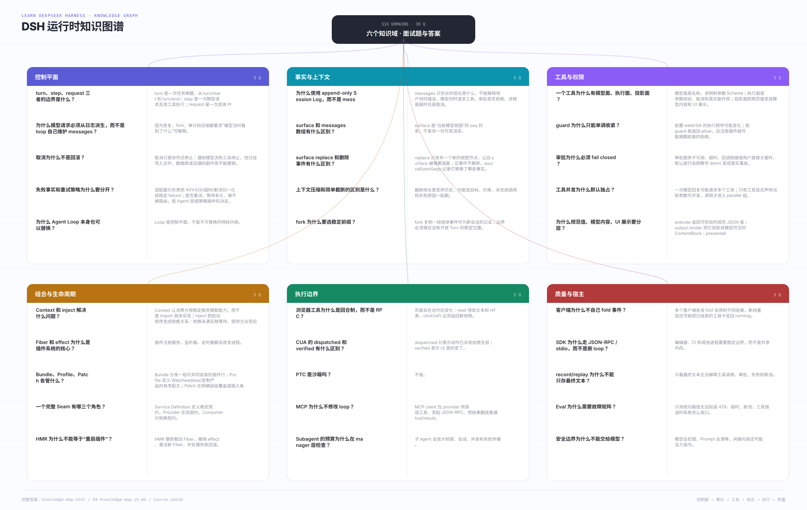

# Course · 重写 Mini DeepSeek Harness

每课一个**自包含文件夹**：讲义、代码、测试、`env.example` 都在该课目录内。

课程按 s01 → s28 递进，每课都可以单独打开、运行、阅读；后一课在前一课基础上增加一个架构边界。

> `course/practice/` 是本地私有练习目录，已被忽略，不随仓库分发。

- 课程设计：[`../docs/02-course-v3.zh.md`](../docs/02-course-v3.zh.md)
- 架构阅读笔记：[`../docs/00-architecture.zh.md`](../docs/00-architecture.zh.md)
- 当前进度：**s01-s28 全部完成**
- 课程网站：[`../site/`](../site/README.md)（`node site/serve.mjs`）

## 知识导图



总图是六个知识域；每课导图按 **S 场景 / T 任务 / A 是什么·怎么做 / R 结果与边界** 展开。XMind 内含总图谱 + 28 张每课知识点。网页直接显示 SVG；需要编辑时下载 XMind。

- [XMind 源文件](../docs/visuals/mindmaps/course.xmind)
- [OPML（通用大纲）](../docs/visuals/mindmaps/course.opml)
- [Markdown 大纲](../docs/visuals/mindmaps/course.md)

> XMind 内含 29 张 sheet（1 张总图谱 + 28 张每课知识点）。如果本机 Xmind 版本提示格式不兼容，直接导入 `.opml`。

## 课程目录

```text
course/lessons/
  # I · 内核
  s01-agent-loop/
  s02-tool-round-trip/
  s03-session-log/
  s04-streaming/
  s05-tool-contract/
  s06-tool-runtime/
  # II · 上下文
  s07-system-prompt/
  s08-inbox-steering/
  s09-llm-seam/
  s10-persistence/
  s11-compaction/
  # III · 组合
  s12-plugin-kernel/
  s13-composition-boot/
  # IV · 执行边界
  s14-capability-seams/
  s15-subagents-presets/
  s16-ptc/
  s17-mcp-skills-commands/
  s18-skills-commands/
  s19-browser-use/
  s20-computer-use-i/
  s21-computer-use-ii/
  # V · 产品面
  s22-web/
  s23-sdk-headless/
  s24-client-ui/
  # VI · 质量
  s25-observability-eval/
  s26-eval/
  s27-security/
  s28-capstone/
```
每课都有 `README.md`、`env.example`、`package.json`、`tsconfig.json`、`src/`、`tests/`；DeepSeek Messages wire 实现在各课 `src/messages.ts`，`src/deepseek.ts` 只做本地导出。

## 运行

环境：Node ≥ 24。不需要 `pnpm install`，运行时零依赖。以 s01 为例（把路径和测试文件名换成对应课号）：

```sh
cd course/lessons/s01-agent-loop

# 1. 配置真实 DeepSeek
cp env.example .env
# 编辑 .env，至少填入 DEEPSEEK_API_KEY

# 2. 运行 demo
node src/demo.ts

# 3. 离线单元测试（不需要 key）
node --test tests/s01.test.ts

# 4. 真实模型端到端测试（需要 key）
node --test tests/live.test.ts

# 可选：类型检查（只有这一步需要 npm install）
npm install
npm run typecheck
```

如果没有 key，`live.test.ts` 会显示 `SKIP`，`s01.test.ts` 仍然全部通过。

## 环境变量

| 变量 | 必填 | 默认 | 说明 |
|---|---|---|---|
| `DEEPSEEK_API_KEY` | 是 | — | DeepSeek API key |
| `DEEPSEEK_BASE_URL` | 否 | `https://api.deepseek.com` | 兼容 OpenAI 的端点；可带 `/v1` |
| `DEEPSEEK_MODEL` | 否 | `deepseek-flash` | DeepSeek-V4.1-Flash（`1017` 是发布角标，不是 id）；也可用 `deepseek-v4-pro` |
| `DEEPSEEK_MAX_TOKENS` | 否 | 不发送 | 单次输出上限 |
| `DEEPSEEK_TIMEOUT_MS` | 否 | 不超时 | 请求超时 |

`.env` 已被 `course/.gitignore` 忽略。不要提交真实 key。

## 学习方式

1. **先跑 demo**，观察一次真实请求产生的事件序列。
2. **读讲义里的「真实源码」链接**，对照 DSH 的真实实现。
3. **读 `src/`**，按 `types → session → deepseek → tools → agent` 的顺序。
4. **改代码、跑测试**：每课有 2-4 个练习，验收标准写清楚。
5. 每 3 课做一次「不看讲义重写」。

## 代码约定

- Node 24 原生类型擦除：只使用可擦除语法（不要 `enum`、`namespace`、构造函数参数属性）。
- 相对 import 带 `.ts` 扩展名。
- 运行时只用 `node:` 内置模块；HTTP 用全局 `fetch`。
- 测试用 `node:test` + `node:assert/strict`。
- 模型一律走真实 DeepSeek；不内置假模型。
- 每个公开类型/函数写 JSDoc，说明契约而不是复述代码。

## 与真实 DSH 的关系

课程不是把 DSH 源码抄一遍，而是按它的架构约束重写一个小实现：

| 真实 DSH | 课程 |
|---|---|
| Cordis 插件树 | s12 实现子集，并把前 11 课重构为插件 |
| 13+ 种 session event、格式迁移 | s03/s10 保留核心事件与单版本持久化 |
| 多种 provider + OAuth + 账户 | 真实 DeepSeek HTTP；s09 做 provider seam |
| Native + PTC executor | s14 做能力 seam；s16 做 PTC |
| 完整 Web/Electron 客户端 | s22 极简 HTML + SSE |
| OTel / 快照门禁 | s25/s26 结构化 span + 录制回放/评测 |

每课讲义都有「刻意简化」小节，明确差异。
