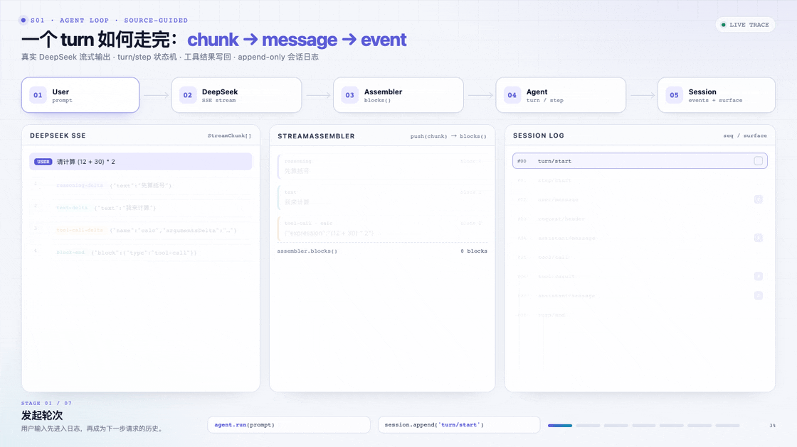
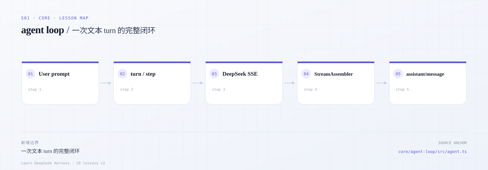

# s01 · 最小 agent loop：一次真实文本 turn 如何发生

> 本课代码：`src/`（`types.ts`、`session.ts`、`messages.ts`、`env.ts`、`tools.ts`、`agent.ts`、`demo.ts`）
>
> 测试：`tests/s01.test.ts`（7 个离线用例）+ `tests/live.test.ts`（1 个真实模型用例）
>
> 模型：真实 DeepSeek；离线测试用本地脚本模型，不访问网络。

---

## 一个普通的周三下午

你把一个 failing test 丢给 agent。它回了三行字，说“我来看看”，然后你按了 Ctrl-C。

第二天你重新打开会话，想接着问它昨天改了哪里。它没有昨天的上下文；日志里也说不清，用户是在哪一步取消的，模型当时到底看到了什么。

这不是模型不够聪明，是运行时把“发生过什么”只放在了一个内存里的 `messages` 数组。**数组只能告诉你现在是什么，不能告诉你为什么变成这样。**

## 这一课只回答一个问题

一次纯文本 turn，怎样才能写成**可观察、可取消、可恢复**的状态机？

先把两个词分开：

- **turn**：一次任务唤醒。用户说“修这个测试”，到 `turn/end` 为止。
- **step**：turn 里的一次模型请求。模型可能一步答完，也可能因为工具结果继续第二步。

本课只跑文本，不跑工具往返；工具留到 s02。你要亲手看到：

- `turn/start` 和 `turn/end` 为什么必须成对，`turn/end` 为什么放在 `finally`；
- 流式返回的 chunk 怎样按 block index 进入 assembler，最后变成一条完整的 assistant message；
- 用户取消时，已经流给用户看的前缀为什么不能丢；
- 下一次请求为什么从 `deriveMessages()` 重建，而不是 loop 自己维护数组。

### 先看一遍它怎么跑



*一条真实 turn：SSE chunk 进入 assembler，组装成 message，再作为事件进入 surface。*

[交互版](../../../docs/visuals/s01-loop.html) · [MP4](../../../docs/visuals/s01-loop.mp4)

### 读完之后，拿这三个问题审自己

1. 如果 `turn/end` 不在 `finally`，进程崩溃时日志会缺什么？
2. 如果请求不是从日志派生，而是 loop 自己维护 `messages`，恢复后模型看到的历史会差在哪？
3. 如果取消时把半个 assistant message 丢掉，用户已经看到的内容为什么算“没发生过”？

---



*本课地图：这一步新增的架构边界，以及它在数据流中的位置。*

## 0. 先跑起来

```sh
cd course/lessons/s01-agent-loop

cp env.example .env
# 编辑 .env，至少填入 DEEPSEEK_API_KEY

node src/demo.ts                 # 一次真实文本 turn
node --test tests/s01.test.ts    # 离线，不需要 key
node --test tests/live.test.ts   # 需要 key；没有则 SKIP

# 可选：类型检查
npm install
npm run typecheck
```

环境变量：

| 变量 | 必填 | 默认 | 说明 |
|---|---|---|---|
| `DEEPSEEK_API_KEY` | 是 | — | DeepSeek API key |
| `DEEPSEEK_BASE_URL` | 否 | `https://api.deepseek.com/anthropic` | DeepSeek Messages 根地址，可带 `/v1` |
| `DEEPSEEK_MODEL` | 否 | `deepseek-flash` | DeepSeek-V4.1-Flash；也可用 `deepseek-v4-pro` |
| `DEEPSEEK_MAX_TOKENS` | 否 | 不发送 | 单次输出上限 |
| `DEEPSEEK_TIMEOUT_MS` | 否 | 不超时 | 请求超时 |

Demo 只发一次纯文本请求，正常情况下事件序列长这样：

```text
model: deepseek/deepseek-flash (https://api.deepseek.com/anthropic)

=== 事件日志 ===
#00 turn/start
#01 step/start
#02 user/message
#03 request/header      deepseek/deepseek-flash tools=[]
#04 assistant/message   blocks=1
#05 step/end
#06 turn/end            {"kind":"completed"}

=== 结果 ===
reason: { kind: 'completed' }
steps : 1
answer: ...
```

请先确认三件事：

1. `turn/end` 是最后一条事件；
2. 第二次运行不会复用进程内的 messages 数组——请求来自 `deriveMessages()`；
3. 中间任何一步失败或取消，`step/end` 与 `turn/end` 仍然存在。

---

## 1. 这一课要回答的问题

1. 一个 agent loop 的最小正确形状是什么？为什么不是 `while (true) { callModel(); }`？
2. turn 和 step 谁包含谁？为什么不能用 turn 的开始/结束推断模型调用次数？
3. 流式 chunk 的 index 为什么不能当作“第几个块”以外的任何东西？
4. 取消时为什么不把 assembly 直接丢掉，而要保留前缀？
5. 为什么请求要从事件日志派生，而不是让 loop 自己维护 `messages`？
6. 模型失败为什么应该变成 `turn/end { kind: 'error' }`，而不是抛给调用方？

---

## 2. 先读真实源码

按这个顺序读，带着右边的问题：

| 顺序 | 文件 / 函数 | 读的时候问自己 | 思考题 |
|---|---|---|---|
| 1 | [`docs/agent-lifecycle.zh.md`](../../../deepseek-harness/docs/agent-lifecycle.zh.md) | 一次 turn 里到底发生了哪些事件？哪些是持久的？ | Q1 |
| 2 | [`agent.ts` → `turn()`](../../../deepseek-harness/packages/core/agent-loop/src/agent.ts) | 为什么 `turn/end` 要放在 `finally`？ | Q2 |
| 3 | [`agent.ts` → `step()`](../../../deepseek-harness/packages/core/agent-loop/src/agent.ts) | 请求准备好之后，先写 system 还是先写 user？ | Q3 |
| 4 | [`llm/src/assembler.ts`](../../../deepseek-harness/packages/llm/llm/src/assembler.ts) | block-start / delta / block-end 如何对应？ | Q4 |
| 5 | [`llm/src/types.ts`](../../../deepseek-harness/packages/llm/llm/src/types.ts) | 为什么模型输出是 `ContentBlock[]` 而不是字符串？ | Q5 |
| 6 | [`session/src/index.ts` → `deriveMessages()`](../../../deepseek-harness/packages/core/session/src/index.ts) | 哪些事件进入历史？空 assistant 为什么被排除？ | Q6 |
| 7 | [`llm-deepseek`](../../../deepseek-harness/packages/llm/llm-deepseek/) | reasoning、usage、finish_reason 如何映射？ | Q7 |

读完后先自己回答第 8 节的 7 个问题，再对照答案。

---

## 3. 核心概念

### 3.1 turn 与 step

- **step** = 一次模型请求（以及它可能请求的工具）。
- **turn** = 0 个或多个 step；在领取首条输入前打开，在不再欠工作时关闭。

一个 turn 可以没有 step（输入为空、被拒绝、打开前取消）。一个 step 失败后 turn 也可能继续（重试、下一轮）。所以：

```text
turn/start → step/start → ... → step/end → step/start → ... → step/end → turn/end
```

不是“一次请求 = 一次 turn”。本课的 `maxSteps` 只是防止脚本化模型无限循环的教学守卫，真实 DSH 用“是否还有欠下的工作”结束 turn。

### 3.2 日志是唯一真源

`Session` 是一个仅追加的事件数组，而不是 `messages` 数组：

```ts
// src/session.ts（节选）
append(type, data): SessionEvent { ... }

deriveMessages(): Message[] {
  for (const event of this.#events) {
    if (event.type === 'user/message') messages.push(event.data.message)
    if (event.type === 'assistant/message' && event.data.message.content.length > 0) {
      messages.push(event.data.message)
    }
    if (event.type === 'tool/result') messages.push(event.data.message)
  }
  return messages
}
```

这样做的直接收益：

- 取消、失败、重试都只是追加事实，不需要回滚一个可变数组；
- 从磁盘恢复后，历史与当时完全一致；
- 测试可以只断言事件序列，而不依赖内部字段。

### 3.3 流式组装：index 是块的身份

SSE 的 delta 是交错的：

```text
block-start(index=0, reasoning)
reasoning-delta(index=0)
block-start(index=1, text)
text-delta(index=1)
reasoning-delta(index=0)
...
```

`StreamAssembler` 用 `Map<index, openBlock>` 累积，最后按 index 排序输出。`block-end` 携带权威的完整块；如果流被截断、没有 `block-end`，就从 delta 合成。

`index` 不是“第几个 token”，也不是数组下标之外的排序依据——它只是同一次响应内一个内容块的稳定 id。

### 3.4 取消：保留用户已经看到的东西

取消不是“把这次响应丢掉”。用户已经看到的文本必须保留：

- `partialBlocks()` 只保留 `text` / `reasoning`，未完成的 `tool-call` 不进入历史；
- 追加 `assistant/message` 时带 `interrupted: true`；
- 如果连一个可见块都没有，就只记录 `assistant/attempt` 失败事实；
- 无论哪种情况，`step/end` 和 `turn/end { kind: 'aborted' }` 都要写入。

### 3.5 失败是结果，不是穿透的异常

`Agent.run()` 不会把模型错误抛给调用方，而是把它收敛成 `RunResult.reason`：

```ts
{ kind: 'error', failure: { message, code } }
```

同时日志里会有 `assistant/attempt`（这次尝试失败）和 `turn/end`。调用方、UI、持久化都能看到同一个事实。

---

## 4. 真实 DeepSeek 适配器

`src/messages.ts` 做三件事：

1. 把内部 `Message[]` 投影成 Messages content-block wire messages；
2. 用 `fetch` 发 `stream: true` 请求，`SseDecoder` 处理跨 chunk 切割与 CRLF；
3. 把 `text_delta` / `thinking_delta` / `stop_reason` / usage 映射成内部 `StreamChunk`。

本课只需要文本路径；`tool_use` 的 `input_json_delta` 合并代码保留，但 demo 不触发它。真实适配器还会处理重试、错误分类和能力协商，这些留给后续课程。

---

## 5. mini 实现

### 5.1 文件地图

| 文件 | 作用 |
|---|---|
| [`src/types.ts`](src/types.ts) | 消息、内容块、流 chunk、会话事件 |
| [`src/session.ts`](src/session.ts) | 仅追加日志、稳定 id、`deriveMessages()`、restore |
| [`src/agent.ts`](src/agent.ts) | `Agent.run()`、`StreamAssembler`、turn/step 状态机 |
| [`src/messages.ts`](src/messages.ts) | 真实 DeepSeek SSE 适配器 |
| [`src/env.ts`](src/env.ts) | 读取 `.env` 并校验配置 |
| [`src/tools.ts`](src/tools.ts) | 工具注册表（本课内部能力，demo 不使用） |
| [`src/demo.ts`](src/demo.ts) | 纯文本 loop 演示 |

### 5.2 run loop 的骨架

```ts
async run(prompt, options) {
  const turn = this.#turn + 1
  this.session.append('turn/start', { turn })
  let reason = { kind: 'completed' }

  try {
    for (let step = 1; step <= this.#maxSteps; step += 1) {
      signal.throwIfAborted()
      this.session.append('step/start', { turn, step })
      try {
        if (step === 1) this.session.append('user/message', { message })
        const outcome = await this.#runStep(turn, step, signal)
        reason = outcome.reason
        if (outcome.toolCalls === undefined) break
        // 工具分发：本课不演示，代码保留为内部能力
      } finally {
        this.session.append('step/end', { turn, step })
      }
    }
  } catch (error) {
    reason = classify(error, signal)
  } finally {
    this.session.append('turn/end', { turn, reason })
  }
}
```

关键点：`turn/end` 在 `finally`，`step/end` 也在 `finally`。这样取消和异常都不会留下半个 turn。

### 5.3 请求从日志派生

```ts
#buildRequest(signal) {
  return Object.freeze({
    sessionId: this.session.id,
    provider: this.#model.provider,
    model: this.#model.model,
    messages: Object.freeze(this.session.deriveMessages()),
    tools: Object.freeze(this.#tools.schemas()),
    signal,
  })
}
```

`request/header` 只在 provider/model/tools 变化时记录一次，避免每步重复写相同快照。

---

## 6. 验收：7 个离线测试 + 1 个真实模型测试

离线测试（`node --test tests/s01.test.ts`）：

| # | 用例 | 证明 |
|---|---|---|
| 1 | text turn | 事件序列、usage、派生历史、单次请求 |
| 2 | model finish error | 失败收敛为 `turn/end`，不抛异常 |
| 3 | assembler 交错块 | reasoning/text 按 index 排序 |
| 4 | assembler 无 block-end | 从 delta 合成；取消只保留可见前缀 |
| 5 | cancel | 保留 `partial ` 前缀、`interrupted: true`、turn 正常收口 |
| 6 | surface append | 只有消息事件进入派生历史；空 assistant 不进入 |
| 7 | replay | restore 后历史一致，新 agent 从 turn 2 继续 |

真实模型测试（`node --test tests/live.test.ts`）：一次 `pong` 文本 turn，断言 1 个 step、没有工具调用、`turn/end` 是最后一条事件。没有 key 时自动 SKIP。

---

## 7. 刻意简化了什么

| 真实 DSH | s01 | 影响 |
|---|---|---|
| tool pipeline / 策略 / 并发 | `tools.ts` 仅保留最小注册表 | 不演示工具往返 |
| surface replace / 压缩 | 只有 append 语义 | 压缩留给后续课 |
| 持久化 / 恢复校验 | `Session.restore()` 简单重放 | 不校验 seq 空洞 |
| inbox / steering / waterfall | 无 | 一次 run 只领一条输入 |
| provider 重试 / 能力协商 | 单次请求 | 失败直接进日志 |
| 多 provider | 只有 DeepSeek | 教学聚焦 |

---

## 8. 思考题（附源码位置与答案）

### Q1. 一次 turn 里到底发生了哪些事件？

最小文本 turn：

```text
turn/start → step/start → user/message → request/header
→ assistant/message → step/end → turn/end
```

`turn/start`、`step/*`、`request/header` 是日志事实；`user/message`、`assistant/message`、`tool/result` 进入 surface。见 [`docs/agent-lifecycle.zh.md`](../../../deepseek-harness/docs/agent-lifecycle.zh.md)。

### Q2. 为什么 `turn/end` 要放在 `finally`？

因为 turn 可能因取消、模型错误、工具错误、进程 dispose 提前结束；只有 `finally` 能保证“开头有 turn/start，结尾一定有 turn/end”。否则恢复时会看到永远打开的 turn。

见 [`agent.ts` → `turn()`](../../../deepseek-harness/packages/core/agent-loop/src/agent.ts)。

### Q3. 为什么请求不直接维护 `messages` 数组？

可变数组在取消/重试/压缩/恢复时会产生分叉：UI 看到的历史、模型看到的历史、磁盘上的历史可能不一致。DSH 让日志成为唯一真源，每次请求都重新投影；这样一次 surface replace 会立刻影响下一步请求。

见 [`session/src/index.ts` → `deriveMessages()`](../../../deepseek-harness/packages/core/session/src/index.ts)。

### Q4. 流式 chunk 的 index 为什么重要？

一次响应里可以同时有 reasoning、text、多个 tool-call；delta 交错到达。index 是它们的稳定身份，assembler 用 index 累积、排序，最后产出 `ContentBlock[]`。

见 [`llm/src/assembler.ts`](../../../deepseek-harness/packages/llm/llm/src/assembler.ts)。

### Q5. 为什么模型输出是 `ContentBlock[]` 而不是字符串？

因为一条 assistant 消息可以同时包含推理、文本和多个工具调用；字符串无法表达顺序、类型和后续的工具配对。`ContentBlock[]` 是模型输出的规范形态，wire 格式只是它的投影。

见 [`llm/src/types.ts`](../../../deepseek-harness/packages/llm/llm/src/types.ts)。

### Q6. 哪些事件进入模型历史？空 assistant 为什么被排除？

只有 `system/message`、`user/message`、`assistant/message`（内容非空）、`tool/result` 进入。空 assistant（只有 finish、没有内容）留在日志里证明“这次请求发生过”，但它对下一轮模型没有信息量，所以不进入 surface。

### Q7. 取消时为什么不能直接丢弃 assembly？

用户已经看到的内容如果从历史里消失，下一轮模型会“失忆”，用户也会觉得界面回退。正确做法是保留可见前缀、标记 `interrupted`，并让 turn 以 `aborted` 正常收口。

---

## 9. 下一课：s02 · tool round-trip

这一课只做了文本 turn。下一课会在这个状态机上加入工具往返：

- 模型请求工具时，参数分片如何组装？
- 工具结果如何写回日志，并驱动下一步请求？
- 工具失败、未知工具、参数错误如何变成模型可见的结果？
- 为什么工具结果必须在 `step/end` 之前提交？

先把本课的 `agent.ts` 读透，再进入 s02。
