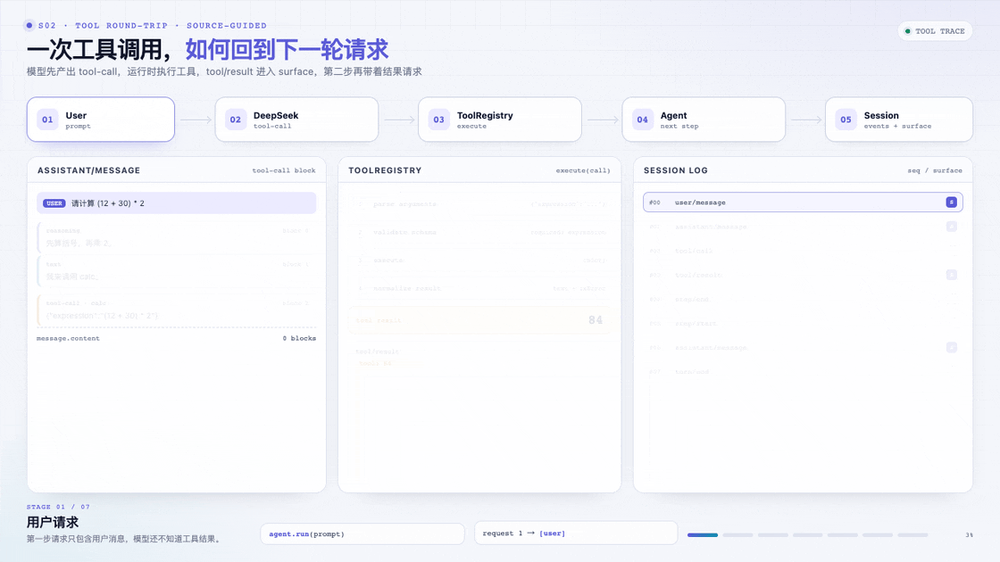
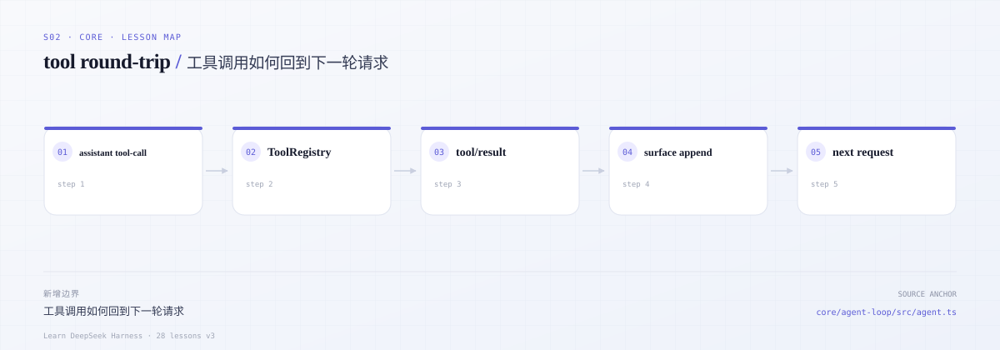
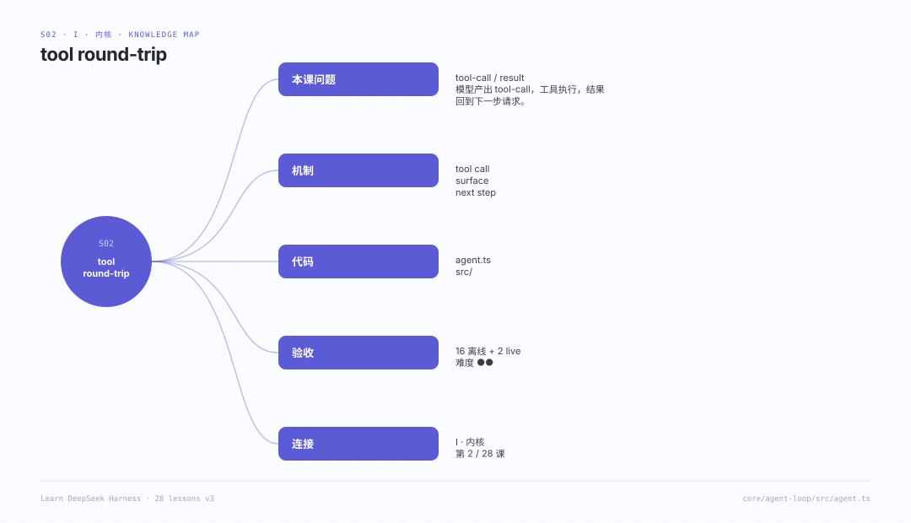

# s02 · tool round-trip：工具调用如何回到下一轮请求

> 本课代码：`src/`（`types.ts`、`session.ts`、`messages.ts`、`env.ts`、`tools.ts`、`agent.ts`、`demo.ts`）
>
> 测试：`tests/s02.test.ts`（16 个离线用例）+ `tests/live.test.ts`（2 个真实模型用例）
>
> 模型：真实 DeepSeek，不使用假模型。

---

## 一个很常见的错觉

模型说：“我已经读了这个文件，问题出在第 42 行。”你打开文件，发现根本没有这行。

继续追问，它又编了一个更合理的解释。不是模型在撒谎，而是它只看到了一次工具调用，却没有看到工具结果回到历史；下一步请求里没有 `tool/result`，它只能继续猜。

另一条路更糟：工具抛了异常，loop 直接结束。用户看到“运行失败”，模型却没机会知道“文件不存在”或“测试超时”，下一轮还是重复同样的动作。

## 这一课要守住的线

工具调用不是一次函数调用，而是**两条必须配对的事实**：

- 模型在 `assistant/message` 里发出 `tool-call`；
- 运行时执行后，把 `tool/result` 写回会话；
- 下一次请求由 `deriveMessages()` 派生，必须能同时看到调用和结果。

失败也一样。未知工具、参数非法、工具抛错，都不能让轮次消失；它们要变成模型可见的 `isError` 结果。模型看到“这次调用失败了”，才可能换一种做法。

### 先看一次真实往返

**90 秒**：先看动画。**3 分钟**：读下面的代码卡。**30 分钟**：跑完整 demo，再对照源码。



*工具调用不是“函数调用完就结束”，而是写回日志、进入 surface、驱动下一步。*

[交互版](../../../docs/visuals/s02-tools.html) · [MP4](../../../docs/visuals/s02-tools.mp4)

### 动画的 7 幕，在代码里是哪几行

| 动画 | 你看到的 | 课程代码 | 真实对照 |
|---|---|---|---|
| 1 请求 | 只有 user 消息 | [`agent.ts:197`](src/agent.ts#L197) | `turn/start` + 首次输入 |
| 2 选工具 | 模型产出 `tool-call` | [`agent.ts:202`](src/agent.ts#L202) | `step()` 里的模型请求 |
| 3 `tool/call` | 调用写进日志 | [`agent.ts:213`](src/agent.ts#L213) | `tool/call` 事件 |
| 4 执行 | 参数校验、执行 | [`agent.ts:221`](src/agent.ts#L221) | `tools/execute` pipeline |
| 5 `tool/result` | 结果写进 surface | [`agent.ts:234`](src/agent.ts#L234) | `tool/result` 事件 |
| 6 第二步 | 下一次请求看到结果 | [`agent.ts:202`](src/agent.ts#L202) | `deriveMessages()` |
| 7 收口 | 模型给最终回答 | [`agent.ts:255`](src/agent.ts#L255) | `turn/end` |

最关键的是这段 25 行。注意顺序：先写 `tool/call`，执行，再写 `tool/result`；结果不是函数的返回值，而是一条日志事实。

```ts
for (const call of calls) {
  this.session.append('tool/call', {
    turn, step,
    callId: call.id,
    name: call.name,
    arguments: call.arguments,
  })

  const result = await this.#tools.execute(call, {
    signal,
    callId: call.id,
    sessionId: this.session.id,
  })

  const message = createMessage({
    role: 'tool',
    toolCallId: call.id,
    isError: result.isError,
    content: result.content,
  })
  this.session.append('tool/result', { turn, step, message })
}
```

*为什么读这里：模型下一轮能不能看到“84”，只取决于最后这行 `append('tool/result')` 有没有发生。*

完整实现：[`src/agent.ts`](src/agent.ts) · 真实对照：[`agent.ts` 的 tool 分发](https://github.com/deepseek-ai/deepseek-harness/blob/master/packages/core/agent-loop/src/agent.ts)

### 最容易误解的两件事

| 误解 | 实际 |
|---|---|
| 工具调用就是一次函数调用 | 调用和结果是两条必须配对的日志事实；下一步请求从日志派生 |
| 工具报错就应该让 turn 失败 | 错误要变成模型可见的 `isError` 结果，模型才有机会换做法 |

### 设计检查

1. 如果 `tool/call` 写了、`tool/result` 没写，下一轮请求会发生什么？
2. 工具抛错时，你的 loop 是记录一个 `isError` 结果，还是直接终止 turn？
3. 同一次 assistant message 里有多个工具调用，结果能按调用 id 对应回去吗？
4. 工具结果的原始参数和模型参数，是否在投影时被重新序列化坏了？
5. 取消发生在工具执行中，未分发的调用有没有一个明确的“未执行”结果？

---



*本课地图：这一步新增的架构边界，以及它在数据流中的位置。*

## 0. 先跑起来

```sh
cd course/lessons/s02-tool-round-trip

cp env.example .env
# 编辑 .env，至少填入 DEEPSEEK_API_KEY

node src/demo.ts
node --test tests/s02.test.ts      # 不需要 key
node --test tests/live.test.ts     # 需要 key；没有则 SKIP

# 可选：类型检查
npm install
npm run typecheck
```

环境变量：

| 变量 | 必填 | 默认 | 说明 |
|---|---|---|---|
| `DEEPSEEK_API_KEY` | 是 | — | DeepSeek API key |
| `DEEPSEEK_BASE_URL` | 否 | `https://api.deepseek.com/anthropic` | DeepSeek Messages 根地址，可带 `/v1` |
| `DEEPSEEK_MODEL` | 否 | `deepseek-flash` | DeepSeek-V4.1-Flash；也可用 `deepseek-v4-pro` |
| `DEEPSEEK_MAX_TOKENS` | 否 | 不发送 | 单次输出上限 |
| `DEEPSEEK_TIMEOUT_MS` | 否 | 不超时 | 请求超时 |

Demo 会打印一次真实 turn 的事件序列。因为模型输出不固定，事件的具体条数取决于它调用了几次工具；正常情况下长这样：

```text
model: deepseek/deepseek-flash (https://api.deepseek.com/anthropic)

=== 事件日志 ===
#00 turn/start
#01 step/start
#02 user/message
#03 request/header
#04 assistant/message
#05 tool/call          calc({"expression":"(12 + 30) * 2"})
#06 tool/result        84
#07 step/end
#08 step/start
#09 assistant/message
#10 step/end
#11 turn/end

=== 结果 ===
reason: { kind: 'completed' }
steps : 2
answer: (12 + 30) * 2 = 84
```

请先观察三件事：

1. 工具调用发生在 `step/end` 之前；
2. 第二次 `step/start` 之后没有新的 `user/message`，但模型看到了上一次的工具结果；
3. `turn/end` 是最后一条事件，即使中途出错也会存在。

---

## 1. 这一课要回答的问题

1. 一个 agent loop 的最小正确形状是什么？为什么不是 `while (true) { callModel(); runTools(); }`？
2. 模型请求应该从哪里来？维护一个 `messages: Message[]`，还是每次从会话日志重新派生？
3. 工具调用失败时，应该让 loop 崩掉，还是让模型看到错误结果？
4. 用户取消时，已经流式输出一半的文本怎么办？
5. 一次轮次（turn）和一次步骤（step）到底谁包含谁？

---

## 2. 先读真实源码

按这个顺序读，带着右边的问题：

| 顺序 | 文件 / 函数 | 读的时候问自己 | 思考题 |
|---|---|---|---|
| 1 | [`docs/agent-lifecycle.zh.md`](../../../deepseek-harness/docs/agent-lifecycle.zh.md) | 一次 turn 里到底发生了哪些事件？哪些是持久的，哪些是实时的？ | Q1 |
| 2 | [`agent.ts` → `turn()`](../../../deepseek-harness/packages/core/agent-loop/src/agent.ts#L327) | 为什么 `turn/end` 要放在 `finally`？为什么工具结果要在 `step/end` 之前？ | Q2 |
| 3 | [`agent.ts` → `preStep()`](../../../deepseek-harness/packages/core/agent-loop/src/agent.ts#L283) | 输入在哪里被「领取」？`toolSet` 为什么是步骤级的？ | Q3 |
| 4 | [`agent.ts` → `step()`](../../../deepseek-harness/packages/core/agent-loop/src/agent.ts#L435) | 请求准备好之后，先写 system 还是先写 user？为什么重试不重复组装？ | Q4 |
| 5 | [`agent.ts` → `prepareRequest()`](../../../deepseek-harness/packages/core/agent-loop/src/agent.ts#L613) | `prepareCall` 绑定了什么？为什么 `agent/request` 不能改 provider/model？ | Q5 |
| 6 | [`agent.ts` → `buildRequest()`](../../../deepseek-harness/packages/core/agent-loop/src/agent.ts#L656) | 请求由哪三部分组成？`request/header` 为什么只记录变化？ | Q6 |
| 7 | [`session/src/types.ts` → `SessionEventMap`](../../../deepseek-harness/packages/core/session/src/types.ts#L287) | 哪些事件进入模型历史？哪些只是日志事实？ | Q7 |
| 8 | [`session/src/index.ts` → `deriveMessages()`](../../../deepseek-harness/packages/core/session/src/index.ts#L999) | 派生规则是什么？空 assistant 消息为什么被排除？ | Q8 |
| 9 | [`tools/src/contracts.ts` → `ToolDefinition`](../../../deepseek-harness/packages/core/tools/src/contracts.ts#L26) | 工具为什么返回「规范值」而不是文本？ | Q9 |
| 10 | [`llm-deepseek`](../../../deepseek-harness/packages/llm/llm-deepseek/) | 真实适配器如何处理 thinking、tool_use、cache usage？ | Q10 |

读完后先回答这 10 个问题，再对照第 9 节的答案；答不上来的，回到对应函数再读一遍。

然后，你应该能不看文档画出这样一条链：

```text
turn/start
  step/start
    user/message (首次)
    request/header
    assistant/message
    tool/call
    tool/result
  step/end
turn/end
```

---

## 3. 核心概念

### 3.1 turn 与 step

- **step** = 一次模型请求 + 它请求的工具。
- **turn** = 0 个或多个 step；在领取首条输入前打开，在不再欠工作时关闭。

一个 turn 可以没有 step（输入被拒绝、被改写为空、取消）。一个 step 失败后 turn 也可能继续（重试）。所以不能用「turn 开始/结束」推断「模型调用次数」。

真实 loop 的 `turn()` 是一个 `while (true)`：每轮跑一个 step；如果模型没有工具调用、且 `next-step` 没有新输入，就 `break`。s01 用「是否有工具调用」作为继续条件，等价于最小版本。

### 3.2 日志是唯一真源

s01 的 `Session` 已经是一个事件日志，而不是 `messages` 数组：

```ts
// src/session.ts
deriveMessages(): Message[] {
  for (const event of this.#events) {
    switch (event.type) {
      case 'system/message':
      case 'user/message':
      case 'tool/result':
        messages.push(event.data.message)
        break
      case 'assistant/message':
        if (event.data.message.content.length > 0) messages.push(event.data.message)
        break
    }
  }
}
```

这一步看起来「多此一举」，但它是后面所有能力的地基：

- **重试**：不重复组装、不重复提交用户消息，因为请求可以从日志重新派生。
- **恢复**：进程重启后，从磁盘读事件，`deriveMessages()` 得到同一份历史。
- **压缩**：替换 surface 节点，但不删除原始事件。
- **审计**：模型看到的每个字节都能从日志重建。

真实 DSH 把这条原则写成硬规则：**model-visible ⟺ logged**。

### 3.3 请求 = header + 派生历史 + 工具声明

真实 `buildRequest()` 的请求是：

```ts
{
  ...header.config,          // provider/model/采样/maxTokens
  messages: session.deriveMessages(),
  toolHistory: session.toolHistory(),
  tools: header.tools,       // 本步准入的工具 schema
  sessionId,
  signal,
}
```

注意：**没有 `system` 字段**。系统提示词是 `messages` 里的 system 节点（surface node 0），由 `system/message` 事件派生。这是 DSH 与很多框架最大的不同之一：提示词不是请求参数，而是历史的一部分。

s01 简化成：

```ts
{
  sessionId,
  provider: model.provider,
  model: model.model,
  messages: session.deriveMessages(),
  tools: tools.schemas(),
  signal,
}
```

### 3.4 失败是结果，不是异常

| 失败 | 真实 DSH | s01 |
|---|---|---|
| 模型请求失败 | `assistant/attempt` + `agent/request-error`，可重试 | `assistant/attempt` + `turn/end {error}` |
| 工具抛错 | 规范化为 `isError` 的 `tool/result` | 同左 |
| 未知工具 | `UNKNOWN_TOOL` 错误结果 | `Error: unknown tool "x"` |
| 工具参数非法 | 规范化错误结果 | `Error: ...` |
| 取消 | `turn/end {aborted}` + 已交付前缀 | 同左 |

关键点：**工具失败不会让轮次失败**。模型需要看到错误，才能决定换一种做法。只有 loop 自身或模型请求失败才会结束轮次。

### 3.5 取消：保留用户已经看到的东西

真实 DSH 的取消契约：

- 取消发生在 `prepareCall` / `agent/request` 期间：system 和 user 都尚未提交，**什么都不写**。
- 取消发生在流中途：已交付的文本/推理前缀以 `assistant/message { interrupted: true }` 结算，下一次请求能看到用户已经看到的内容。
- 取消发生在工具调用期间：未分发的调用得到合成的 `tool/call` + `ABORTED_BEFORE_DISPATCH` 结果，保证回放时配对。

s01 实现了第二条（流中途取消保留前缀），第一条/第三条留给 s05、s07。

---

## 4. 真实 DeepSeek 适配器

这一课不再使用假模型。`src/messages.ts` 直接调用 `POST /v1/messages`，并把 SSE 转成内部 `StreamChunk`。这是整课最长、也最值得逐行读的文件。

### 4.1 请求映射

```ts
// src/messages.ts
const body = {
  model: this.model,
  max_tokens: config.maxTokens ?? 4096,
  system,                         // 从 system 消息提取，放在顶层
  messages: toWireMessages(request.messages),
  tools: toWireTools(request.tools), // { name, description, input_schema }
  thinking: { type: 'enabled' },
  stream: true,
}
```

- 内部 `Message` 有 `system` / `developer` / `user` / `assistant` / `tool` 角色；system 进入顶层 `system`。
- assistant 的 `tool-call` 投影成 `tool_use` block；`tool` 消息投影成 user `tool_result` block。
- 工具结果通过 `tool_use_id` 配对，不再有 OpenAI 的 `tool_call_id` 字段。
- 工具声明使用 `input_schema`，不是 `function.parameters`。
- 工具的原始参数是字符串；投影时解析成 `input` 对象。

### 4.2 SSE 解析

```text
data: {"type":"message_start","message":{"usage":{"input_tokens":12}}}
data: {"type":"content_block_start","index":0,"content_block":{"type":"text","text":""}}
data: {"type":"content_block_delta","index":0,"delta":{"type":"text_delta","text":"你"}}
data: {"type":"content_block_start","index":1,"content_block":{"type":"tool_use","id":"call_1","name":"calc","input":{}}}
data: {"type":"content_block_delta","index":1,"delta":{"type":"input_json_delta","partial_json":"{\"expression\":\"1+1\"}"}}
data: {"type":"content_block_stop","index":1}
data: {"type":"message_delta","delta":{"stop_reason":"tool_use"},"usage":{"output_tokens":7}}
data: {"type":"message_stop"}
```

`SseDecoder` 处理三件容易出错的事：

1. 一个 chunk 可能只包含半个 `data:` 行；
2. 换行可能是 `\n` 或 `\r\n`；
3. 一个 SSE event 可能有多行 `data:`。

### 4.3 工具调用分片

Messages 的工具参数不是按 `tool_calls[].index` 合并，而是按 content block index：

- `content_block_start` 带 `tool_use.id` / `name`；
- 后续 `input_json_delta.partial_json` 是参数 JSON 的增量；
- 同一个 block index 拼接后才是完整 `input`；
- `content_block_stop` 时生成完整的 `tool-call` block。

代码里用 `Map<number, block>` 累积，流结束时补 `block-end`，把完整块交给 assembler。

### 4.4 reasoning 与 cache usage

- Messages 的 thinking 是 `thinking` block，用 `thinking_delta` 增量到达；我们映射成 `reasoning` 块。
- usage 字段是 `input_tokens` / `output_tokens` / `cache_read_input_tokens` / `cache_creation_input_tokens`；不再有 `prompt_cache_hit_tokens`。
- `input_tokens` 是本次输入总量，cache 读/写单独记。

### 4.5 错误与超时

- 非 2xx：读 body，尽量解析 `{ error: { message, code } }`，抛 `DeepSeekError(code, status)`。
- 网络错误：抛 `NETWORK`，由 loop 记成 `assistant/attempt`。
- `DEEPSEEK_TIMEOUT_MS`：用 `AbortSignal.timeout` 与调用方 signal 合并，超时后按取消路径结算。

---

## 5. mini 实现

### 5.1 文件地图

| 文件 | 作用 | 真实对应 |
|---|---|---|
| [`src/types.ts`](src/types.ts) | 消息、内容块、流、工具、会话事件 | `dsh-llm` + `dsh-session` + `dsh-tools` 的核心类型 |
| [`src/session.ts`](src/session.ts) | 事件日志、`append`、`deriveMessages` | `core/session` |
| [`src/messages.ts`](src/messages.ts) | 真实 DeepSeek HTTP + SSE 适配器 | `llm/llm-deepseek` + `llm/llm` 的 assembler |
| [`src/env.ts`](src/env.ts) | `.env` 读取与校验 | 真实 DSH 的 credentials/settings |
| [`src/tools.ts`](src/tools.ts) | 注册表、参数校验、结果规范化 | `core/tools` 的一小部分 |
| [`src/agent.ts`](src/agent.ts) | turn/step 状态机、流组装、取消 | `core/agent-loop/src/agent.ts` |
| [`src/demo.ts`](src/demo.ts) | 计算器 demo | — |

### 5.2 run loop 的骨架

[`src/agent.ts` → `run()`](src/agent.ts#L176)：

```ts
this.session.append('turn/start', { turn })
try {
  for (let step = 1; step <= maxSteps; step++) {
    this.session.append('step/start', { turn, step })
    try {
      if (step === 1) this.session.append('user/message', { message })
      const outcome = await this.#runStep(turn, step, signal)
      // 没有工具调用 → 结束
      // 有工具调用 → 执行，然后进入下一步
    } finally {
      this.session.append('step/end', { turn, step })
    }
  }
} catch (error) {
  // abort / model error / unknown error → 记录原因
} finally {
  this.session.append('turn/end', { turn, reason })
}
```

三个细节：

1. **`user/message` 在 `step/start` 之后写**。真实 DSH 更晚：它在 `pre-step` 接纳输入、`step/start` 之后才写。这样如果 `pre-step` 拒绝，日志里不会出现一条「模型从没见过的用户消息」。s01 没有 pre-step，所以放在第一步入口。
2. **`step/end` 在 `finally`**。模型失败、工具抛错、取消，都必须关闭步骤，否则回放时会出现「打开但永不结束」的步骤。
3. **`turn/end` 在最外层 `finally`**。这是回放和恢复的锚点；没有它，会话会被判定为崩溃中断。

### 5.3 流组装

[`StreamAssembler`](src/agent.ts#L65) 只做一件事：把 `block-start / delta* / block-end` 拼成 `ContentBlock[]`。

```ts
push(chunk) {
  switch (chunk.type) {
    case 'block-start': this.#open.set(chunk.index, { ... }); break
    case 'text-delta': this.#open.get(chunk.index).text += chunk.text; break
    case 'tool-call-delta':
      open.id = chunk.id
      open.args += chunk.argumentsDelta
      break
    case 'block-end': this.#blocks.set(chunk.index, chunk.block); break
    ...
  }
}
```

为什么需要它？因为模型的流是**交错的**：文本块和多个工具调用块可以同时推进，靠 `index` 关联 delta。真实实现见 [`llm/llm/src/assembler.ts`](../../../deepseek-harness/packages/llm/llm/src/assembler.ts)。

s01 的版本有三个刻意简化：不处理 reasoning 与 text 的交错边界、不校验 tool-call 参数 JSON、不区分 `assistant/attempt` 的完整流。s03 会补齐。

### 5.4 工具结果规范化

[`ToolRegistry.execute()`](src/tools.ts#L87)：

```text
找不到工具        → Error: unknown tool "x"
JSON 解析失败     → Error: invalid JSON arguments ...
required/type 失败 → Error: <path> is required / must be ...
execute 抛错      → Error: <message>
取消              → 继续抛，结束轮次
```

只有最后一种会终止轮次。其余都变成 `isError` 的 `tool/result`，模型在下一步会看到。

---

## 6. 验收：16 个离线测试 + 2 个真实模型测试

离线测试（`tests/s02.test.ts`）不需要 key：

| 组 | 覆盖 |
|---|---|
| Session | 派生历史、空 assistant、interrupted 前缀、seq/冻结、重放、消息 id |
| StreamAssembler | reasoning/text/tool-call 顺序、usage、无 block-end 时从 delta 合成、取消前缀 |
| ToolRegistry | 成功、schema 投影、注销、未知工具、非法 JSON、缺参、类型错、抛错、重名 |
| DeepSeek wire | 消息映射、工具映射、SSE 跨 chunk/CRLF/多行 data、cache usage、finish reason |

真实模型测试（`tests/live.test.ts`）需要 key，缺少时自动 `SKIP`：

1. **plain chat**：一次请求完成一轮，没有工具调用；
2. **tool roundtrip**：模型调用 `calc`，第二次请求看到 `tool/result`，最终回答包含 42。

运行：

```sh
node --test tests/s02.test.ts
node --test tests/live.test.ts
```

---

## 7. 刻意简化了什么

| 真实 DSH | s01 | 影响 |
|---|---|---|
| `agent/pre-step` waterfall、inbox claim | 无 | 不能在写入前拒绝/改写输入 |
| `system-prompt` 组装 | 无 | 请求里没有 system 消息 |
| `request/header` 完整快照 + `request/context` | 只有 provider/model/tools 名 | 不能做能力协商 |
| 工具流水线（策略/审批/并发） | 直接执行 | 无沙箱、无并发 |
| `assistant/attempt` 嵌入完整流 | 只记失败 | 不能回放失败流 |
| 持久化 | 内存 | 进程退出即丢 |
| 工具 schema DSL | 手写 JSON Schema + 最小校验 | 无类型推导、无嵌套联合 |
| `whenIdle`、maintenance、多轮唤醒 | 无 | 不支持运行中插入输入 |
| PTC executor | 无 | 不支持程序化工具调用 |
| provider seam / retry / 能力协商 | 单一 DeepSeek 适配器 | s08 才做多 provider 抽象 |

这些不是「偷懒」，而是把复杂度留给后面的课。每课只引入一个架构能力，才能看清它到底解决了什么问题。

---

## 8. 练习

### 练习 1：观察 reasoning

保持 `DEEPSEEK_MODEL=deepseek-flash` 重新跑 demo，观察 `reasoning` 块。

要求：

- 打印 `assistant/message` 里的 reasoning 块；
- 确认 `reasoning` 和 `text` 是两个不同 index 的块；
- 观察 `usage.reasoningTokens`。

提示：demo 里遍历 `event.data.message.content`，按 `block.type` 分支即可。

### 练习 2：429 重试

DeepSeek 在限流时返回 HTTP 429。

要求：

- 在 `DeepSeekModel.stream()` 里检测 429；
- 读取 `retry-after` 头（秒），等待后最多重试 2 次；
- 重试耗尽后抛 `DeepSeekError(code='RATE_LIMITED')`；
- 用一个本地 mock HTTP 服务验证（不要用假模型；这里测的是 HTTP 层）。

提示：把 `fetch` 调用抽成 `#request()`，只对 429/5xx 重试。真实 DSH 的重试在 `llm-retry`，策略与传输分离。

### 练习 3：缺失工具结果的恢复

如果 `#runStep` 在写出 assistant 工具调用之后抛错，日志里会有 `tool/call` 但没有 `tool/result`。下一次请求会得到不配对的工具历史。

要求：

- 在 `step` 失败时，扫描已记录的 `tool/call`，为没有对应 `tool/result` 的调用补一条错误结果；
- 错误文本分别区分「已开始但结果未知」和「还没开始」。

提示：真实实现叫 `ToolCallRecovery`，在 [`agent.ts`](../../../deepseek-harness/packages/core/agent-loop/src/agent.ts#L363) 注册 `session/event` 观察者；s05 会正式实现。

### 练习 4：真实的多轮 REPL

写一个 `src/repl.ts`：

```text
you> 你好
agent> 你好！
you> 帮我算 1+2
agent> 3
```

要求：

- 复用同一个 `Session` 和 `Agent`；
- 每次输入调用一次 `agent.run()`；
- 打印每轮的最终回答；
- 输入 `/events` 打印当前日志类型序列；
- 输入 `/usage` 汇总每轮 token。

提示：`run()` 已经支持多轮；你只需要一个 `node:readline` 循环。

### 练习 5（进阶）：超时与取消

要求：

- 给 `Agent.run()` 传一个 `AbortController`，在 500ms 后取消；
- 用 `DEEPSEEK_TIMEOUT_MS=500` 观察超时路径；
- 确认取消后 `turn/end` 是 `aborted`，并且已交付的文本以 `interrupted: true` 进入历史。

提示：`fetch` 的 signal 会中止 body 读取；loop 的 catch 分支负责结算。

---

## 9. 思考题（附源码位置与答案）

### Q1. 一次 turn 里到底发生了哪些事件？哪些是持久的，哪些是实时的？

**持久事实**（`session/event`，重载后仍在）：`turn/start`、`turn/end`、`step/start`、`step/end`、`system/message`、`developer/message`、`user/message`、`assistant/message`、`assistant/attempt`、`tool/call`、`tool/result`、`request/header`、`request/context`、`session/end-seed`。

**实时扩展点**（`agent/*`，进程本地）：`agent/status`、`agent/inbox/*`、`agent/pre-step`、`agent/request`、`agent/request-error`、`agent/turn-stopping`、`agent/assistant-stream`、`agent/created` / `agent/disposed` / `agent/error`。

判断标准：**重载后是否必须存在**。需要回放、审计、恢复的事实进 session；只需要拦截当前这次运行、给 UI 推送状态的进 `agent/*`。`agent/assistant-stream` 的 chunk 是瞬态的，真正的持久结算在 `assistant/message` 或 `assistant/attempt`。

见 [agent-lifecycle 时序图](../../../deepseek-harness/docs/agent-lifecycle.zh.md) 与 [`SessionEventMap`](../../../deepseek-harness/packages/core/session/src/types.ts#L287)。

### Q2. 为什么 `turn/end` 要放在 `finally`？为什么工具结果要在 `step/end` 之前？

`turn/end` 是「这个轮次已经闭合」的唯一持久证据。恢复逻辑靠它判断会话是不是崩在半个轮次里；如果异常、取消、模型失败路径漏写，下一次打开会被永久判定为中断。所以它必须在最外层 `finally`，而不是成功分支。

工具调用属于当前 step 的模型请求结果：`step/start` 与 `step/end` 夹住「一次模型请求 + 它请求的工具」。`tool/call` / `tool/result` 先落日志，下一次请求才能从日志派生到配对的工具历史；写在 `step/end` 之后会让事实落在步骤边界外，回放、统计、恢复都会错位。

见 [`turn()`](../../../deepseek-harness/packages/core/agent-loop/src/agent.ts#L327) 的 `finally`、[`step()`](../../../deepseek-harness/packages/core/agent-loop/src/agent.ts#L435) 里的工具批次。

### Q3. 输入在哪里被「领取」？`toolSet` 为什么是步骤级的？

`preStep()` 调用 `inbox.claim(target, turn)`：轮次边界领取**全部 `next-step` + 一条 `next-turn`**；步骤之间只领取 `next-step`。claim 是纯删除（不发 discarded），成功后逐条发 `agent/inbox/claimed`。

随后 `ctx.tools.resolve({ agent, modelSelection, signal })` 产生**步骤级** `ResolvedToolSet`。同一份准入同时喂给 prompt 组装和 `tools.execute()`：模型被告知能调用的工具，和实际可执行的工具，必须是同一份快照；条件工具每个步骤只求值一次，重试复用，步骤结束 dispose。否则 prompt 里有的工具执行不到、或执行了 prompt 里没有的工具。

见 [`preStep()`](../../../deepseek-harness/packages/core/agent-loop/src/agent.ts#L283)、[`inbox.ts`](../../../deepseek-harness/packages/core/agent-loop/src/inbox.ts) 与 [tools README 的 conditional tools](../../../deepseek-harness/packages/core/tools/README.md#conditional-tools)。

### Q4. 请求准备好之后，先写 system 还是先写 user？为什么重试不重复组装？

先 system，再 user。`step/start` 之后先跑 `agent/request` + `prepareCall()`，然后同步准入：先 `system/message` 对账（按路由能力决定「改写第一个 system 节点」还是 `in-history` 追加），再逐条 `user/message`，最后 `request/header` / `request/context`。首次提示词必须排在用户消息之前；`in-history` 路由允许后续提示词更新追加在已有历史之后，以保留 KV cache 前缀。

重试只重新 `prepareRequest()` 并复用**已经渲染好的 assembly**，不重跑 pre-step、不重新组装、不重复提交用户消息。否则同一句用户输入会被写两遍，下一次请求会看到重复的 prompt。

见 [`step()`](../../../deepseek-harness/packages/core/agent-loop/src/agent.ts#L435) 的准入顺序，以及 [agent-loop README 的 retry 说明](../../../deepseek-harness/packages/core/agent-loop/README.md#understand-the-implementation)。

### Q5. `prepareCall` 绑定了什么？为什么 `agent/request` 不能改 provider/model？

`ctx.llm.prepareCall(config, signal)` 用路由解析出适配器实例，校验适配器字段，物化 reasoning effort / maxTokens 的默认值，返回 `PreparedLlmCall`（`config`、`adapterDefaults`、`context`、`systemPromptUpdate`、`toolUpdate`、`retryPolicy`、`stream`）。loop 在 header 记录、提示词准入、最终 dispatch 全程复用这个实例，避免中途换实现。

`agent/request` 在 `prepareCall` 之前运行，只应调整采样等控制参数。provider / model / reasoningEffort 已经在 step 准备时被快照，并用于 prompt 组装、工具准入和 header；此时再改会让日志、提示词、工具集三者不一致。所以 loop 直接抛错，并提示改用 `agent.model.select()` 在 step 准备前改。

见 [`prepareRequest()`](../../../deepseek-harness/packages/core/agent-loop/src/agent.ts#L613) 与 [Request headers and adapter defaults](../../../deepseek-harness/packages/core/agent-loop/README.md#request-headers-and-adapter-defaults)。

### Q6. 请求由哪三部分组成？`request/header` 为什么只记录变化？

loop 构造的请求 = **`header.config` + `deriveMessages()` + `header.tools`**，另外带 `toolHistory`、`sessionId`、`signal`；**没有 `system` 字段**。

`request/header` 是完整信封快照（config、adapterDefaults、tools），只在 `initial` / `resume` / `change` / `series` 时追加。未变化的步骤和重试继承最近一份：日志不会因为每个 step 重复同一份 header 而膨胀，回放时「最近一份 header」就能重建请求。`request/context` 单独记录 contextWindow / systemPromptUpdate，只在变化时写。

见 [`buildRequest()`](../../../deepseek-harness/packages/core/agent-loop/src/agent.ts#L656)、[`EpochHeader`](../../../deepseek-harness/packages/core/session/src/types.ts#L246)、[`request/header`](../../../deepseek-harness/packages/core/session/src/types.ts#L398)。

### Q7. 哪些事件进入模型历史？哪些只是日志事实？

只有 5 种 **surface 事件**进入模型历史：`system/message`、`developer/message`、`user/message`、`assistant/message`、`tool/result`。

其余都是日志事实：`turn/start` / `turn/end`、`step/start` / `step/end`、`assistant/attempt`、`tool/call`、`request/header`、`request/context`、`session/end-seed`。注意 `tool/call` **不在**历史里：工具调用作为 `tool-call` block 存在 assistant message 中；`tool/result` 才是工具结果消息。`deriveMessages()` 只走 surface 折叠结果。

见 [`SurfaceEventType`](../../../deepseek-harness/packages/core/session/src/types.ts#L447) 与 [`deriveMessages()`](../../../deepseek-harness/packages/core/session/src/index.ts#L999)。

### Q8. 派生规则是什么？空 assistant 消息为什么被排除？

`deriveEventMessage()` 的规则：

- `user/message`、`tool/result`：原样返回；
- `system/message`、`developer/message`、`assistant/message`：内容为空返回 `null`，否则原样返回；
- 其他事件（边界、attempt、log-only）：返回 `null`。

空 assistant 可能只是一个 `max-tokens` 步骤承载 usage 的锚点，内容为空对 provider 没有意义；放进历史会产生一条没有内容的消息。空 system/developer 节点则保留 surface 位置但不产生 wire message，用于表达「没有系统提示词」和做节点替换。

见 [`deriveEventMessage()`](../../../deepseek-harness/packages/core/session/src/surface.ts#L120) 与 [`deriveMessages()`](../../../deepseek-harness/packages/core/session/src/index.ts#L999)。

### Q9. 工具为什么返回「规范值」而不是文本？

`execute()` 只返回 `output.schema` 声明的**无损 JSON 值**；`output.render(args, value)` 负责把它投影成模型可见内容；`presentationMeta` 负责投影可回放的 UI 数据。这样：

- 程序化调用（PTC / workflow）拿到结构化值，不用解析自然语言；
- 模型拿到适合阅读的渲染结果；
- 策略替换 / 屏蔽内容时，规范值仍然完整；
- 工具的作者可以独立演进渲染和程序化 API。

见 [`ToolOutputDefinition`](../../../deepseek-harness/packages/core/tools/src/contracts.ts#L16) 与 [`ToolDefinition`](../../../deepseek-harness/packages/core/tools/src/contracts.ts#L26)。

### Q10. 真实适配器如何处理 thinking、tool_use、cache usage？

真实 `llm-deepseek` 走 DeepSeek 的 Messages 风格 wire：

- `thinking` 块 → `reasoning` 块；`thinking_delta` → reasoning delta；
- `tool_use` 块 → `tool-call`；finish reason `tool_use` → `tool-calls`；
- usage 的 `input_tokens` / `output_tokens` / `cache_read_input_tokens` / `cache_creation_input_tokens` 分别映射到 `inputTokens` / `outputTokens` / `cacheReadTokens` / `cacheWriteTokens`，并在最终 finish 前算出 total。

s01 默认模型是 `deepseek-flash`，用的是 DeepSeek Messages：`thinking` block、`tool_use` / `tool_result` content block、`input_tokens` / `cache_read_input_tokens`。

见真实 [`translate.ts` 的 usage 映射](../../../deepseek-harness/packages/llm/llm-deepseek/src/translate.ts#L34)、[`thinking` 映射](../../../deepseek-harness/packages/llm/llm-deepseek/src/translate.ts#L51)、[`tool_use` 映射](../../../deepseek-harness/packages/llm/llm-deepseek/src/translate.ts#L55)；s01 实现见 [`deepseek.ts`](src/messages.ts)。

### Q11. 为什么工具结果要按模型顺序提交，而不是完成顺序？

模型历史必须与它发出的调用顺序一致：assistant 的 `tool-call` block 顺序、`tool/result` 的顺序、下一次请求的配对都依赖它。按完成顺序提交会让 `tool_call` / `tool_result` 的配对关系依赖时序，回放、UI 和依赖顺序的 provider 校验都会不稳定。

所以 batch 调度允许工具体并发完成，但**提交**只跨「连续的模型顺序槽位」推进；独占工具形成屏障，后续调用在启动前重新分类。

见 [`executeToolBatch()`](../../../deepseek-harness/packages/core/tools/src/batch.ts#L50) 与 [`runGroup()` 的 `committed` 推进](../../../deepseek-harness/packages/core/tools/src/batch.ts#L139)。

### Q12. 为什么请求不直接带 `system` 字段？

因为系统提示词会在一轮中变化：工具增减、压缩、`in-history` 更新、恢复后的重放。把提示词作为 `messages` 里的 `system/message` 节点，才能表达「哪个版本在什么位置生效」，才能做 per-node 替换、压缩遮蔽和缓存友好的追加。

`GenerateOptions.system` 只服务于一次性的、非 loop 的调用者；loop 构造的请求把提示词全部放在 `messages` 里，并显式不设 `system`。

见 [`GenerateOptions`](../../../deepseek-harness/packages/llm/llm/src/types.ts#L555)、[`system/message`](../../../deepseek-harness/packages/core/session/src/types.ts#L338)，以及 [agent-loop README 的 prompt admission](../../../deepseek-harness/packages/core/agent-loop/README.md#understand-the-implementation)。

## 10. 下一课：s02 · session log

s01 的 `deriveMessages()` 只是「按顺序挑消息」。s02 会回答：

- 为什么需要 `surfaceOp: replace`？压缩如何在不删日志的情况下改写模型历史？
- `request/header` 和 `request/context` 为什么不进历史？
- `assistant/attempt` 和 `assistant/message` 的边界在哪？
- 如何从 JSONL 恢复一个 session，并保证 seq 连续、事件合法？
- 重放（replay）与恢复（resume）的区别是什么？

先读：[`core/session/src/surface.ts`](../../../deepseek-harness/packages/core/session/src/surface.ts) 与 [`docs/subsystems/session.zh.md`](../../../deepseek-harness/docs/subsystems/session.zh.md)。

---

## 知识导图



*围绕本课主体元素：是什么 / 在 agent 里起什么作用 / 关键特征 / 运行位置 / 面试常问 / 架构连接。*

[总知识导图](../../../docs/visuals/mindmaps/course.svg) · [XMind 源文件](../../../docs/visuals/mindmaps/course.xmind)
