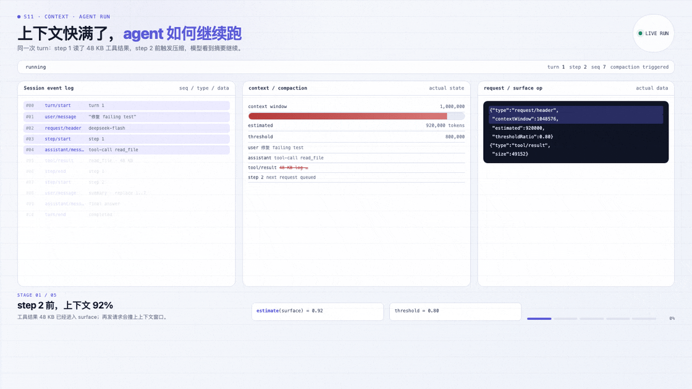
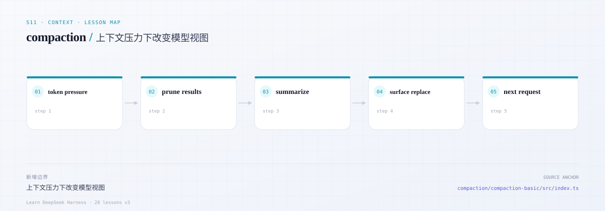
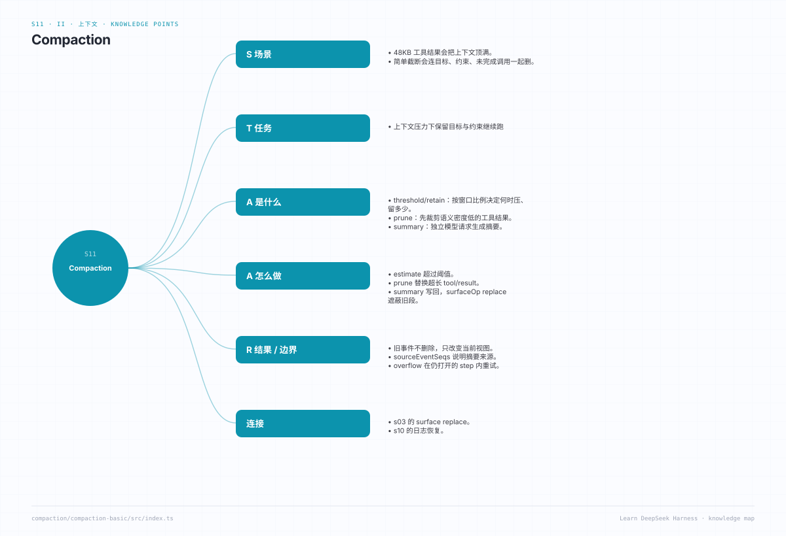

# s11 · compaction：在有限上下文里继续工作

> 本课代码：`src/`（新增 `compaction.ts`；`agent.ts` 接入 beforeStep / overflow 重试）
>
> 测试：`tests/s11.test.ts`（7 个离线用例）+ s03-s09 回归（79 个）+ `tests/live.test.ts`（1 个真实模型用例）
>
> 模型：真实 DeepSeek，默认 `deepseek-flash`。

---

## 长任务跑到一半，上下文满了

一个真实的下午：agent 为了修一个测试，读了一份 48 KB 的构建日志。下一步它还要继续读代码、改文件、再跑测试。

上下文窗口不是无限的。把整份日志原样塞回请求，token 会先撞墙；更糟的是，旧日志会和当前目标争夺注意力，模型开始忘记“不要改测试”这种约束。

很多人第一反应是“截断历史”。但截断会连约束、未完成的工具调用、用户刚说过的目标一起删掉。**压缩不是把聊天记录变短，而是为下一步决策重新划一个工作集。**

## 这一课要守住的线

压缩改变的是**模型当前看到什么**，不是**系统曾经发生过什么**。

- 工具结果可以裁剪，因为它的语义密度低；
- 旧段落可以摘要，但摘要必须保留目标、约束、未完成动作和证据来源；
- 旧事件不能删除；用 `surfaceOp: replace` 让新摘要遮蔽旧 surface；
- overflow 重试发生在仍然打开的 step 内，不能重跑 pre-step 或用户准入。

### 先看一次真实压缩

**90 秒**：先看动画。**3 分钟**：读下面的代码卡。**30 分钟**：跑完整 demo，再对照源码。



*同一次 run：48 KB tool/result → token 92% → prune → summary → surface replace → step 2。*

[交互版](../../../docs/visuals/agent-run.html?lesson=s11) · [MP4](../../../docs/visuals/s11-agent-run.mp4)

### 动画的 5 幕，在代码里是哪几行

| 动画 | 你看到的 | 课程代码 | 真实对照 |
|---|---|---|---|
| 1 92% | `estimate(surface)` 超过阈值 | [`compaction.ts:132`](src/compaction.ts#L132) | `token-meter` |
| 2 prune | 超长 `tool/result` 被替换 | [`compaction.ts:161`](src/compaction.ts#L161) | `pruneToolResults` |
| 3 summary | 旧段落走独立模型请求 | [`compaction.ts:209`](src/compaction.ts#L209) | `summarizeWithModel` |
| 4 replace | 摘要遮蔽旧 surface | [`compaction.ts:215`](src/compaction.ts#L215) | `surfaceOp: replace` |
| 5 continue | 新请求只看到摘要 | [`agent.ts`](src/agent.ts) | overflow 重试 |

真正改变模型看到的，不是 `delete`，而是这个 `append` 上的 `surfaceOp`：

```ts
session.append(
  'user/message',
  { message: summaryMessage },
  {
    surfaceOp: {
      op: 'replace',
      startSeq: old[0]!.seq,
      endSeq: old[old.length - 1]!.seq,
    },
    sourceEventSeqs: old.map(node => node.seq),
  },
)
```

*为什么读这里：`sourceEventSeqs` 把“这段摘要是从哪些旧事件来的”钉在日志里。没有它，回放时就说不清摘要凭什么替换了旧 surface。*

完整实现：[`src/compaction.ts`](src/compaction.ts) · 真实对照：[`compaction-basic`](https://github.com/deepseek-ai/deepseek-harness/blob/master/packages/compaction/compaction-basic/src/index.ts)

### 最容易误解的两件事

| 误解 | 实际 |
|---|---|
| 压缩就是把聊天记录删短 | 旧事件仍在日志里；`surface replace` 只改变模型当前看到的视图 |
| 摘要越短越好 | 摘要必须保留目标、约束、未完成动作和证据来源，否则下一步会做错决定 |

### 设计检查

1. 你的压缩策略保留了“用户当前目标”和“不可违反的约束”吗？
2. 裁剪工具结果后，模型还知道哪些调用已经发生、哪些结果未知吗？
3. 摘要替换了哪些 `seq`？`sourceEventSeqs` 能解释吗？
4. 压缩失败/摘要失败时，是保留原请求，还是把错误伪装成成功？
5. 压缩后的 surface 还能通过 replay 得到同样的模型输入吗？

---



*本课地图：这一步新增的架构边界，以及它在数据流中的位置。*

## 0. 先跑起来

```sh
cd course/lessons/s11-compaction
cp env.example .env
node src/demo.ts
node --test tests/s11.test.ts
node --test tests/s09-regression.test.ts tests/s08-regression.test.ts tests/s07-regression.test.ts tests/s06-regression.test.ts tests/s05-regression.test.ts tests/s04-regression.test.ts tests/s03-regression.test.ts
node --test tests/live.test.ts
```

Demo 会构造一段长历史（包含一个巨大的工具结果），先裁剪，再用真实模型摘要旧段落：

```text
estimated tokens: 1064
threshold: 200 retain: 48
surface before: 6 raw events: 15
=== compaction ===
{ compacted: true, prunedToolResults: 1, summarizedMessages: 3, ... }
surface after: 4 raw events: 17
```

---

## 1. 这一课要回答的问题

1. 什么时候应该压缩？阈值怎么算？
2. 为什么先裁剪工具结果，再决定是否摘要？
3. 摘要如何改写模型历史，而不删除原始事件？
4. 为什么压缩本身也是一次模型请求？
5. 上下文溢出后如何重试？
6. 压缩不能解决什么？

---

## 2. 先读真实源码

| 顺序 | 文件 / 函数 | 读的时候问自己 | 思考题 |
|---|---|---|---|
| 1 | [`compaction-basic`](../../../deepseek-harness/packages/compaction/compaction-basic/src/index.ts) | 触发阈值、retain、摘要目标如何配置？ | Q1 / Q6 |
| 2 | [`token-meter`](../../../deepseek-harness/packages/llm/token-meter/src/index.ts) | token 如何按精确路由估算？ | Q1 |
| 3 | [`compaction` README](../../../deepseek-harness/packages/compaction/compaction-basic/README.md) | 为什么先 prune 再 summarize？ | Q2 |
| 4 | [`surface.ts` → replace](../../../deepseek-harness/packages/core/session/src/surface.ts) | 摘要如何替换旧 surface？ | Q3 |
| 5 | [`agent/request-error`](../../../deepseek-harness/packages/core/agent-loop/README.md) | overflow 恢复为什么在 step 内？ | Q5 |
| 6 | [`compaction` 的限制](../../../deepseek-harness/packages/compaction/compaction-basic/README.md) | 哪些内容不能压缩？ | Q7 |

---

## 3. 核心概念

### 3.1 触发条件

s10 的简化公式：

```text
threshold = contextWindow * thresholdRatio
retain    = contextWindow * retainRatio
if estimate(session) >= threshold: compact
```

真实 DSH 还会考虑输出预留、headroom、per-model policy，以及 `floor(min(W*0.8, W-O-B))`。

### 3.2 先 prune 再 summarize

- 工具结果通常又长又机械，裁剪收益高、语义损失小；
- 如果裁剪后已低于阈值，就不需要摘要（省一次模型调用）；
- 摘要保留决策、约束、未完成工作，适合语义压缩。

s10 先替换超长 `tool/result` 的内容，再选择旧段落做摘要。

### 3.3 surface replace

摘要不是「删除旧消息」，而是：

```ts
session.append('user/message', { message: summary }, {
  surfaceOp: { op: 'replace', startSeq, endSeq },
  sourceEventSeqs: [startSeq, ..., endSeq],
})
```

原始事件仍在日志里，审计/回放/fork 仍然可见；模型只看到摘要。

### 3.4 摘要也是模型请求

摘要需要理解语义，所以它本身是一次 LLM 调用。它不进入主对话历史，使用独立的请求（无工具、独立 prompt），结果作为一条 user 摘要消息写回。

### 3.5 overflow 重试

当模型失败是 `CONTEXT_OVERFLOW` 时：

1. 在仍然打开的 step 内压缩；
2. 如果产生新 surface generation，重试该 step；
3. 否则保留原始错误。

重试不重跑 pre-step/用户准入。

---

## 4. 本课实现

| 文件 | 作用 | 真实对应 |
|---|---|---|
| [`src/compaction.ts`](src/compaction.ts) | token 估算、prune、摘要、replace、overflow 判定 | `compaction-basic` + `token-meter` |
| [`src/agent.ts`](src/agent.ts) | beforeStep 压缩、overflow 重试 | `agent-loop` |
| [`src/demo.ts`](src/demo.ts) | 长历史 + 真实摘要 | — |

关键代码：

```ts
const nodes = surfaceMessages(session)
// 1. prune 超长 tool/result
// 2. 选 tail（保留最近 retainTokens）
// 3. 摘要 old span
session.append('user/message', { message: summary }, {
  surfaceOp: { op: 'replace', startSeq: old[0].seq, endSeq: old.at(-1).seq },
  sourceEventSeqs: old.map(node => node.seq),
})
```

---

## 5. 验收

离线（`tests/s11.test.ts`）：

| 测试 | 证明 |
|---|---|
| estimate/threshold | 近似 token 与阈值 |
| below threshold | 不触发压缩 |
| prune + summary | 裁剪大工具结果，摘要旧段落，原始事件保留 |
| too few | 太少消息不压缩 |
| summarizer failure | 摘要失败传播 |
| overflow 判定 | 常见 code/message |
| agent overflow | 溢出后压缩并重试 step |

回归：s03-s09 共 79 个用例全部保留。

真实模型：真实 `deepseek-flash` 摘要一段长历史，surface replace + 原始事件保留。

---

## 6. 刻意简化了什么

| 真实 DSH | s10 | 影响 |
|---|---|---|
| 精确 token meter（含工具/图片/缓存） | 字符/4 近似 | 教学够用 |
| 多模型 policy / headroom | 单 contextWindow | 后续 |
| tool-result pruner 独立包 | 内联 prune | 语义相同 |
| compaction 恢复的 surface generation 判定 | 简单 overflow 一次重试 | 后续 |
| image offload / spill | 无 | 后续 |
| 分层摘要 / 多次压缩 | 单次 | 教学够用 |

---

## 7. 练习

1. **精确 token**：用 4 字符/token 改成按 UTF-8 字节 + 工具 schema 估算，比较阈值行为。
2. **保留 system head**：当前逻辑保留第一个 system；如果 system 节点在中间（in-history），如何调整？
3. **摘要质量**：要求摘要包含「未完成工作」和「用户约束」，写测试断言。
4. **多次压缩**：连续压缩两次，验证 surface 仍然连续、source 引用完整。
5. **溢出恢复**：用 TestModel 第一次返回 CONTEXT_OVERFLOW，第二次成功；验证只重试 step，不重跑用户准入。

---

## 8. 思考题（附源码位置与答案）

### Q1. 什么时候压缩？阈值怎么算？

当估算 token 超过 `contextWindow * thresholdRatio` 时。真实实现还要减去输出预留和 headroom，避免请求刚好塞满。见 [`compaction-basic`](../../../deepseek-harness/packages/compaction/compaction-basic/src/index.ts)。

### Q2. 为什么先裁剪工具结果，再决定是否摘要？

工具结果通常冗长、机械，裁剪成本低；裁剪后可能已经低于阈值，省掉一次摘要模型调用。摘要更适合保留决策和约束。

### Q3. 摘要如何改写历史而不删除事件？

用 `surfaceOp: replace` 替换旧 surface 节点，`sourceEventSeqs` 记录被遮蔽的节点。原始事件仍在日志里。见 s02 的 surface 语义。

### Q4. 为什么压缩本身也是模型请求？

只有模型能理解语义并生成有用的摘要。它使用独立请求（无工具、独立 prompt），不进入主对话历史。

### Q5. 上下文溢出后如何重试？

在 step 内捕获 overflow，调用压缩；如果产生新 surface，重试该 step。不能重跑 pre-step/用户准入，否则会重复提交输入。见 `#runStep` 的 overflow 分支。

### Q6. retain/tail 如何选？

从最新消息往回累加 token，直到达到 retain 预算；更老的消息成为摘要候选。system head 保留，除非它在被替换区间内。

### Q7. 压缩不能解决什么？

- 不能缩小 system prompt 和工具 schema；
- 不能拆分一个不可分割的巨大工具调用/结果；
- 不能恢复被模型遗忘的细节；
- 不能替代外部存储/检索。

### Q8. 压缩对 KV cache 有什么影响？

surface replace 改变了请求前缀，缓存从第一个被替换的 token 开始失效。摘要后通常需要重新建立缓存。in-history 提示词追加可以保留前缀，但摘要本身是历史改写，无法避免失效。

---

## 9. 下一课：s11 · plugin kernel

s10 完成了上下文管理。s11 会把前面 10 课重构成插件树：

- Context / Service / inject 如何工作？
- Fiber / effect 如何保证卸载即撤销？
- waterfall / serial / emit 如何分发事件？
- scope 如何把注册限制到单个 agent？
- 为什么没有特权内核？

先读：[`vendor/cordis/src/{context,fiber,events}.ts`](../../../deepseek-harness/vendor/cordis/src/context.ts)。

---

## 知识导图



*围绕本课主体元素：是什么 / 在 agent 里起什么作用 / 关键特征 / 运行位置 / 面试常问 / 架构连接。*

[总知识导图](../../../docs/visuals/mindmaps/course.svg) · [XMind 源文件](../../../docs/visuals/mindmaps/course.xmind)
