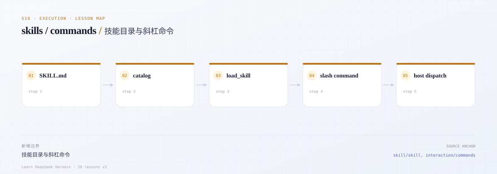

# s18 · Skills / Commands：不修改 loop 的两种扩展

> 本课代码：`src/skills/catalog.ts`、`src/skills/tool.ts`、`src/commands/registry.ts`、`src/host.ts`、`src/tools.ts`、`src/demo.ts`
>
> 测试：`tests/s18.test.ts`（10 个离线用例）
>
> 依赖：Node >= 24、零运行时依赖；本课不访问网络，不需要 API key。

---

## 开篇三问

### 1. 一个 skill 是什么？为什么不能把正文全塞进 prompt？

skill 是「可复用指令包」：一段 Markdown 正文，加上 `name` / `description` frontmatter。它可能是一份 PDF 表单流程、代码 review 清单、某个内部系统的操作手册。

如果把所有技能正文一次性放进系统提示词：

- token 成本随技能数量线性增长；
- 大多数技能与当前任务无关，会稀释模型的注意力；
- 技能更新后要重新拼整个 prompt，缓存也更容易失效。

所以 DSH 只注入 **catalog**（名字 + 一句话描述），正文按需加载。

### 2. 模型如何“按需点单”？

两个角色分工：

- **catalog**：启动时扫描 `SKILL.md`，把 `- name: description` 注入上下文；
- **`load_skill(name)` 工具**：模型判断任务匹配某条描述后，才调用工具取回正文。

这和“给模型一个文件系统，让它自己读”不同：catalog 是受控的菜单，加载是显式动作，host 可以审计、限权、替换。

### 3. 为什么 slash command 不该产生模型轮次？

`/help`、`/compact`、`/model` 是确定性的 host 操作：它们不改变“模型该看到什么”，只改变 UI、配置或上下文压缩策略。交给模型既慢又不可靠，还会污染消息历史。

所以命令由 host 直接分派：解析 `/name args`，调用注册的 handler，返回一段输出；只有**不以 `/` 开头的普通输入**才进入 agent。

---

## 场景

用户说：“帮我把这份 PDF 表单填了。”

```text
启动：catalog 注入
  - pdf: Fill and inspect PDF forms...
  - review: Review a diff for correctness, tests and risk.

用户：帮我把这份 PDF 表单填了
模型：调用 load_skill({ name: "pdf" })     ← 只加载匹配的那一个
工具：返回 PDF 流程正文
模型：按正文步骤读字段、填值、校验

用户：/help                                 ← host 直接返回帮助
用户：/compact                              ← host 直接压缩，不进模型
```

如果没有 catalog/按需加载，第二步就只能把两个技能的正文都塞进上下文；如果没有 host 命令，`/help` 会变成一次昂贵的模型请求。

---



*本课地图：这一步新增的架构边界，以及它在数据流中的位置。*

## 0. 先跑起来

```sh
cd course/lessons-v3/s18-skills-commands

node src/demo.ts
node --test tests/s18.test.ts
```

Demo 会在临时目录里造两个 skill（一个 bundle、一个 flat 文件），然后：

1. 打印模型可见的 catalog；
2. 按需加载 `pdf` 正文；
3. 通过 `load_skill` 工具加载 `review`；
4. 路由 `/help`、`/skills` 和普通输入，打印 `modelTurn` 计数。

预期输出（节选）：

```text
=== catalog (what the model sees at startup) ===
- pdf: Fill, split and inspect PDF forms...
- review: Review a diff for correctness, tests and risk.

/help                          -> command modelTurn=false turns=0
/skills pdf                    -> command modelTurn=false turns=0
please review this diff        -> turn    modelTurn=true turns=1

model turns: 1 (slash commands contributed 0)
```

---

## 1. 先读真实源码

| 顺序 | 文件 | 读的时候问自己 |
|---|---|---|
| 1 | [`docs/subsystems/skills.md`](https://github.com/deepseek-ai/deepseek-harness/blob/master/docs/subsystems/skills.md) | provider / registry / consumer 如何分层？catalog 与 load 谁负责？ |
| 2 | [`packages/skill/skill/src/index.ts`](https://github.com/deepseek-ai/deepseek-harness/blob/master/packages/skill/skill/src/index.ts) | `SkillSummary` 和 `SkillDefinition` 为什么要分开？ |
| 3 | [`packages/skill/skill-filesystem`](https://github.com/deepseek-ai/deepseek-harness/tree/master/packages/skill/skill-filesystem) | 扫描优先级、bundle 与 flat 文件、invalidation |
| 4 | [`packages/skill/tool-skill`](https://github.com/deepseek-ai/deepseek-harness/tree/master/packages/skill/tool-skill) | 模型可见的 skill 工具长什么样？ |
| 5 | [`docs/subsystems/commands.md`](https://github.com/deepseek-ai/deepseek-harness/blob/master/docs/subsystems/commands.md) | 命令为什么“不创建模型消息”？ |
| 6 | [`packages/interaction/commands/src/index.ts`](https://github.com/deepseek-ai/deepseek-harness/blob/master/packages/interaction/commands/src/index.ts) | handler 拿到什么？返回值去哪？ |

---

## 2. 核心概念

### 2.1 skill 的两种布局

```text
<root>/pdf/SKILL.md     ← bundle
<root>/review.md        ← flat
```

frontmatter 只放元数据：

```markdown
---
name: pdf
description: Fill, split and inspect PDF forms. Use when the task involves a .pdf file.
---

# PDF workflow
...
```

真实 DSH 还会校验 kebab-case 名字、支持多个 root 的优先级、按 scope 分层、watcher 失效等。本课只保留最小可观察部分。

### 2.2 catalog 是“菜单”，load 是“点单”

```ts
await catalog.refresh()
catalog.catalogText()   // "- pdf: Fill and inspect PDF forms..."
catalog.load('pdf')     // 返回正文，不含 frontmatter
```

`catalogText()` 永远不包含正文。模型看到菜单后，通过 `load_skill(name)` 工具点单。

### 2.3 load_skill 是一个普通工具

```ts
const tools = new ToolRegistry()
tools.register(createLoadSkillTool(catalog))
const result = await tools.execute(
  { id: 'c1', name: 'load_skill', arguments: '{"name":"review"}' },
  { signal, callId: 'c1' },
)
```

它和 calc、bash 没有本质区别：有 name / description / JSON Schema，返回 `ToolResult`。未知 skill、缺参数、非法 JSON 都变成 `isError: true` 的模型可见结果。

### 2.4 命令是 host 分派，不是工具

```ts
const commands = new CommandRegistry()
commands.register({ name: 'help', description: 'Show help', run: () => '...' })

await commands.dispatch('/help')      // { handled: true, output: '...' }
await commands.dispatch('hello')      // { handled: false }
```

`routeInput()` 把两条路径接起来：

```ts
const result = await routeInput(input, { commands, agent })
if (result.kind === 'command') {
  // 直接显示 result.output，模型轮次为 0
} else {
  // 只有这里才调用 agent.run(input)
}
```

`modelTurn` 字段就是为了让测试能明确断言“命令没有产生模型轮次”。

---

## 3. 本课实现

| 文件 | 作用 | 真实对应 |
|---|---|---|
| [`src/skills/catalog.ts`](src/skills/catalog.ts) | 扫描 bundle/flat、解析 frontmatter、catalog、按需加载 | `skill` + `skill-filesystem` |
| [`src/skills/tool.ts`](src/skills/tool.ts) | 模型可见的 `load_skill(name)` | `tool-skill` |
| [`src/commands/registry.ts`](src/commands/registry.ts) | 命令注册、解析、直接分派 | `dsh-commands` |
| [`src/host.ts`](src/host.ts) | 命令 vs 普通输入的路由边界 | interactive adapter |
| [`src/tools.ts`](src/tools.ts) | 最小工具注册表与结果规范化 | `dsh-tools` |
| [`src/demo.ts`](src/demo.ts) | 离线演示 | — |

本课**不依赖 MCP**：s17 把 MCP、skills、commands 放在一起讲；这里只抽出 skills / commands，单独验证它们不需要改 agent loop。

---

## 4. 验收：10 个离线测试

| # | 用例 | 证明 |
|---|---|---|
| 1 | bundle + flat 扫描 | frontmatter、排序、source |
| 2 | catalog 文本 | 只有 name/description，没有正文 |
| 3 | load | 返回正文、剥离 frontmatter |
| 4 | 无效目录/文件 | 没有 SKILL.md 的目录、非 .md 被忽略 |
| 5 | frontmatter 解析 | 引号、描述里的冒号、无 frontmatter |
| 6 | load_skill 工具 | 模型可见 schema、按需返回正文 |
| 7 | 工具错误 | 未知 skill / 缺 name / 非法 JSON / 未知工具 |
| 8 | 命令分派 | `/name args`、普通输入透传、未知/非法命令 |
| 9 | 路由 | 命令 0 轮次；普通输入恰好 1 轮次 |
| 10 | 重名命令 | 注册表拒绝冲突 |

```sh
node --test tests/s18.test.ts
```

---

## 5. 刻意简化了什么

| 真实 DSH | s18 | 影响 |
|---|---|---|
| 多 root 优先级、scope 分层 | 单 root | 不做覆盖规则 |
| watcher / cache invalidation | 手动 `refresh()` | 演示够用 |
| kebab-case 校验、权限策略 | 无 | 不做安全边界 |
| system prompt 注入与替换 catalog | 只提供 `catalogText()` | 需上层拼接 |
| 命令 UI、参数补全、attachments | 简单字符串 | 不做交互细节 |
| 命令/技能的 session 事件 | 无 | 本课不依赖日志 |

---

## 6. 练习

1. **技能优先级**：多个 root 同名时，按 `project > user > bundled` 覆盖。
2. **模型不可见技能**：支持 `model-invocable: false`，只允许用户手动调用。
3. **catalog 注入**：把 `catalogText()` 放进 system prompt，并在 `load_skill` 后追加正文。
4. **命令权限**：`/compact` 只允许 owner，`/help` 所有人可用。
5. **热更新**：用 `fs.watch` 在 SKILL.md 变化时自动 `refresh()`。
6. **审计**：记录每次 `load_skill` 的 name / 时间 / 调用者，但不把正文写进日志。

---

## 7. 思考题（附答案）

### Q1. 为什么 catalog 和正文要分开？

catalog 是稳定、短小、可缓存的“菜单”；正文是长尾、按需的“食材”。分开后，启动 prompt 只随技能数量增长一行，而不是随正文长度增长；技能内容更新也不会影响 catalog 前缀的缓存。

### Q2. `load_skill` 为什么是工具，而不是让模型直接读文件？

工具是受控接口：host 可以限制可见技能、审计加载、替换来源（本地/远程/打包），而模型不需要知道文件系统布局。直接读文件则把路径、权限、格式都暴露给模型。

### Q3. 命令为什么不能走模型？

命令是确定性的 host 操作，输出是 UI 结果而不是模型消息。走模型会引入延迟、成本和不确定性，还会让 `/help` 之类的内容进入对话历史。真实 DSH 的 command handler 直接拿到 agent 和 raw input，不创建模型消息。

见 [`docs/subsystems/commands.md`](https://github.com/deepseek-ai/deepseek-harness/blob/master/docs/subsystems/commands.md)。

### Q4. 这些扩展为什么不需要改 agent loop？

它们都挂在既有扩展点：skill 提供上下文（catalog + load 工具），command 走 host 路由。loop 只看到“工具”和“消息”，不需要知道能力来源。这也是 DSH 用 capability seam 组织扩展的原因。

### Q5. 未知命令应该落到模型吗？

本课选择不落：`/nope` 返回 `unknown command`，`modelTurn: false`。这样用户输入不会被悄悄改写成一个模型请求；需要“自然语言兜底”的产品可以显式选择回落，但那是产品策略，不是注册表的默认行为。

---

## 8. 下一课

- **s17**：MCP / skills / commands 合在一起，看外部工具协议如何接入同一工具面；
- **s19 / s20**：browser-use / computer-use，skill 常用来描述复杂 UI 流程；
- **s24**：client UI，命令如何变成可发现的 slash 菜单。

---

## 面试自测

[打开 IV · 执行边界 面试自测 →](../../../site/#/quiz?part=execution)

*概念题覆盖 DSH 架构；该 Part 的最后几题是 coding 任务。*
