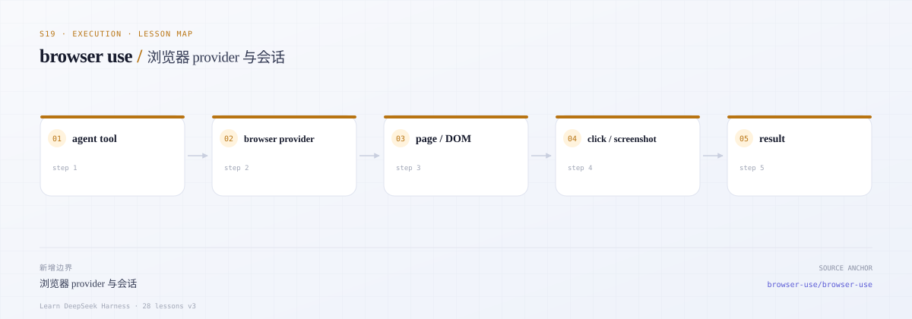
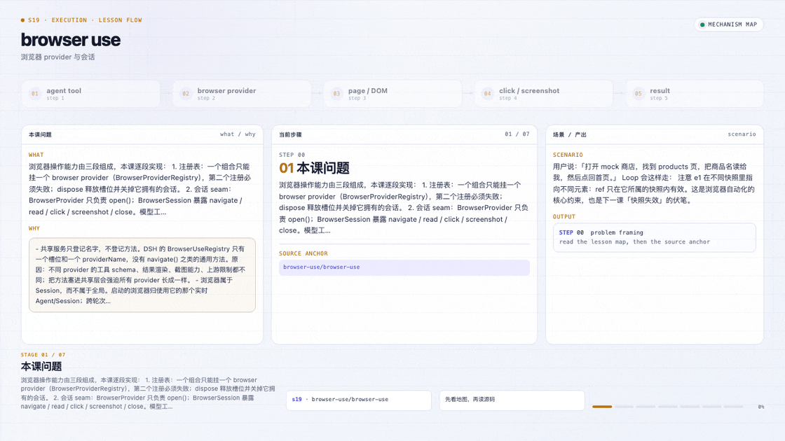

# s19 · browser-use：单槽位 provider、会话 seam 与 mock 浏览器

> 本课代码：`src/types.ts`、`src/registry.ts`、`src/mock-browser.ts`、`src/tools.ts`、`src/demo.ts`
>
> 测试：`tests/browser.test.ts`（8 个离线用例）
>
> 本课不调用模型、不联网、零运行时依赖。

---

## 0. 开篇三问

### 0.1 这一课学什么？

浏览器操作能力由三段组成，本课逐段实现：

1. **注册表**：一个组合只能挂一个 browser provider（`BrowserProviderRegistry`），第二个注册必须失败；dispose 释放槽位并关掉它拥有的会话。
2. **会话 seam**：`BrowserProvider` 只负责 `open()`；`BrowserSession` 暴露 `navigate` / `read` / `click` / `screenshot` / `close`。模型工具只依赖这个 seam。
3. **工具投影**：把浏览器操作投影成模型能调用的 `browser_navigate` / `browser_read` / `browser_click`，并让错误以 `isError: true` 的结果回到 loop，而不是抛异常。

真实 Playwright / Chrome DevTools / Stagehand 都是这三段里的「provider」；本课用 mock 把边界和失败路径固定下来，之后替换 provider 不需要改工具。

### 0.2 DSH 为什么这样拆？

- **共享服务只登记名字，不登记方法**。DSH 的 `BrowserUseRegistry` 只有一个槽位和一个 `providerName`，没有 `navigate()` 之类的通用方法。原因：不同 provider 的工具 schema、结果渲染、截图能力、上游限制都不同；把方法塞进共享层会强迫所有 provider 长成一样。
- **浏览器属于 Session，而不属于全局**。启动的浏览器归使用它的那个实时 Agent/Session；跨轮次复用，Session 释放时关闭。所以注册表在 `dispose()` 时先停工具、关会话，再释放槽位。
- **注册即所有权**。第二次注册（哪怕同名）直接抛错，避免两个 provider 同时操作一个浏览器。这与「配置错误要尽早暴露」一致——静默替换会让工具调用落到错误的浏览器上。

真实文档：[浏览器操作（中文）](https://github.com/deepseek-ai/deepseek-harness/blob/master/docs/subsystems/browser-use.zh.md)、[Browser Use（英文）](https://github.com/deepseek-ai/deepseek-harness/blob/master/docs/subsystems/browser-use.md)。

### 0.3 场景

> 用户说：「打开 mock 商店，找到 products 页，把商品名读给我，然后点回首页。」

Loop 会这样走：

```text
browser_navigate https://mock.example/
  → 快照: [e1] link "Products" -> /products, [e2] button "Search" ...
browser_click e1
  → 快照: url=/products, [e2] button "Add to cart" ...
browser_read
  → text: Two widgets in stock ...
browser_click e1            # 现在 e1 是 "Back home"
  → 快照: url=https://mock.example/
```

注意 `e1` 在不同快照里指向不同元素：**ref 只在它所属的快照内有效**。这是浏览器自动化的核心约束，也是下一课「快照失效」的伏笔。

---



*本课地图：这一步新增的架构边界，以及它在数据流中的位置。*

### 先看机制动画



*浏览器 provider 与会话：每一步的边界、输入和产出。*

[交互版](../../../docs/visuals/lesson-flow.html?lesson=s19) · [MP4](../../../docs/visuals/s19-flow.mp4)

## 1. 先跑起来

```sh
cd course/lessons-v3/s19-browser-use
node src/demo.ts
node --test tests/*.test.ts
```

Demo 会在内存 mock 站点里打开首页、点链接、读正文、截一张占位图，并演示一次未找到元素的错误。

---

## 2. 先读真实源码

| 顺序 | 文件 | 读的时候问自己 | 对应本课 |
|---|---|---|---|
| 1 | [`packages/browser-use/browser-use/src/index.ts`](https://github.com/deepseek-ai/deepseek-harness/blob/master/packages/browser-use/browser-use/src/index.ts) | 为什么注册表只有 `register()`？`ctx.effect` 的 disposer 何时执行？ | `src/registry.ts` |
| 2 | [`docs/subsystems/browser-use.zh.md`](https://github.com/deepseek-ai/deepseek-harness/blob/master/docs/subsystems/browser-use.zh.md) | 「只注册名称」与「按 Session 管理所有权」分别约束谁？ | 设计说明 |
| 3 | [`browser-use-playwright-mcp`](https://github.com/deepseek-ai/deepseek-harness/blob/master/packages/experimental/browser-use-playwright-mcp/README.md) | MCP 工具如何变成 DSH 工具？连接失败时注册怎么处理？ | provider 的 `open()` |
| 4 | [`browser-use-chrome-devtools-mcp`](https://github.com/deepseek-ai/deepseek-harness/blob/master/packages/experimental/browser-use-chrome-devtools-mcp/README.md) | 启动 vs 附加浏览器，状态归谁？ | 会话生命周期 |
| 5 | [`browser-use-stagehand-native`](https://github.com/deepseek-ai/deepseek-harness/blob/master/packages/experimental/browser-use-stagehand-native/README.md) | AI 辅助动作为什么仍由 DSH 拥有任务循环？ | 工具结果渲染 |
| 6 | [`browser-use-runtime`](https://github.com/deepseek-ai/deepseek-harness/blob/master/packages/experimental/browser-use-runtime/README.md) | 每个 Agent 的 MCP 客户端为什么按 Session 初始化？ | `openSession` 的归属 |

上游 provider 文档：[Playwright MCP](https://github.com/microsoft/playwright-mcp)、[Chrome DevTools MCP](https://github.com/ChromeDevTools/chrome-devtools-mcp)、[Stagehand](https://github.com/browserbase/stagehand)。

---

## 3. 核心概念

### 3.1 单槽位注册表

```ts
const registration = registry.register(provider) // 占槽
registry.register(other)                          // throw PROVIDER_ALREADY_REGISTERED
await registration.dispose()                      // 关会话 → 腾槽
```

Disposer 必须处理两个陷阱：

- **幂等**：重复 dispose 不能报错，也不能重复关闭。
- **身份**：旧 provider 的 disposer 在槽位被新 provider 占用后执行时，只能清理自己的会话，不能清掉新注册。

本课用 `token` 记录身份，并在 `release()` 里先比较再清空：

```ts
if (this.registration === state) this.registration = undefined
const owned = [...this.sessions].filter(([, token]) => token === state.token)
await Promise.all(owned.map(([session]) => session.closed ? undefined : session.close()))
```

### 3.2 会话所有权

`openSession()` 把会话登记到注册表；`dispose()` 会关闭它们。真实 DSH 里这对应「Session 运行时释放时关闭它启动的资源」，而附加的外部浏览器只断开连接、不杀进程。本课 mock 没有外部浏览器，所以统一 close。

### 3.3 观测 → 动作 → 再观测

浏览器工具不是 RPC，而是**回合制**：

```text
read  → 得到 ref 表
click(ref) → 返回新快照（页面可能已经变了）
```

因此 `click()` 必须返回快照，而不是 `void`。否则模型点完之后没有新的 ref 表，下一步只能猜。

### 3.4 工具错误不是异常

```ts
{ isError: true, content: [{ type: 'text', text: 'Error: ELEMENT_NOT_FOUND: ...' }] }
```

Loop 继续跑，模型可以改参数重试。只有「provider 不存在」「会话关闭」这类结构性错误才值得让调用方感知；本课把它们也收敛成同样的结果，便于测试。

---

## 4. 本课实现

| 文件 | 作用 | 真实对应 |
|---|---|---|
| [`src/types.ts`](src/types.ts) | `BrowserProvider` / `BrowserSession` / `BrowserError` | provider 契约 |
| [`src/registry.ts`](src/registry.ts) | 单槽位注册、会话登记、幂等 dispose | `BrowserUseRegistry` |
| [`src/mock-browser.ts`](src/mock-browser.ts) | 内存站点、导航、点击、文本、截图占位 | 某个真实 provider |
| [`src/tools.ts`](src/tools.ts) | 三个模型工具 + `runTool` 错误收敛 | 工具投影层 |
| [`src/demo.ts`](src/demo.ts) | 无模型演示 | — |

### 关键代码：工具 schema

```ts
{
  name: 'browser_click',
  inputSchema: {
    type: 'object',
    properties: { ref: { type: 'string' } },
    required: ['ref'],
    additionalProperties: false,
  },
  execute: async args => text(renderSnapshot(await session.click(requireString(args, 'ref')))),
}
```

`renderSnapshot()` 把快照压成模型可读的文本：

```text
url: https://mock.example/products
title: Products — Mock Shop
[e1] link "Back home" -> https://mock.example/
[e2] button "Add to cart"
```

---

## 5. mock 的边界（必须明确）

| 真实 provider | 本课 mock | 教学影响 |
|---|---|---|
| 启动/附加真实 Chromium | 内存页面表 | 不验证浏览器兼容性 |
| 真实 DOM/AX 快照 | 固定元素表 | 不练习选择器与可访问性树 |
| 真实 PNG 截图 | 1×1 PNG + 1280×720 声明尺寸 | **不能**把 `bytes` 当画面；`placeholder: true` 强制提醒 |
| MCP/stdio 生命周期 | 纯内存 | 不覆盖连接失败、重连 |
| 跨轮次保留浏览器状态 | 进程内会话 | 不覆盖 fork/恢复 |

替换成真实 provider 时，只要实现 `open(): Promise<BrowserSession>` 并注册进去；工具层不动。这正是本课要证明的 seam。

---

## 6. 验收

`node --test tests/*.test.ts` 覆盖：

| 测试 | 证明 |
|---|---|
| 单例 | 第二次注册（含同名）抛 `PROVIDER_ALREADY_REGISTERED`，首个 provider 不被破坏 |
| dispose | 关闭拥有的会话、释放槽位、幂等、可换 provider |
| 未注册 | `openSession()` 抛 `PROVIDER_NOT_REGISTERED` |
| 工具闭环 | navigate → click 链接 → 新 URL；read 返回 ref 表 |
| 错误 | 未知工具、禁用元素、缺参数、未知页面都变成 `isError`，会话仍可用 |
| 截图 | mime/尺寸/bytes/placeholder 四元组 |
| 关闭 | 关闭后 session 与工具都报 `SESSION_CLOSED`；重复 dispose 安全 |

---

## 7. 刻意简化了什么

| 真实 DSH | s19 | 影响 |
|---|---|---|
| Cordis `Service` + `ctx.effect` | 普通类 + 手动 dispose | 不覆盖插件卸载顺序 |
| 按 Session 绑定 provider 所有权 | 注册表统一持有 | 不覆盖多 Session |
| MCP 工具目录与资源 | 固定三个工具 | 不覆盖动态 schema |
| 图像附件存储 | 只返回 bytes | 不覆盖多模态附件 |
| 取消语义 | 无 | 已交付的动作本来就不可撤销 |

---

## 8. 练习

1. **同名重注册**：让第二个 provider 同名注册时给出更具体的诊断（哪个 Session 在用）。
2. **ref 失效**：`click(ref)` 时校验 ref 是否来自「最近一次快照」，过期返回 `STALE_SNAPSHOT`。做完这个练习，你就理解了 s21 的核心。
3. **真实 provider 桩**：写一个 `PlaywrightStubProvider`，`open()` 里 spawn 一个假 MCP server，验证工具层零改动。
4. **截图元数据**：给 `BrowserScreenshot` 加 `viewport` 与 `deviceScaleFactor`，思考真实坐标换算需要哪些字段。
