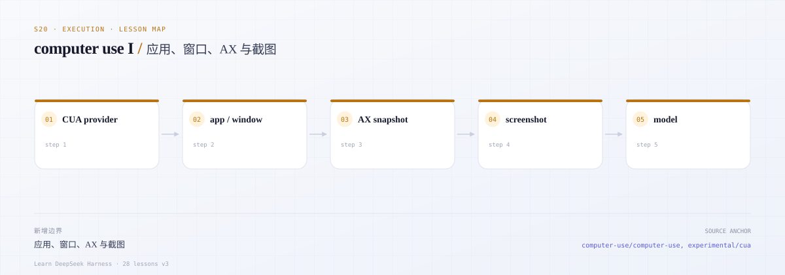
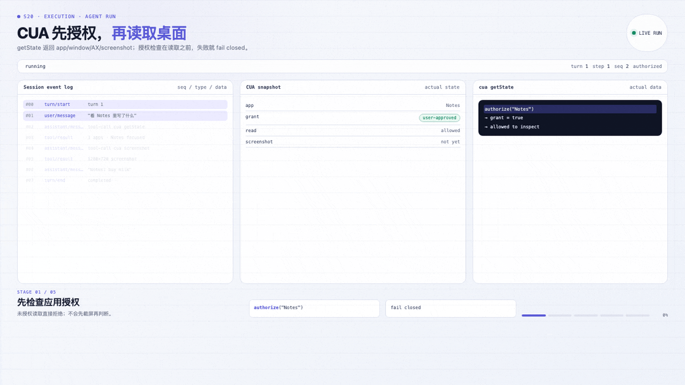

# s20 · computer-use I：注册表、mock 桌面、AX 快照与授权

> 本课代码：`src/types.ts`、`src/registry.ts`、`src/access.ts`、`src/mock-desktop.ts`、`src/tool.ts`、`src/demo.ts`
>
> 测试：`tests/computer-use.test.ts`（10 个离线用例）
>
> 本课不调用模型、不联网、不启动任何桌面程序；零运行时依赖。

---

## 0. 开篇三问

### 0.1 这一课学什么？

1. **注册表**：`ComputerUseProviderRegistry` 一次只允许一个 provider（第二个注册失败），`dispose()` 关闭它拥有的会话后释放槽位。
2. **桌面 seam**：`ComputerUseProvider` 只负责 `open()`；`CuaDesktopSession` 提供 `listApps` / `getApp` / `getWindows` / `getState` / `screenshot`。
3. **授权**：应用必须先被授权才能读窗口、AX 树、截图；未授权时 fail closed（`APP_ACCESS_REQUIRED`），而不是返回空数据。
4. **工具投影**：把观测投影成模型工具 `cua`，参数形状是 `{ method, params }`，方法为 `getApp` / `getWindows` / `getState` / `screenshot`。

### 0.2 DSH 为什么这样拆？

- **共享服务只登记名字**。DSH 的 `ComputerUseRegistry` 没有通用的 `click` / `type` 方法；工具 schema、AX 渲染、截图诊断、上游限制都归 provider。共享层只回答「现在挂的是哪个 provider」。
- **权限属于 provider，不属于模型**。CUA 的真实边界是 macOS TCC（辅助功能 / 屏幕录制）加上「用户是否允许控制这个应用」两件事。DSH 把应用授权放在 provider 里，并且在**分派前**检查；模型不能靠改参数绕过。
- **观测是有代际的**。`getState` 返回的是某一刻的 AX 树；窗口变了、树变了，旧下标就失效。s21 会把这条约束显式化成 `STALE_SNAPSHOT` / `WINDOW_CHANGED`；本课先把快照结构立住。
- **截图是数据，不是文本**。真实 DSH 会把 PNG 作为图像附件交给支持图像输入的模型；本课返回 `bytes + mime + 尺寸`，并在工具层只回元数据。

真实文档：[计算机操作（中文）](https://github.com/deepseek-ai/deepseek-harness/blob/master/docs/subsystems/computer-use.zh.md)、[Computer Use（英文）](https://github.com/deepseek-ai/deepseek-harness/blob/master/docs/subsystems/computer-use.md)、[共享 CUA 对象](https://github.com/deepseek-ai/deepseek-harness/blob/master/packages/experimental/cua/README.zh.md)、[macOS CUA provider](https://github.com/deepseek-ai/deepseek-harness/blob/master/packages/experimental/cua-macos/README.zh.md)。

### 0.3 场景

> 用户说：「在 Notes 里找到购物清单，把内容读给我。」

```text
cua getApp  { selector: "Notes" }
  → { appId: "notes", bundleId: "com.apple.Notes", running: true }
cua getWindows { appId: "notes" }
  → [ {windowId:1, title:"Untitled — Notes", bounds:{...}}, {windowId:2, ...} ]
cua getState { appId: "notes", windowId: 2 }
  → elements: [ {index:0, role:"AXWindow"}, {index:1, role:"AXTextArea", value:"milk, eggs, coffee"} ]
cua screenshot { appId: "notes", windowId: 2 }
  → { mimeType:"image/png", width:760, height:600, placeholder:true }
```

如果用户还没允许控制 Notes，第三步会直接失败，前两步里也不会泄露任何 AX 内容。

---



*本课地图：这一步新增的架构边界，以及它在数据流中的位置。*

### 先看机制动画



*实际 agent run：SessionEvent 与运行中的状态。*

[交互版](../../../docs/visuals/agent-run.html?lesson=s20) · [MP4](../../../docs/visuals/s20-agent-run.mp4)

## 1. 先跑起来

```sh
cd course/lessons-v3/s20-computer-use-i
node src/demo.ts
node --test tests/*.test.ts
```

Demo 会列出 mock 应用（Notes / Finder / 未运行的 Calendar），先演示「未授权读取被拒绝」，授权后再读窗口、AX 树和截图元数据，最后撤销授权。

---

## 2. 先读真实源码

| 顺序 | 文件 | 读的时候问自己 | 对应本课 |
|---|---|---|---|
| 1 | [`packages/computer-use/computer-use/src/index.ts`](https://github.com/deepseek-ai/deepseek-harness/blob/master/packages/computer-use/computer-use/src/index.ts) | 为什么注册表只有一个 `register()`？关闭期间为什么保留注册？ | `src/registry.ts` |
| 2 | [`docs/subsystems/computer-use.zh.md`](https://github.com/deepseek-ai/deepseek-harness/blob/master/docs/subsystems/computer-use.zh.md) | `cuaAccess`、应用授权、系统权限三者的分工？ | `src/access.ts` |
| 3 | [`packages/experimental/cua/src/application-access.ts`](https://github.com/deepseek-ai/deepseek-harness/blob/master/packages/experimental/cua/src/application-access.ts) | 授权检查为什么在 AX/截图/输入之前？拒绝后为什么不能重放？ | 授权顺序 |
| 4 | [`packages/experimental/cua/src/api.ts`](https://github.com/deepseek-ai/deepseek-harness/blob/master/packages/experimental/cua/src/api.ts) | app/window 对象如何保留句柄与快照？ | `CuaDesktopSession` |
| 5 | [`packages/experimental/cua/src/permission-store.ts`](https://github.com/deepseek-ai/deepseek-harness/blob/master/packages/experimental/cua/src/permission-store.ts) | 持久授权 vs 会话授权、拒绝记录、撤销代际？ | s21 扩展点 |
| 6 | [`packages/experimental/cua/src/bridge.ts`](https://github.com/deepseek-ai/deepseek-harness/blob/master/packages/experimental/cua/src/bridge.ts) | 截图如何变成工具结果的附件？ | 截图元数据 |
| 7 | [`packages/experimental/cua-bundle/README.md`](https://github.com/deepseek-ai/deepseek-harness/blob/master/packages/experimental/cua-bundle/README.md) | 用户在哪里打开 Computer Use、授权给谁？ | 权限说明 |

---

## 3. 核心概念

### 3.1 macOS CUA 的真实结构

```text
模型
  → tools.cua（method + params）
    → CuaProvider（MCP 或原生）
      → 共享 helper（dsh-cua-native，Swift）
        → macOS Accessibility (AX) / ScreenCaptureKit / CGEvent
          → 目标应用（Notes、Finder、Safari…）
```

- **provider**：连接 helper、把模型参数翻译成原生调用、把结果投影成工具结果。MCP 版通过 stdio 连一个已安装的 `cua-driver`；原生版把 Swift helper 作为依赖安装。
- **helper**：真正调用 macOS 框架的进程。它需要两项 TCC 权限：
  - **Accessibility**：读取 AX 树、派发点击/键盘；
  - **Screen Recording**：截图。
- **目标应用**：还需要「用户是否允许控制它」这一层授权。DSH 用 `userQuestions` 弹出授权卡片，选项通常是「仅本次会话允许 / 拒绝 / 始终允许」。

两层权限不能混为一谈：系统权限决定 helper **能不能**看和点；应用授权决定用户**愿不愿意**让你看和点这个 app。

### 3.2 provider 的职责

| 职责 | 在哪 |
|---|---|
| 连接/启动 helper，处理超时与重连 | provider |
| 列出运行中的应用、选择应用、窗口 | provider |
| 遍历 AX 树并扁平化、限制元素数/深度 | provider |
| 截图、记录截图尺寸与窗口几何 | provider |
| 应用授权检查 | provider（本课 `ApplicationAccess`） |
| 模型工具 schema 与结果渲染 | provider 的工具层 |
| **任务循环、提示词、上下文** | DSH，不在 provider |

本课把 provider 拆成 `MockDesktopSession` + `cua` 工具，正是这张表的最小实现。

### 3.3 授权必须在读取之前

```ts
async getState(appId, windowId) {
  const record = this.requireApp(appId)   // 应用存在且运行
  this.access.require(appId)              // 用户授权；未授权抛 APP_ACCESS_REQUIRED
  return { ... }                          // 之后才碰 AX 树
}
```

顺序很重要：如果先读 AX 再检查，未授权的内容已经进入进程内存，日志、错误信息、重试都可能泄露它。真实 DSH 的 `application-access.ts` 把授权放在 launch / AX / screenshot / input 之前，并在撤销时作废已有句柄。

### 3.4 快照（`getState`）

一次 `getState` 返回：

```ts
{
  appId, windowId,
  snapshotId: 'snap-3',      // 本次观测的代际
  capturedAt: 1730000000000,
  window: { windowId, title, bounds },
  elements: [ { index: 0, role: 'AXWindow', title: 'Untitled — Notes' }, ... ],
  truncated: false
}
```

模型后续用 `index` 引用元素。**快照不是实时视图**：窗口一改，`index` 就可能指向别的控件。本课保留 `snapshotId` 字段，s21 用它做失效检测。

---

## 4. 本课实现

| 文件 | 作用 | 真实对应 |
|---|---|---|
| [`src/types.ts`](src/types.ts) | provider/session/AX/screenshot 契约 | `cua` 的公开类型 |
| [`src/registry.ts`](src/registry.ts) | 单槽位注册、会话登记、幂等 dispose | `ComputerUseRegistry` |
| [`src/access.ts`](src/access.ts) | 应用授权、撤销、fail closed | `application-access.ts` |
| [`src/mock-desktop.ts`](src/mock-desktop.ts) | 应用/窗口/AX/截图 mock | Cua Driver provider |
| [`src/tool.ts`](src/tool.ts) | `cua` 工具与错误收敛 | `tools.cua` |
| [`src/demo.ts`](src/demo.ts) | 无模型演示 | — |

### 关键代码：单槽位

```ts
register(provider) {
  if (this.registration !== undefined) {
    throw new CuaError('PROVIDER_ALREADY_REGISTERED',
      `computer use provider "${this.registration.name}" is already registered`)
  }
  ...
}
```

这行检查是「一次只挂一个桌面后端」的唯一保证。它拒绝同名重复注册，因为同名不等于同一个实例：两个 helper 同时操作桌面，结果不可预测。

---

## 5. mock 的边界（必须明确）

| 真实 macOS CUA | 本课 mock | 教学影响 |
|---|---|---|
| Swift helper + TCC 权限 | 纯内存 | 不验证系统权限流程 |
| 真实 AX 树（数千节点） | 固定小树 | 不练习遍历上限/裁剪 |
| ScreenCaptureKit 真实 PNG | 1×1 PNG + 窗口尺寸声明 | **不能**当画面；`placeholder: true` |
| CGEvent 真实输入 | 无（s21 记录 dispatch） | 不验证焦点/输入法 |
| 应用启动/隐藏/最小化 | 固定 running 状态 | 不覆盖 launch 流程 |
| 多显示器 / Retina 缩放 | 单一 point 坐标系 | 不覆盖坐标换算 |

---

## 6. 验收

`node --test tests/*.test.ts` 覆盖：

| 测试 | 证明 |
|---|---|
| 注册 | 第二次注册（含同名）抛 `PROVIDER_ALREADY_REGISTERED` |
| dispose | 关闭拥有的会话、释放槽位、幂等 |
| 选择应用 | 名称/bundleId 均可；未知 → `APP_NOT_FOUND`；未运行 → `APP_NOT_RUNNING` |
| 授权 | 未授权读窗口/AX/截图全部 `APP_ACCESS_REQUIRED`；`listApps` 不受影响 |
| 窗口 | windowId、bounds、main 标记正确 |
| AX | 扁平化、index 连续、默认主窗口、指定窗口、未知窗口报错 |
| 截图 | mime/尺寸/bytes/placeholder 四元组 |
| 工具 | 方法分发、JSON 结果、截图只回元数据、未知方法/缺参数报错 |
| 关闭/撤销 | 关闭后 `SESSION_CLOSED`；撤销后立即拒绝 |

---

## 7. 刻意简化了什么

| 真实 DSH | s20 | 影响 |
|---|---|---|
| MCP / 原生两种 provider | 只有 mock | 不覆盖 helper 启动与重连 |
| 持久授权 + 会话授权 + 拒绝记录 | 单一授权集合 | s21 补持久/会话两级 |
| 截图附件与多模态路由 | 只返回元数据 | s21 讨论附件 |
| 动作（click/type/press/scroll） | 不实现 | s21 实现 |
| 快照失效 / 窗口变化 | 只保留 snapshotId | s21 实现错误码 |
| 系统权限申请与设置页跳转 | 不实现 | 只解释 |

---

## 8. 练习

1. **授权卡片**：给 `ApplicationAccess` 加一个 `ask` 回调，模拟「仅本次会话 / 拒绝 / 始终允许」三种回答。
2. **AX 裁剪**：给 `getState` 加 `maxElements` / `maxDepth`，超出时返回 `truncated: true`。
3. **多显示器**：给窗口加 `displayId` 与 `scale`，思考 point 与 pixel 的关系（s21 会用到）。
4. **替换 provider**：写一个 `RecordingProvider`，把真实 MCP 的响应录成 fixture，再让 `cua` 工具跑在 fixture 上。
