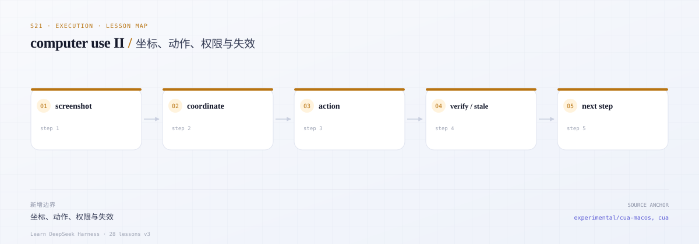
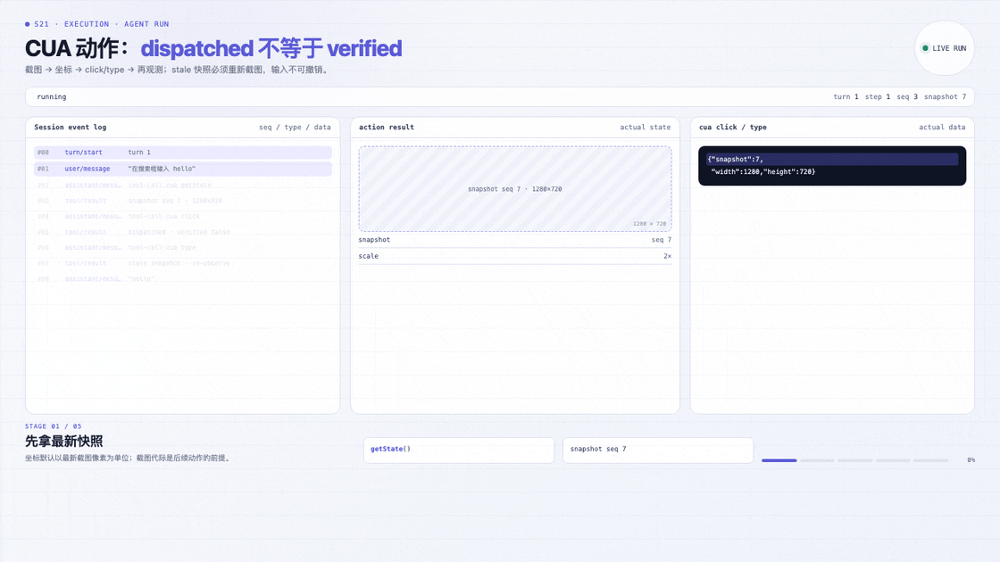
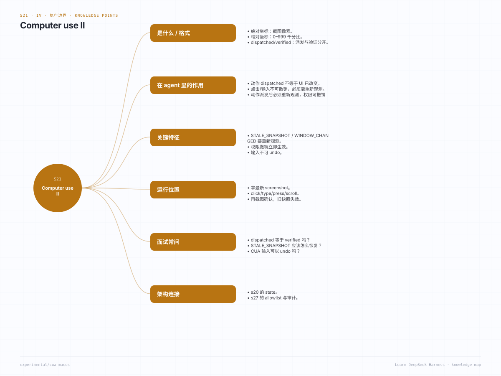

# s21 · computer-use II：动作、坐标、快照失效与授权撤销

> 本课代码：`src/types.ts`、`src/registry.ts`、`src/access.ts`、`src/coordinates.ts`、`src/mock-desktop.ts`、`src/tool.ts`、`src/demo.ts`
>
> 测试：`tests/cua-actions.test.ts`（12 个离线用例）
>
> 本课不调用模型、不联网、不操作真实桌面；零运行时依赖。

---

## 0. 开篇三问

### 0.1 这一课学什么？

在 s20 的观察能力上补四件事：

1. **动作**：`click` / `type` / `press` / `scroll`。每个动作返回 `status: "dispatched"`、`verified: false`、`irreversible: true`。成功只代表「已发出」，不代表「界面已生效」。
2. **坐标**：绝对坐标是**最近一次截图的像素**（换算成原生 point 要除以 `scale`）；相对坐标是 **0-999 的千分比**，窗口尺寸变化后仍可用。
3. **失效**：旧快照 → `STALE_SNAPSHOT`；快照/截图之后窗口尺寸变了 → `WINDOW_CHANGED`；没有截图就用绝对坐标 → `SCREENSHOT_REQUIRED`。
4. **授权**：持久授权（profile 存储，跨会话）与会话授权（只在当前 Session）分开；撤销后下一次分派立即失败，但已经派发的输入**不会回滚**。

### 0.2 DSH 为什么这样设计？

- **输入不可撤销**。桌面收到的是真实事件（CGEvent），发出后无法撤回。DSH 的 guidance 明确写着：取消可能留下部分效果；不确定时不要重试，先观察。API 用 `verified: false` 强迫调用方重新读状态，而不是相信「成功」。
- **坐标必须绑定观测**。模型看到的是截图，原生接口要的是 point。两者之间隔着 scale、窗口边框、多显示器。DSH 让 provider 保存「截图 ↔ 窗口几何」的对应关系，在分派前只换算一次；窗口尺寸一变就拒绝旧坐标。这样模型不能拿旧截图去点新界面。
- **快照是代际的**。AX 的 `elementIndex` 只在某次 `getState` 内有效。DSH 的 guidance：`STALE_SNAPSHOT` 要重新 `getState`，`WINDOW_CHANGED` 要重新观察（必要时先恢复窗口），`SCREENSHOT_REQUIRED` 要先截图。错误码本身就是给模型的下一步指令。
- **两级授权**。「仅本次会话」不写入 profile，「始终允许」写入；撤销时两者都要清掉，并且要在下一次分派前生效。这样用户不必为了拒绝一次操作而杀掉整个会话。
- **截图是多模态附件**。真实 DSH 只在模型声明支持图像输入、且挂载了附件存储时，才把 PNG 作为持久化附件交给模型；否则退化成 MCP 图像诊断文本。本课用 `placeholder: true` 的假 PNG 把这条链路固定成「bytes + mime + 像素尺寸」。

### 0.3 场景

> 用户说：「把 Notes 里购物清单的末尾加上 ` — milk`，然后确认写进去了。」

```text
cua getState { appId:"notes", windowId:1 }
  → snapshotId:"snap-1", elements:[…, {index:4, role:"AXTextArea", value:"Shopping list"}]
cua type { appId:"notes", windowId:1, text:" — milk" }
  → { status:"dispatched", verified:false, irreversible:true, dispatchId:"dispatch-1" }
cua getState { appId:"notes", windowId:1 }        # 必须重新观察
  → snapshotId:"snap-2", AXTextArea.value:"Shopping list — milk"
```

如果第二步之后直接 `click` 一个旧 `snapshotId` 的元素，会得到 `STALE_SNAPSHOT`；如果这时窗口被用户拉大，会先得到 `WINDOW_CHANGED`。

---



*本课地图：这一步新增的架构边界，以及它在数据流中的位置。*

### 先看机制动画



*实际 agent run：SessionEvent 与运行中的状态。*

[交互版](../../../docs/visuals/agent-run.html?lesson=s21) · [MP4](../../../docs/visuals/s21-agent-run.mp4)

## 1. 先跑起来

```sh
cd course/lessons-v3/s21-computer-use-ii
node src/demo.ts
node --test tests/*.test.ts
```

Demo 会：未授权时被拒绝 → 授权 → 读快照并点元素 → 截图 → 用绝对/相对坐标各点一次 → 打字并重新观测 → 改窗口尺寸让旧快照失效 → 重新观测恢复 → 取消（确认不可撤销）→ 撤销授权后再次被拒绝。

---

## 2. 先读真实源码

| 顺序 | 文件 | 读的时候问自己 | 对应本课 |
|---|---|---|---|
| 1 | [`packages/experimental/cua/src/protocol.ts`](https://github.com/deepseek-ai/deepseek-harness/blob/master/packages/experimental/cua/src/protocol.ts) | click/scroll 为什么同时接受 snapshot / absolute / relative 三种目标？ | `src/tool.ts` 参数整形 |
| 2 | [`packages/experimental/cua/src/coordinates.ts`](https://github.com/deepseek-ai/deepseek-harness/blob/master/packages/experimental/cua/src/coordinates.ts) | 为什么先报 `STALE_SNAPSHOT` 再报 `SCREENSHOT_REQUIRED`？scale 在哪里用？ | `src/coordinates.ts` |
| 3 | [`packages/experimental/cua/src/application-access.ts`](https://github.com/deepseek-ai/deepseek-harness/blob/master/packages/experimental/cua/src/application-access.ts) | 授权为什么在 launch/AX/截图/输入之前？撤销如何作废句柄？ | `src/access.ts` |
| 4 | [`packages/experimental/cua/src/permission-store.ts`](https://github.com/deepseek-ai/deepseek-harness/blob/master/packages/experimental/cua/src/permission-store.ts) | 持久授权、会话授权、拒绝记录、撤销代际分别存在哪？ | 两级授权 |
| 5 | [`packages/experimental/cua/src/bridge.ts`](https://github.com/deepseek-ai/deepseek-harness/blob/master/packages/experimental/cua/src/bridge.ts) | 截图结果如何变成附件？为什么文本结果不够？ | 多模态附件 |
| 6 | [`packages/experimental/cua/src/index.ts`](https://github.com/deepseek-ai/deepseek-harness/blob/master/packages/experimental/cua/src/index.ts) | 截图为什么要求模型声明 image 输入与 attachment store？ | 截图链路 |
| 7 | [`packages/experimental/cua-macos/src/guidance.ts`](https://github.com/deepseek-ai/deepseek-harness/blob/master/packages/experimental/cua-macos/src/guidance.ts) | 错误码如何变成给模型的下一步指令？ | 错误语义 |
| 8 | [`cua-relative-coordinates` 升级指南](https://github.com/deepseek-ai/deepseek-harness/blob/master/docs/upgrade-guide/v0.2.1-rc.2/cua-relative-coordinates/guide.md) | 为什么引入 0-999 相对坐标？ | `src/coordinates.ts` |

背景文档：[计算机操作（中文）](https://github.com/deepseek-ai/deepseek-harness/blob/master/docs/subsystems/computer-use.zh.md)、[共享 CUA 对象](https://github.com/deepseek-ai/deepseek-harness/blob/master/packages/experimental/cua/README.zh.md)。

---

## 3. 核心概念

### 3.1 截图 → 坐标 → 原生 point

```text
截图 1800×1280 px（窗口 900×640 pt，scale=2）
  ↓ 模型看像素，选 (900, 640)
换算：native = pixel / scale = (450, 320) pt
  ↓ provider 把 point 交给 helper
CGEvent / AXPress 落在窗口内
```

三条规则：

| 目标 | 输入 | 前置条件 | 换算 |
|---|---|---|---|
| 元素 | `snapshotId + elementIndex` | 最新 `getState` 且窗口未变 | 不需要坐标 |
| 绝对坐标 | `x + y`（像素） | 该窗口最近一次截图 | `x / scale` |
| 相对坐标 | `x + y`（0-999） | 该窗口最近一次观测 | `x/1000 * width`，clamp 到 `width-1` |

相对坐标在窗口被拉大后仍然有意义（比例不变）；绝对坐标不行——旧截图对应旧像素网格，所以 resize 后必须重新截图。

### 3.2 错误码就是下一步指令

| 错误 | 含义 | 模型应该做什么 |
|---|---|---|
| `STALE_SNAPSHOT` | 快照不是最新的 | 重新 `getState`，用新 `snapshotId` |
| `WINDOW_CHANGED` | 快照/截图之后窗口尺寸变了 | 重新观察；必要时先恢复窗口 |
| `SCREENSHOT_REQUIRED` | 用绝对坐标但还没有截图 | 先 `screenshot` |
| `APP_ACCESS_REQUIRED` | 该应用未授权（或已撤销） | 请用户授权；不要重放旧动作 |
| `INVALID_ARGUMENT` | 相对坐标越界 / 元素下标越界 | 修正参数，不要重试同一请求 |

真实 DSH 的 guidance 还区分 `STALE_APP`（重新 `getApp`）、`PERMISSION_DENIED`（系统权限）、`APP_ACCESS_REVOKED`（重新取句柄）。本课保留与坐标/输入最相关的五个。

### 3.3 派发 ≠ 验证

```ts
{
  status: 'dispatched',
  verified: false,      // 永远 false
  irreversible: true,   // 永远 true
  note: 'Input was dispatched, not verified. It cannot be undone; read fresh state to verify the effect.'
}
```

这不是悲观，而是事实：点击可能落在错误控件上、输入可能被输入法拦截、窗口可能在派发瞬间失焦。工具只能说「我发出了」。验证只能靠下一次 `getState` / `screenshot`。

### 3.4 两级授权

```ts
access.grant('notes', { scope: 'session', sessionId: 'session-a' })  // 只属于 a
access.grant('finder', { scope: 'persistent' })                       // 写 profile，所有会话
access.revoke('notes', { sessionId: 'session-a' })                    // 只撤会话授权
access.revoke('finder')                                               // 两级都撤
```

- 没有 profile 存储时 `persistent` 授权报 `PERSISTENCE_UNAVAILABLE`：不能假装持久化成功。
- 授权检查发生在**每一次**读取/截图/动作之前，所以撤销对下一次调用立即生效。
- 撤销不会撤销已经派发的输入：记录仍在 `session.dispatched` 里。

### 3.5 为什么 `type` 之后要重新观测

mock 把文本追加到窗口里第一个 `AXTextArea`，所以重新 `getState` 能看到 `Shopping list — milk`。真实桌面同理：输入法、焦点、光标位置都会影响结果。**唯一可信的验证是重新读状态。**

---

## 4. 本课实现

| 文件 | 作用 | 真实对应 |
|---|---|---|
| [`src/types.ts`](src/types.ts) | 动作/坐标/派发/回执类型 | `protocol.ts` + `types.ts` |
| [`src/registry.ts`](src/registry.ts) | 单槽位注册（复制自 s20） | `ComputerUseRegistry` |
| [`src/access.ts`](src/access.ts) | 持久/会话两级授权与撤销 | `permission-store.ts` |
| [`src/coordinates.ts`](src/coordinates.ts) | 绝对/相对坐标纯函数 | `coordinates.ts` |
| [`src/mock-desktop.ts`](src/mock-desktop.ts) | 快照代际、窗口 resize、动作派发 | Cua Driver provider |
| [`src/tool.ts`](src/tool.ts) | `cua` 工具（观察 + 动作） | `tools.cua` |
| [`src/demo.ts`](src/demo.ts) | 无模型演示 | — |

### 关键代码：失效检查顺序

```ts
if (snapshotId 不是该窗口的最新快照) throw STALE_SNAPSHOT
if (snapshot.generation !== window.generation) throw WINDOW_CHANGED
if (elementIndex 越界) throw INVALID_ARGUMENT
```

顺序决定模型的下一步：旧快照先重新 `getState`；窗口变了再观察一次；参数错了只改参数。反过来（先报参数错）会让模型在错误的快照上反复试。

---

## 5. mock 的边界（必须明确）

| 真实 CUA | 本课 mock | 教学影响 |
|---|---|---|
| 真实 CGEvent / AXPress | 记录 dispatch，type 改内存 AX 值 | 不验证焦点、输入法、事件顺序 |
| 真实截图（ScreenCaptureKit） | 1×1 PNG + 窗口像素尺寸 | **不能**把 bytes 当画面 |
| 外部 resize / 多显示器 | `resizeMockWindow()` 模拟 | 不覆盖移动/缩放动画 |
| 真实 TCC 权限流程 | 无 | 不覆盖系统设置页 |
| 键盘快捷键语义 | 只记录 key/modifiers | 不验证应用响应 |
| 撤销与超时 | `cancel()` 只返回 undone=false | 不覆盖部分效果 |

---

## 6. 验收

`node --test tests/*.test.ts` 覆盖：

| 测试 | 证明 |
|---|---|
| 注册 | 单槽位；第二次注册失败；dispose 关闭会话 |
| 授权 | 未授权动作被拒绝；撤销后立即再次拒绝 |
| 持久 vs 会话 | 持久跨会话；会话不跨会话；同一存储「重启」后持久仍在 |
| 动作 | `dispatched` / `verified:false` / `irreversible:true`；dispatch 记录完整 |
| 取消 | `undone:false`，已派发记录保留 |
| 相对坐标 | 0/500/999 边界；-1、1000、小数被拒绝 |
| 绝对坐标 | 无截图 `SCREENSHOT_REQUIRED`；越界 `INVALID_ARGUMENT`；scale 换算正确 |
| stale | 旧 `snapshotId` → `STALE_SNAPSHOT`；最新可用；元素下标越界报错 |
| window changed | resize 后元素/相对/绝对全部 `WINDOW_CHANGED`；重新观测恢复，绝对坐标仍需新截图 |
| type | 派发后重新观测能看到 mock 的可见效果 |
| press/scroll | 修饰键、滚动行数记录；越界行数报错 |
| 工具 | 方法分发、错误收敛、截图元数据（含 pixel/scale） |
| 关闭 | `SESSION_CLOSED` |

---

## 7. 刻意简化了什么

| 真实 DSH | s21 | 影响 |
|---|---|---|
| 持久授权写入 profile domain storage + 文件锁 | 注入式 `AccessStorage` | 不覆盖并发/迁移 |
| 授权卡片（AskUserQuestion） | 直接 `grant()` | 不覆盖交互流程 |
| 截图附件与多模态路由 | 只回元数据 | 不覆盖附件存储 |
| 窗口移动 vs 缩放 | 只模拟 resize | 移动不改窗口局部坐标（真实规则） |
| `STALE_APP` / 权限撤销句柄 | 未实现 | 保留最相关错误 |
| 部分效果、超时、重连 | 未实现 | 用 `verified:false` 表达 |

---

## 8. 练习

1. **窗口移动**：加 `moveMockWindow()`，验证移动后绝对/相对坐标仍有效（窗口局部坐标不变），而屏幕坐标会变。
2. **多显示器**：给窗口加 `displayScale` 与 `origin`，实现「截图坐标 → 全局屏幕坐标」的换算。
3. **部分效果**：让 `press('Return')` 在 mock 里触发一次导航，`cancel()` 后仍能看到部分效果，思考如何向模型报告。
4. **授权卡片**：把 `grant()` 换成异步 `ask` 回调，模拟「仅本次会话 / 拒绝 / 始终允许」，并测试拒绝后不重放。
5. **把 s21 接回 s20**：抽出共享 core 包，让两课只保留差异，比较「复制 vs 共享」的维护成本。

---

## 知识导图



*用一张图记住：本课问题、机制、代码位置、验收与相邻课程。*

[总知识导图](../../../docs/visuals/mindmaps/course.svg) · [XMind 源文件](../../../docs/visuals/mindmaps/course.xmind)
