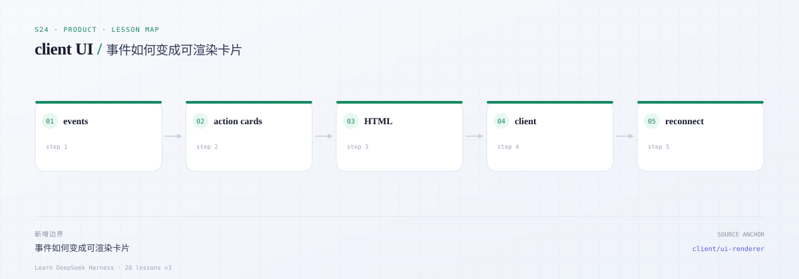
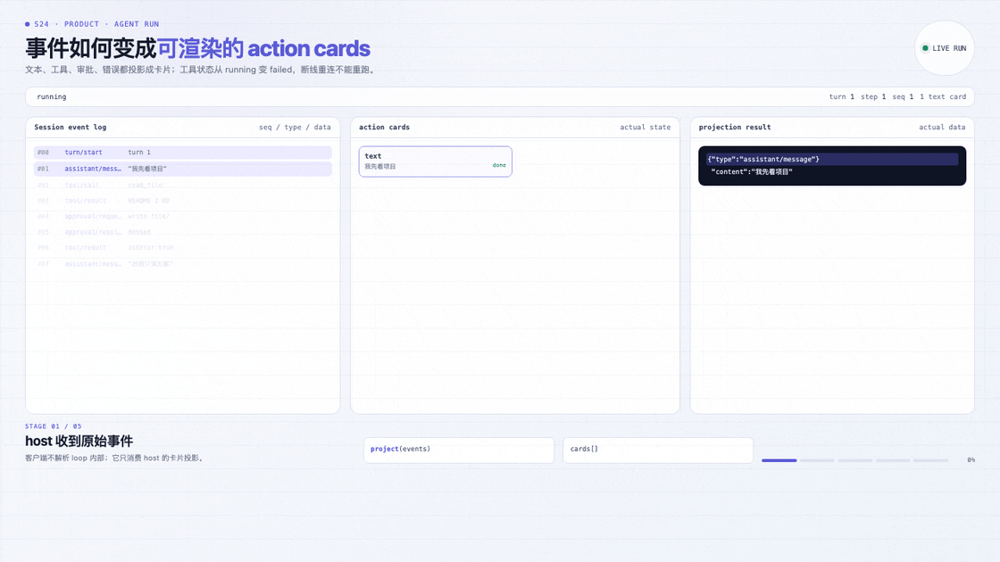
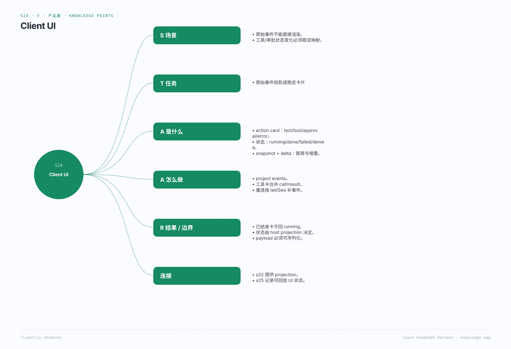

# s24 · client UI：action card / tool result projection

## 开篇三问

1. 浏览器已经拿到了原始事件，为什么还要在 host 侧先投影成卡片？
2. 工具卡从 `running` 变成 `failed`、审批卡从 `pending` 变成 `denied`，状态该由谁决定？
3. 首屏快照和增量事件如何对齐到同一个 `seq`，既不丢结果也不重复渲染？

## 场景

用户打开一个长任务会话：助手说“我先看看项目结构”，调用 `read_file`，接着要写文件，弹出审批，用户拒绝，模型改用只读方案，最后又遇到一次 429。客户端需要把这段过程稳定地渲染成五类卡片——**text、tool-call、tool-result、approval、error**——每张卡都有状态、标题、摘要和可序列化 payload，而且断线重连后不能把已经结束的工具卡重新显示成“运行中”。

本课不引入 React，也不启动真实模型：`src/projection.ts` 是一个纯同步 fold，输出普通 JSON；`src/html.ts` 用字符串模板做一个最小 HTML 渲染器；`src/server.ts` 提供一个可选的本地演示页。

---



*本课地图：这一步新增的架构边界，以及它在数据流中的位置。*

### 先看机制动画



*实际 agent run：SessionEvent 与运行中的状态。*

[交互版](../../../docs/visuals/agent-run.html?lesson=s24) · [MP4](../../../docs/visuals/s24-agent-run.mp4)

## 0. 先跑起来

```sh
cd course/lessons/s24-client-ui
node src/demo.ts          # 打印示例会话的卡片 JSON
node src/server.ts        # http://127.0.0.1:0 上渲染同样的卡片
node --test tests/*.test.ts
```

Demo 的示例事件在 `src/demo.ts`，覆盖成功工具、被拒绝的审批、错误卡和断线后补上的孤立工具结果。

---

## 1. 为什么要有 projection 层

客户端不应该理解每一种 session 事件。事件是**append-only 的领域事实**，卡片是**面向渲染的有限状态**：

- 事件回答“发生了什么”，卡片回答“现在该怎么画”。
- 卡片可以被序列化后跨进程传输，也可以被缓存、快照、比较。
- 状态迁移只在一个地方发生，移动端/Web/终端才能画出同一张卡。

这和 DSH 的 session projection 是同一个思路：host 计算一次，客户端只渲染。参考
[`session-projection`](https://github.com/deepseek-ai/deepseek-harness/blob/master/docs/subsystems/session-projection.zh.md)
和
[`web-client`](https://github.com/deepseek-ai/deepseek-harness/blob/master/docs/subsystems/web-client.zh.md)。

DSH 里更接近“卡片”的能力是实验性的 action cards：模型调用 `propose_action`，turn 结束后在答案下方显示一张可操作卡片，用户动作会作为下一条状态通知回到模型。本课借鉴它的**kind / title / summary / payload / decision** 形状，但把范围缩小到工具结果投影：

- [`action-cards`（host 侧）](https://github.com/deepseek-ai/deepseek-harness/blob/master/packages/experimental/action-cards/README.zh.md)
- [`client-ui-action-cards`（浏览器侧）](https://github.com/deepseek-ai/deepseek-harness/blob/master/packages/experimental/client-ui-action-cards/README.zh.md)

---

## 2. 数据模型

`src/types.ts` 只有三类东西：

```ts
SessionEvent   // 输入：带 seq/at 的领域事件
ActionCard     // 输出：kind/status/title/summary/payload
CardProjectionState // 快照：seq/turn/status/cards
```

卡片是**完全可 JSON 序列化**的：没有 `Date`、`Error`、`Map`、类实例，`payload` 只允许 JSON 值。这样浏览器、日志和快照测试拿到的是同一份字节。

五种 kind：

| kind | 何时产生 | 状态迁移 |
|---|---|---|
| `text` | 助手流式文本 | `streaming → succeeded` |
| `tool-call` | `tool/call` | `running → succeeded / failed / cancelled` |
| `tool-result` | 窗口外到达的 `tool/result` | `succeeded / failed` |
| `approval` | `approval/request` | `pending → succeeded / denied` |
| `error` | `error` | `failed` |

正常的一轮里，`tool/result` 会**更新**对应的 `tool-call` 卡，而不是再生成一张重复卡。只有从中间 `seq` 恢复、先看到结果后看到调用时，才会生成独立的 `tool-result` 卡——这正好对应真实客户端的“断线补洞”问题。

---

## 3. 纯 fold 与增量一致性

`applyEvent(state, event)` 满足：

```ts
project(events) === events.reduce(applyEvent, emptyState)
```

实现上没有隐藏的 Map 索引，卡片查找按 id 做；未知事件返回**同一个状态引用**，方便上层做浅比较。增量更新时先复制 `cards` 数组，再替换目标卡，输入状态不会被修改。

这条性质是本课最重要的测试：把同一批事件一次性投影，与逐条 `push` 到 `CardProjection`，结果必须深度相等。否则断线重连和首屏快照必然对不上。

---

## 4. 文件地图

| 文件 | 作用 |
|---|---|
| [`src/types.ts`](src/types.ts) | 事件、卡片、投影状态 |
| [`src/projection.ts`](src/projection.ts) | `applyEvent` / `project` / `CardProjection` |
| [`src/html.ts`](src/html.ts) | 无框架 HTML 渲染（含转义） |
| [`src/demo.ts`](src/demo.ts) | 示例事件与 JSON 输出 |
| [`src/server.ts`](src/server.ts) | 可选：本地演示 HTTP 服务 |
| [`tests/s24.test.ts`](tests/s24.test.ts) | 投影、错误卡、审批卡、增量一致性 |

---

## 5. 验收

```sh
node --test tests/*.test.ts
```

测试覆盖：

| 用例 | 证明 |
|---|---|
| 成功工具调用 | call 卡带参数，result 回填后状态与摘要更新 |
| 错误卡 | `error` 事件生成 `failed` 卡，payload 保留 code/retryable |
| 审批卡 | pending → allowed / denied，拒绝不执行副作用 |
| 增量一致性 | 逐条 apply 与一次性 project 深度相等 |
| 文本增量 | 多次 `assistant/text` 追加到同一张卡 |
| 孤立结果 | 从中间窗口恢复时生成 `tool-result` 卡 |
| 序列化 | `JSON.parse(JSON.stringify(cards))` 深度相等 |
| HTML 转义 | 用户文本中的 `<script>` 不会变成标签 |

---

## 6. 刻意简化了什么

| 真实 DSH | s24 | 影响 |
|---|---|---|
| 增量 fold + 版本化 state schema | 简单数组查找 | 规模 |
| slot / turn-tail 组合 | 固定卡片列表 | 布局 |
| 真实 action 驱动副作用 | 只投影审批结果 | 交互 |
| SSE / 重连去重 | 只给事件和 `since` 形状 | 传输 |
| 富文本 / diff / 图片块 | 纯文本 payload | 渲染 |

---

## 7. 练习

1. 给 `tool-call` 增加 `startedAt/finishedAt`，并保证快照重放时时间来自事件而不是 `Date.now()`。
2. 增加 `since` 参数：只投影 `seq > since` 的事件，验证孤立结果卡。
3. 把 `tool-call` 的 payload 做字段级 redaction，再渲染。
4. 为卡片增加 `aria-live` 区域，让审批卡出现时被读屏软件播报。
5. 实现一个 `mergeCards(previous, next)`，让客户端只 patch 变化的卡片。

---

## 8. 延伸阅读

- [DSH session projection](https://github.com/deepseek-ai/deepseek-harness/blob/master/docs/subsystems/session-projection.zh.md)
- [DSH web client](https://github.com/deepseek-ai/deepseek-harness/blob/master/docs/subsystems/web-client.zh.md)
- [DSH action cards](https://github.com/deepseek-ai/deepseek-harness/blob/master/packages/experimental/action-cards/README.zh.md)
- [DSH client UI action cards](https://github.com/deepseek-ai/deepseek-harness/blob/master/packages/experimental/client-ui-action-cards/README.zh.md)
- [DSH conversation 与 presentation](https://github.com/deepseek-ai/deepseek-harness/blob/master/docs/subsystems/conversation.zh.md)

---

## 知识导图



*用一张图记住本课的知识点：概念、事实、边界与失败模式。*

[总知识导图](../../../docs/visuals/mindmaps/course.svg) · [XMind 源文件](../../../docs/visuals/mindmaps/course.xmind)
