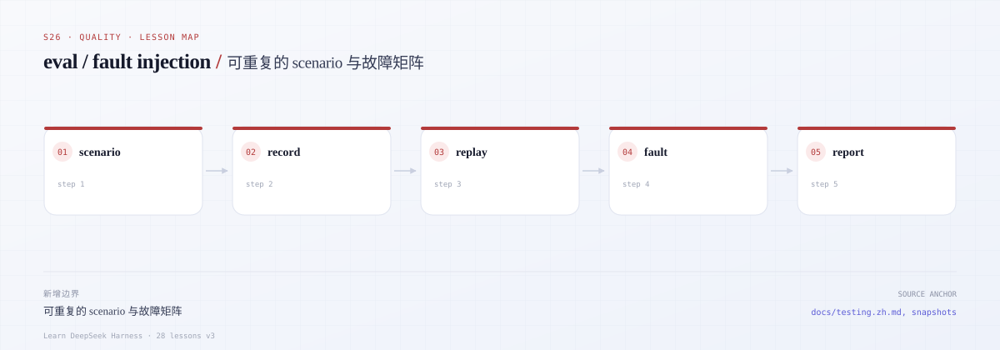
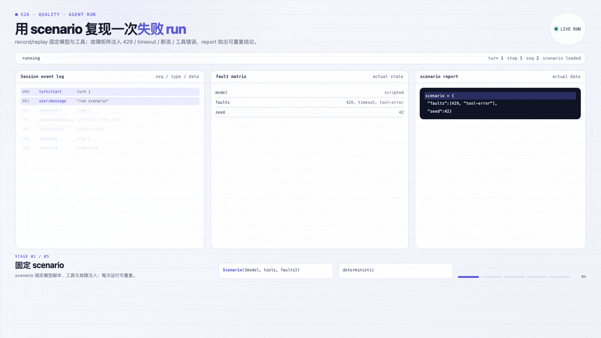
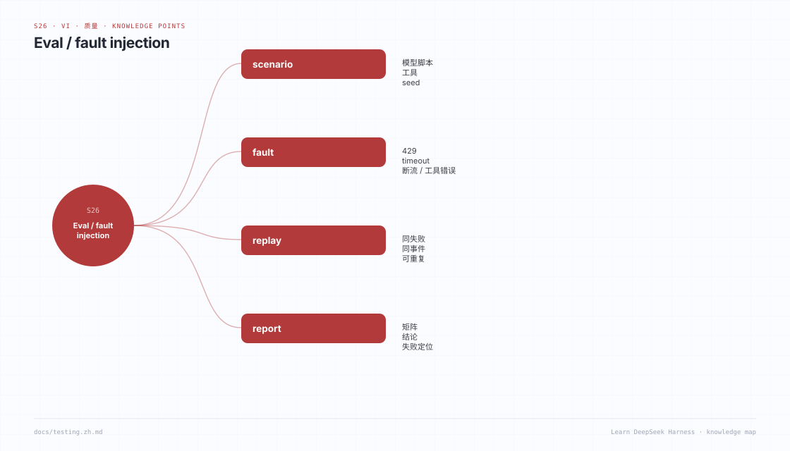

# s26 · eval：record/replay、snapshot 与故障注入

## 开篇三问

1. observability 已经在记录 span 和事件，为什么还需要一个独立的 eval 层？
2. 一次线上失败（429、超时、断流）如何变成 CI 里可重复重放的输入？
3. snapshot 相等就够了吗？失败报告还应该告诉工程师什么？

## 场景

凌晨两点，线上 agent 在第 3 步收到 429；另一次请求在流到一半时连接被切断；还有一次工具返回了错误参数。你不可能靠“再跑一次真实模型”来复现这些偶发故障。

本课把 s25 里的 telemetry/record/replay 拆出一个**评测层**：一次录制，多次重放；用 snapshot 比较两次运行；用故障矩阵覆盖 429 / 超时 / 断流 / 工具错误；最后用一个可重复的 scenario runner 输出通过率、失败用例和路径级 diff。所有测试离线运行。

---



*本课地图：这一步新增的架构边界，以及它在数据流中的位置。*

### 先看机制动画



*实际 agent run：SessionEvent 与运行中的状态。*

[交互版](../../../docs/visuals/agent-run.html?lesson=s26) · [MP4](../../../docs/visuals/s26-agent-run.mp4)

## 0. 先跑起来

```sh
cd course/lessons/s26-eval
node src/demo.ts
node --test tests/*.test.ts
```

Demo 会打印故障矩阵的摘要，以及一个“期望成功却收到 429”的失败报告样式。

---

## 1. 边界：observability 记录事实，eval 判断事实

| 层 | 回答的问题 | 本课对应 |
|---|---|---|
| observability | “发生了什么？耗时多少？哪个 span 失败？” | `events`、`usage`、`RunResult.failures` |
| eval | “这次行为是否符合预期？和上次是否一致？” | `snapshot`、`ScenarioRunner`、`EvalReport` |

真实 DSH 把 telemetry 作为独立 seam（`session-telemetry`），并明确要求快照测试只覆盖稳定的外部契约。参考：

- [DSH 测试策略（含 snapshot 规则）](https://github.com/deepseek-ai/deepseek-harness/blob/master/docs/testing.zh.md)
- [DSH session telemetry](https://github.com/deepseek-ai/deepseek-harness/blob/master/docs/subsystems/session-telemetry.zh.md)
- [DSH tool execution pipeline](https://github.com/deepseek-ai/deepseek-harness/blob/master/docs/tool-execution-pipeline.zh.md)

本课刻意不实现 span 树：s25 已经讲过。这里只保留 eval 需要的三样东西——**可重放输入、可比较输出、可注入故障**。

---

## 2. record / replay

```ts
const recording = new RecordingModel(inner)
await runAgent(...recording...)

const replay = new ReplayModel(recording.records)
await runAgent(...replay...)
```

关键点：

- 记录的是**模型看到的 request + 按序产出的 chunk**，不是最终消息；
- 抛出的异常也要记录成一条 `{ error: { name, message, code } }`，否则断流无法重放；
- 记录经过 `JSON.stringify` 后仍可还原（`serializeRecords` / `deserializeRecords`）；
- Replay 按 cursor 消费，耗尽后显式报错，避免“少了几步却静默通过”。

---

## 3. snapshot 与路径级 diff

`snapshotRun` 只保留稳定字段：outcome、messages、tool calls、事件类型序列、usage、steps。**不包含时间戳和 run id**，否则每次运行都不相等。

`diffSnapshots(a, b)` 返回：

```ts
{ path: '$.messages[2].content', left: 'old', right: 'new' }
```

`formatDiff` 把它变成可读的失败报告。测试会故意改一条消息，确认 path 指到具体字段，而不是只报一句 “snapshot mismatch”。

---

## 4. 故障矩阵

| 故障 | 注入点 | 归一化 failure |
|---|---|---|
| 429 | model finish(error) | `rate-limit` |
| 超时 | model 抛 `TimeoutError` | `timeout` |
| 断流 | 已产出 delta 后抛 `STREAM_CLOSED` | `disconnect` |
| 工具错误 | 工具 `run` 抛错 | `tool-error`（非终止，回灌给模型） |

归一化很重要：上层只判断 `failure.kind`，不解析各家 provider 的错误字符串。真实 DSH 也要求公共边界把多种失败表示收敛成一种契约，见
[defensive-patterns](https://github.com/deepseek-ai/deepseek-harness/blob/master/docs/defensive-patterns/general.zh.md)。

---

## 5. scenario runner

```ts
const report = new ScenarioRunner({ repeats: 2 }).runAll(scenarios)
```

每个 scenario 声明：

- `prompt`、`createModel()`、可选 tools；
- `expect`: `{ kind: 'ok' }`、`{ kind: 'failure', failure: 'rate-limit' }` 或 `{ kind: 'tool-error' }`；
- runner 重复执行，**所有 repeat 的 snapshot 必须一致**，否则把不一致本身记成失败；
- 报告包含 `passed/failed/passRate`、每个场景的 metrics、失败原因和 diff。

这里的“通过”不是“模型答对了”，而是“在已知输入下，行为符合声明的预期”。语义正确性需要更上层的 grader；本课只做可重复的回归评测。

---

## 6. 文件地图

| 文件 | 作用 |
|---|---|
| [`src/types.ts`](src/types.ts) | model / chunk / failure / event 类型 |
| [`src/model.ts`](src/model.ts) | `RecordingModel`、`ReplayModel`、序列化 |
| [`src/agent.ts`](src/agent.ts) | 最小 agent loop，含失败归一化 |
| [`src/faults.ts`](src/faults.ts) | 429 / 超时 / 断流 / 工具错误模型 |
| [`src/snapshot.ts`](src/snapshot.ts) | 快照、路径 diff、格式化 |
| [`src/runner.ts`](src/runner.ts) | 可重复 scenario runner 与报告 |
| [`src/demo.ts`](src/demo.ts) | 故障矩阵演示 |
| [`tests/s26.test.ts`](tests/s26.test.ts) | record→replay→snapshot、故障矩阵、失败报告 |

---

## 7. 验收

```sh
node --test tests/*.test.ts
```

| 用例 | 证明 |
|---|---|
| record → replay | 两次运行 snapshot 完全一致 |
| 序列化往返 | 录制结果过 JSON 后仍可 replay |
| 断流重放 | 部分 chunk + 异常都能重放 |
| 故障矩阵 | 四种故障得到四种 normalization |
| 可重复性 | 同一 scenario 重复执行 snapshot 一致 |
| 失败报告 | 期望成功却失败时，报告含路径和提示 |
| 工具错误 | 错误回灌模型，run 可继续但 failures 可见 |

---

## 8. 刻意简化了什么

| 真实 DSH | s26 | 影响 |
|---|---|---|
| 真实 SSE / provider 重试 | 录制 chunk | 传输细节 |
| 多维 grader / 模型评分 | 声明式 expect | 语义评测 |
| 快照文件管理 / 更新流程 | 内存快照 + diff | CI 集成 |
| 并发 scenario / 分片 | 顺序执行 | 吞吐 |
| span / trace 关联 | 不实现（见 s25） | 可观测性 |

---

## 9. 练习

1. 给 scenario 增加 `timeoutMs`，超时也归类为 `timeout` 而不是测试进程被杀。
2. 把 `serializeRecords` 的结果写进 `fixtures/*.json`，做跨进程 replay。
3. 实现 `--update` 模式：只在显式 flag 下更新快照，防止误覆盖。
4. 给 runner 增加并发上限，并验证报告顺序仍稳定。
5. 增加一个 `tool-error` 后模型重试成功的场景，区分 recovered / unrecovered。

---

## 10. 延伸阅读

- [DSH 测试策略](https://github.com/deepseek-ai/deepseek-harness/blob/master/docs/testing.zh.md)
- [DSH session telemetry](https://github.com/deepseek-ai/deepseek-harness/blob/master/docs/subsystems/session-telemetry.zh.md)
- [DSH tool execution pipeline](https://github.com/deepseek-ai/deepseek-harness/blob/master/docs/tool-execution-pipeline.zh.md)
- [DSH defensive patterns](https://github.com/deepseek-ai/deepseek-harness/blob/master/docs/defensive-patterns/general.zh.md)

---

## 知识导图



*用一张图记住本课的知识点：概念、事实、边界与失败模式。*

[总知识导图](../../../docs/visuals/mindmaps/course.svg) · [XMind 源文件](../../../docs/visuals/mindmaps/course.xmind)
