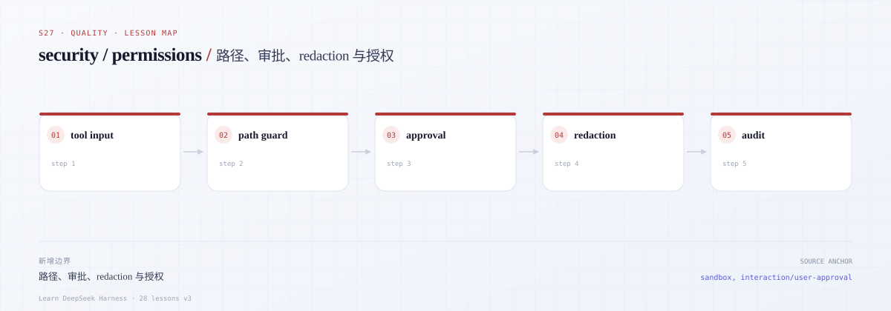

# s27 · security：最小安全边界

## 开篇三问

1. 为什么 `resolve()` 之后用 `startsWith(root)` 判断路径还不够？
2. 审批超时、回调抛错、用户没点按钮时，默认应该是允许还是拒绝？
3. 日志里“看不见”的 secret，如何证明它真的没有被写出去？

## 场景

一个 coding agent 正在改项目：它请求读取 `../../.ssh/id_rsa`，请求写入工作区外的文件，弹出审批后用户直接关掉了窗口，工具返回了 2 MB 的构建日志，随后 CUA 想点击一个没有授权的桌面应用。任何一处默认放行，都会把“教学 demo”变成真实事故。

本课只实现五条最小边界：**工作区路径逃逸、fail-closed 审批、secret/sensitive 字段 redaction、工具输出截断、CUA 应用授权**。全部离线，CUA 用 mock executor，文件操作只在临时目录。

---



*本课地图：这一步新增的架构边界，以及它在数据流中的位置。*

## 0. 先跑起来

```sh
cd course/lessons/s27-security
node src/demo.ts
node --test tests/*.test.ts
```

Demo 会依次触发路径逃逸、审批拒绝、redaction、截断和 CUA 拒绝，并打印一份**已 redact 的审计日志**。

---

## 1. 路径逃逸：`realpath` + `relative`，不是字符串前缀

常见但不安全的写法：

```ts
const target = resolve(root, input)
if (!target.startsWith(root)) throw new Error('escape')
```

它挡不住：

- `root = /work/app`，`input = ../app-evil/x`：`/work/app-evil/x` 以 `/work/app` 开头；
- `root` 内部有一个指向外部的 symlink；
- macOS 大小写/规范化差异；
- 目标不存在时无法 `realpath`。

本课的 `Workspace` 做三件事：

1. 创建时对 root 取 `realpath`，之后所有比较都基于真实路径；
2. 对目标找到**最近的已存在祖先**并 `realpath`，再把不存在的后缀拼回去；
3. 用 `relative(realRoot, realTarget)` 判断，拒绝 `..` 开头或绝对路径。

这样既挡住 symlink，也允许“写一个还不存在的新文件”。参考
[DSH filesystem](https://github.com/deepseek-ai/deepseek-harness/blob/master/docs/subsystems/filesystem.zh.md)
和
[DSH sandbox](https://github.com/deepseek-ai/deepseek-harness/blob/master/docs/subsystems/sandbox.zh.md)。

---

## 2. 审批：fail-closed

审批不是一个布尔值，而是一个**可能失败、可能超时、可能被取消的异步决策**。`FailClosedApproval` 的规则：

| 输入 | 结果 |
|---|---|
| 明确返回 `allowed-once` | 允许一次 |
| 返回 `denied` / 未知字符串 / `undefined` | 拒绝 |
| 回调抛异常 | 拒绝 |
| 超时 | 拒绝 |
| `AbortSignal` 已取消 | 拒绝 |
| 没有配置审批服务 | 拒绝（`DenyAllApproval`） |

真实 DSH 的 approval 文档强调请求标识、结果枚举和按会话策略；本课把这些收敛成“除了一次性明确允许，其他一律拒绝”。见
[DSH approval](https://github.com/deepseek-ai/deepseek-harness/blob/master/docs/subsystems/approval.zh.md)。

---

## 3. Redaction：按 key 和按值

两套规则同时生效：

- **按 key**：`apiKey`、`api_key`、`authorization`、`token`、`secret`、`password`、`cookie`、`privateKey` 等，大小写/下划线/连字符归一化后匹配，值整体替换成 `[REDACTED]`；
- **按值**：`sk-...`、`Bearer ...`、`AKIA...`、PEM 私钥块。

递归处理对象/数组，限制深度，检测循环引用，跳过 `__proto__` / `constructor` / `prototype` 防止原型污染。错误对象单独处理：`name`、`message`、`code`、`stack` 都要过一遍。

参考 DSH 的
[防御性模式](https://github.com/deepseek-ai/deepseek-harness/blob/master/docs/defensive-patterns/general.zh.md)
和
[credentials](https://github.com/deepseek-ai/deepseek-harness/blob/master/docs/subsystems/credentials.zh.md)。

---

## 4. 截断：按 code point，不切断 UTF-8

`truncateText(text, maxChars)`：

- 用 `Array.from` 按 code point 计数，避免把一个 emoji/中文 surrogate 切成两半；
- 保留 marker，并且 marker 也计入上限；
- 返回 `{ text, truncated, originalLength, returnedLength, omitted }`，让调用方能在 UI 上显示“还有 N 字符”。

工具输出进入模型/日志前必须截断；否则一次 `cat` 就能把上下文窗口打爆。真实 DSH 对工具输出和 read 结果都有上限，见
[DSH filesystem](https://github.com/deepseek-ai/deepseek-harness/blob/master/docs/subsystems/filesystem.zh.md)。

---

## 5. CUA 应用授权

`CuaAccess` 维护一个显式 allowlist：每个 app 允许哪些动作（`read-screen` / `click` / `type` / `launch`），可选绑定 bundle id。

- app 未注册 → 拒绝；
- allowlist 为空 → 拒绝；
- 动作未列出 → 拒绝；
- bundle id 不匹配 → 拒绝；
- 拒绝时 **executor 一次都不会被调用**。

这就是“授权检查在副作用之前”的最小形状。真实 DSH 的 CUA 还涉及桌面共享生命周期和平台权限，见
[DSH computer use](https://github.com/deepseek-ai/deepseek-harness/blob/master/docs/subsystems/computer-use.zh.md)。

---

## 6. 文件地图

| 文件 | 作用 |
|---|---|
| [`src/workspace.ts`](src/workspace.ts) | realpath 容器与读写 |
| [`src/approval.ts`](src/approval.ts) | fail-closed 审批与审计 |
| [`src/redact.ts`](src/redact.ts) | key/值 redaction |
| [`src/truncate.ts`](src/truncate.ts) | code point 截断 |
| [`src/cua.ts`](src/cua.ts) | CUA 应用授权 |
| [`src/tools.ts`](src/tools.ts) | 把边界组合成 read/write 工具 |
| [`src/demo.ts`](src/demo.ts) | 五种拒绝的 demo |
| [`tests/s27.test.ts`](tests/s27.test.ts) | 逃逸、拒绝、redaction、截断、授权 |

---

## 7. 验收

```sh
node --test tests/*.test.ts
```

| 用例 | 证明 |
|---|---|
| `../` 逃逸 | 读写都抛 `PATH_ESCAPE`，工作区外没有文件 |
| 绝对路径逃逸 | `/etc/passwd` 被拒绝 |
| symlink 逃逸 | 指向外部的链接被 `realpath` 识别 |
| 前缀 sibling | `/root-evil` 不会被误判为 root 内 |
| 审批拒绝 | 不调用写入；文件不存在 |
| 审批超时/抛错/取消 | 一律 denied |
| redaction | 嵌套 key、数组、错误、循环都无 secret |
| 原型污染 | `__proto__` 不进入结果 |
| 超长输出 | 长度 ≤ 上限，marker 存在，中文/emoji 不裂开 |
| CUA 拒绝 | executor 未被调用；未注册 app/动作/bundle 全拒绝 |

---

## 8. 刻意简化了什么

| 真实 DSH | s27 | 影响 |
|---|---|---|
| OS 级 sandbox（seatbelt/landlock） | 只做路径/审批 | 进程隔离 |
| 完整 fs provider / 元数据 | 读写两个方法 | 能力 |
| 用户交互 UI | mock 决策函数 | 体验 |
| 远程/多租户授权 | 单进程内存 | 部署 |
| CUA 桌面共享生命周期 | 纯授权检查 | 平台 |

---

## 9. 练习

1. 给 `Workspace` 增加 `copy/move`，并保证目标路径同样经过 realpath 检查。
2. 把审批结果落到 append-only 审计文件，测试崩溃后 fail-closed。
3. 增加“允许一次 + 记住本会话”的审批，但要求显式 scope，不允许全局永久允许。
4. 给 redaction 增加可配置的 key 列表，并测试误杀率。
5. 给 CUA 增加“需要用户确认”的 launch 动作，确认缺失时拒绝。

---

## 10. 延伸阅读

- [DSH sandbox](https://github.com/deepseek-ai/deepseek-harness/blob/master/docs/subsystems/sandbox.zh.md)
- [DSH approval](https://github.com/deepseek-ai/deepseek-harness/blob/master/docs/subsystems/approval.zh.md)
- [DSH filesystem](https://github.com/deepseek-ai/deepseek-harness/blob/master/docs/subsystems/filesystem.zh.md)
- [DSH computer use](https://github.com/deepseek-ai/deepseek-harness/blob/master/docs/subsystems/computer-use.zh.md)
- [DSH credentials](https://github.com/deepseek-ai/deepseek-harness/blob/master/docs/subsystems/credentials.zh.md)
- [DSH defensive patterns](https://github.com/deepseek-ai/deepseek-harness/blob/master/docs/defensive-patterns/general.zh.md)

---

## 面试自测

[打开 VI · 质量 面试自测 →](../../../site/#/quiz?part=quality)

*概念题覆盖 DSH 架构；该 Part 的最后几题是 coding 任务。*
