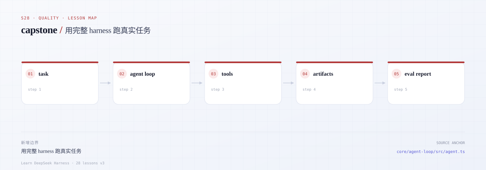
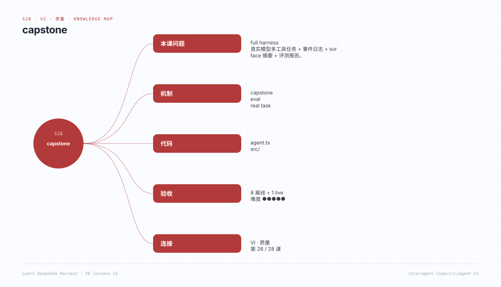

# s28 · capstone：一次真实的多工具任务

## 开篇三问

1. 一个多工具任务如何证明“真的执行了”，而不是模型在最后一段文字里自述？
2. 事件日志、surface 摘要、评测报告分别回答什么问题，为什么不能只留其中一个？
3. 没有 API key 时，怎样仍然验证从工具调用到产物落盘的整条链路？

## 场景

交付一个仓库审计任务：agent 必须列出文件、读取源码、搜索 `TODO/FIXME`、写出一份带 `file:line` 引用的 `audit.md`，最后给出摘要。运行结束后留下四类证据：

- `events.jsonl`：append-only 事件日志；
- `surface.json`：工具/文件/审批/错误的 surface 摘要；
- `eval-report.json`：验收检查与指标（通过/失败、步骤、token、文件数）；
- `audit.md`：agent 真正写出的报告。

有 key 时用真实 DeepSeek（流式 Messages + tool_use）；没有 key 时用 `OfflineModel` 跑同一套 agent、工具、日志和评测，只是在模型边界替换成确定性脚本。测试全部离线。

---



*本课地图：这一步新增的架构边界，以及它在数据流中的位置。*

## 0. 先跑起来（无需 key）

```sh
cd course/lessons/s28-capstone
node src/demo.ts
node --test tests/*.test.ts
```

Demo 会把 `fixtures/project` 复制到一个临时工作区，运行离线 capstone，然后打印：

- 事件数量、surface 摘要；
- 每条验收检查的 PASS/FAIL；
- 产物目录（默认 `.runs/<runId>/`）。

---

## 1. 真实 DeepSeek 运行

```sh
cp env.example .env      # 填入 DEEPSEEK_API_KEY
node src/main.ts         # 默认复制 fixtures/project 到 .runs/<runId>/workspace
```

或者审计自己的目录：

```sh
node src/main.ts --workspace /absolute/path/to/repo --out /tmp/capstone-run
```

`main.ts` 会：

1. 读取 `.env`（不覆盖已有环境变量），没有 key 时直接退出并提示；
2. 用 `DeepSeekModel` 请求 `${DEEPSEEK_BASE_URL}/v1/messages`，`stream: true`；
3. 解析 Messages SSE 的 `text_delta`、`thinking_delta` 和 `input_json_delta`，把工具参数 JSON 还原；
4. 执行工具，写事件日志，最后生成 surface 与 eval；
5. 按 eval 是否通过设置退出码。

> 真实模型可能不按脚本走。评测会如实报告失败（例如没写 `audit.md`、步骤超限、tool error），而不是把失败包装成成功。

---

## 2. 三层证据

| 产物 | 回答的问题 | 本课实现 |
|---|---|---|
| `events.jsonl` | 发生了什么、顺序如何？ | `src/events.ts` 的 append-only log |
| `surface.json` | 用了哪些工具/文件、审批结果、错误数？ | `summarizeSurface` |
| `eval-report.json` | 是否满足验收标准？指标是多少？ | `src/eval.ts` |
| `audit.md` | agent 交付了什么？ | 工具真实写入工作区后复制到产物目录 |

只看 `audit.md` 不够：模型可以自述“我检查了所有文件”，但事件日志里没有 `read_file`；只看事件也不够：读了文件不代表报告达标。三层证据互相约束。

参考：

- [DSH testing policy](https://github.com/deepseek-ai/deepseek-harness/blob/master/docs/testing.zh.md)
- [DSH session projection](https://github.com/deepseek-ai/deepseek-harness/blob/master/docs/subsystems/session-projection.zh.md)
- [DSH tool execution pipeline](https://github.com/deepseek-ai/deepseek-harness/blob/master/docs/tool-execution-pipeline.zh.md)
- [DSH persistence](https://github.com/deepseek-ai/deepseek-harness/blob/master/docs/subsystems/persistence.zh.md)

---

## 3. 任务与工具

系统提示要求 agent：

1. 用 `list_files` 看仓库结构；
2. 用 `read_file` 读至少 3 个文本文件；
3. 用 `search_text` 找 `TODO` / `FIXME`（支持 regex）；
4. 用 `write_file` 写 `audit.md`，每条发现带 `file:line`；
5. 最后用一段话总结。

工具都在工作区内运行：

- `list_files`：递归列出，跳过 `.git` / `node_modules` / `.runs`；
- `read_file`：UTF-8，20k 字符截断；
- `search_text`：最多扫描 200 个文件，返回前 100 条匹配；
- `write_file`：先路径校验，再走审批（默认只允许 `audit.md`）。

路径容器复用 s27 的思路：`realpath` 最近祖先 + `relative`，不是字符串 `startsWith`。

---

## 4. 验收标准

`src/eval.ts` 的检查项：

| id | 通过条件 |
|---|---|
| `run-completed` | agent 正常结束，没有模型失败 |
| `report-written` | 工作区存在 `audit.md` |
| `report-has-findings` | 报告里至少 3 个 `TODO/FIXME` |
| `report-cites-paths` | 报告引用 `src/app.ts` 和 `README.md` |
| `files-reviewed` | 成功读取 ≥ 3 个不同文件 |
| `tools-used` | 至少使用 4 种工具 |
| `approval-granted` | 至少 1 次写入审批被允许 |
| `no-errors` | 事件里 0 个 error / tool error |
| `bounded-steps` | 步骤数 ≤ 配置上限（默认 8） |

`passed = 所有检查通过`。指标另存：steps、tool calls、input/output tokens、files read、report chars、findings count、duration（事件逻辑时间差）。

---

## 5. 文件地图

| 文件 | 作用 |
|---|---|
| [`src/types.ts`](src/types.ts) | message / tool / model / event 类型 |
| [`src/workspace.ts`](src/workspace.ts) | 工作区路径容器 |
| [`src/events.ts`](src/events.ts) | JSONL 事件日志、surface 摘要 |
| [`src/tools.ts`](src/tools.ts) | 四个工具 + 审批 |
| [`src/messages.ts`](src/messages.ts) | 真实 DeepSeek 流式客户端 |
| [`src/sse.ts`](src/sse.ts) | SSE 解码器 |
| [`src/offline.ts`](src/offline.ts) | 无 key 的确定性模型 |
| [`src/agent.ts`](src/agent.ts) | 多步工具循环 |
| [`src/eval.ts`](src/eval.ts) | 验收检查与指标 |
| [`src/run.ts`](src/run.ts) | 编排、产物落盘 |
| [`src/demo.ts`](src/demo.ts) | 离线 smoke |
| [`src/main.ts`](src/main.ts) | 真实 DeepSeek CLI |
| [`fixtures/project/`](fixtures/project) | 被审计的示例仓库 |
| [`tests/s28.test.ts`](tests/s28.test.ts) | SSE、HTTP 映射、离线 smoke、拒绝场景 |

---

## 6. 评测指标怎么看

- **pass rate**：本次 capstone 的 9 项检查通过比例；
- **steps / tool calls**：效率与是否绕路；真实模型常见失败是“反复读同一文件”；
- **tokens**：上下文成本，和 report 长度、读取文件数一起看；
- **approval granted/denied**：写操作是否真的经过审批；
- **tool errors**：工具失败被回灌后模型是否能恢复；
- **duration**：日志逻辑时间差，不是墙钟；用于对比同一 fixture 的运行。

离线 smoke 的意义不是“模型很聪明”，而是**管道可重复**：同一 fixture、同一脚本模型，必须得到同一组事件/摘要/评测结果。

---

## 7. 刻意简化了什么

| 真实 DSH | s28 | 影响 |
|---|---|---|
| 完整 provider 重试/退避 | 一次请求，失败即报告 | 鲁棒性 |
| 完整 session store / resume | 单次 JSONL，不 resume | 持久化 |
| 多 provider / 多模型路由 | 单 DeepSeek endpoint | 部署 |
| 富 UI / action cards | 纯文本报告 | 展示 |
| 真实验收 grader | 固定 9 项检查 | 语义评测 |
| 并发工具执行 | 顺序执行 | 吞吐 |

---

## 8. 扩展方向

1. **resume**：从 `events.jsonl` 恢复 messages，继续被中断的 run。
2. **真实 grader**：让第二个模型按 rubric 给 `audit.md` 打分，并与规则检查交叉验证。
3. **并行工具**：只读工具并发执行，写工具串行；用事件 seq 保持可重放。
4. **更细的 surface**：按目录统计读取量、按工具统计耗时/token。
5. **多模型对比**：同一 fixture 跑 `deepseek-flash` / `deepseek-v4-pro`，比较 pass rate 与成本。
6. **失败注入**：复用 s26 的 fault model，验证 agent 在 429/断流下的报告质量。

---

## 9. 延伸阅读

- [DSH testing policy](https://github.com/deepseek-ai/deepseek-harness/blob/master/docs/testing.zh.md)
- [DSH session projection](https://github.com/deepseek-ai/deepseek-harness/blob/master/docs/subsystems/session-projection.zh.md)
- [DSH tool execution pipeline](https://github.com/deepseek-ai/deepseek-harness/blob/master/docs/tool-execution-pipeline.zh.md)
- [DSH persistence](https://github.com/deepseek-ai/deepseek-harness/blob/master/docs/subsystems/persistence.zh.md)
- [DSH session format](https://github.com/deepseek-ai/deepseek-harness/blob/master/docs/session-format-status.zh.md)

---

## 知识导图



*用一张图记住：本课问题、机制、代码位置、验收与相邻课程。*

[总知识导图](../../../docs/visuals/mindmaps/course.svg) · [XMind 源文件](../../../docs/visuals/mindmaps/course.xmind)
