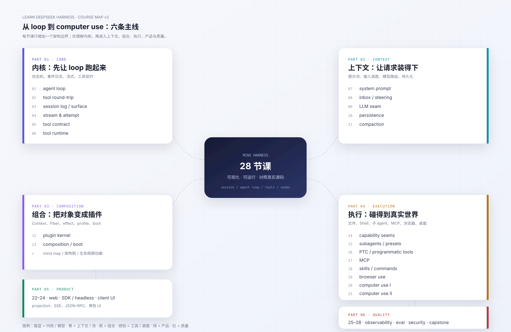
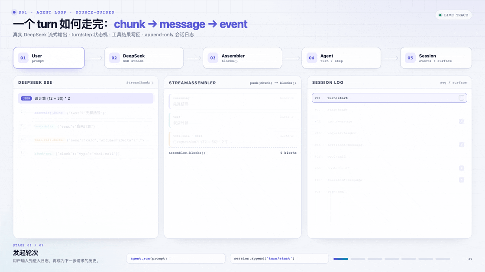
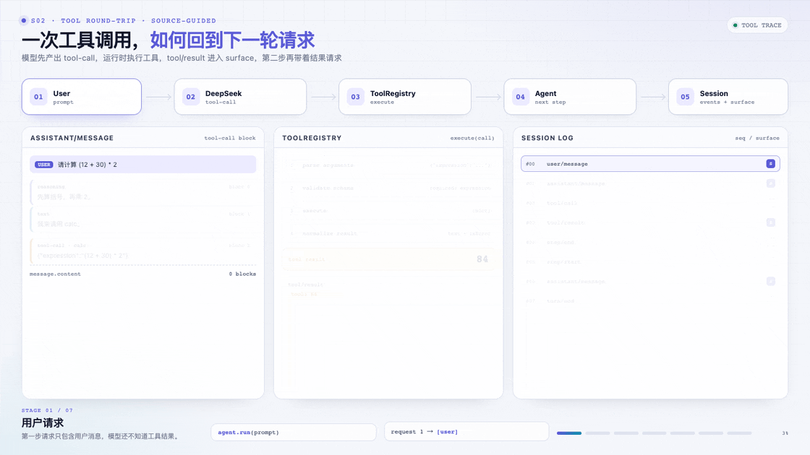
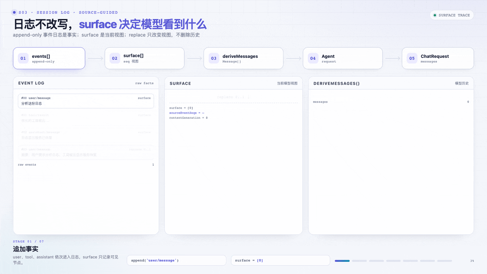

# 课程 v3 设计：30 课内的可视化课程



> 状态：28 课目录已落地。新加的 PTC、browser use、computer use 等课程使用可替换的 mock/provider 边界，离线测试可跑；真实后端可按 README 替换。
>
> 目标读者不变，但课程从“代码快照序列”改为“架构边界 + 可视化机制”的课程。

## 1. 为什么改

现有 18 课有三个结构问题：

1. **s01 过载**：loop、stream、tools、cancel、session 雏形都在第一课。
2. **s02→s03 增量感弱**：s01 已经吃了 stream 组装，s03 只剩持久化/attempt 的增量。
3. **s04/s05 看起来都是 tool**：其实一个是作者契约，一个是运行时编排。

v3 的修法：

- s01 只讲最小 loop，工具下沉到 s02，stream 下沉到 s04
- s03 成为完整的事件日志/surface 课
- s04 成为完整的 stream/attempt 课
- s05/s06 分别命名 `tool contract` / `tool runtime`
- 新增 PTC、browser use、computer use
- 每课开头固定回答三个问题

## 2. 每课开篇模板

```markdown
## 开篇 · 本课定位

### 这一课学什么
3–5 条，不超过一屏。

### DeepSeek 为什么这么做
从真实源码/设计文档解释约束，不写“因为最佳实践”。

### 服务的场景
对应真实 coding agent 的哪个动作/故障/用户需求。

### 一张图
静态架构图 + 交互式机制动画 + 代码地图。
```

参考实现：[`course/lessons/s01-agent-loop/README.md`](../course/lessons/s01-agent-loop/README.md)。

## 3. 28 课草案

### Part I · 内核（1–6）

| # | 课 | 新增边界 |
|---|---|---|
| 01 | agent loop | turn/step、最小请求、取消 |
| 02 | tool round-trip | tool call/result、多步循环 |
| 03 | session log | 事件日志、surface、derive、replay |
| 04 | stream & attempt | chunk 持久化、attempt、live 帧 |
| 05 | tool contract | schema DSL、输出契约、scope |
| 06 | tool runtime | pre/guard/approval/batch/recovery |

### Part II · 上下文（7–11）

| # | 课 | 新增边界 |
|---|---|---|
| 07 | system prompt | sections、variables、contexts、准入 |
| 08 | inbox / steering | next-turn/next-step、claim、cancel |
| 09 | LLM seam | provider、prepareCall、能力、重试 |
| 10 | persistence | JSONL、flush、resume、fork、修复 |
| 11 | compaction | token 压力、裁剪、摘要、replace |

### Part III · 组合（12–13）

| # | 课 | 新增边界 |
|---|---|---|
| 12 | plugin kernel | Context、Service、Fiber、effect、events、scope |
| 13 | composition / boot | profile、bundle、patch、required entry |

### Part IV · 执行边界（14–21）

| # | 课 | 新增边界 |
|---|---|---|
| 14 | capability seams | fs、shell、sandbox、approval |
| 15 | subagents / presets | spawn、深度、并发、preset |
| 16 | PTC | run_code、持久运行时、tools.* |
| 17 | MCP | stdio JSON-RPC、工具发现、外部 server |
| 18 | skills / commands | 技能目录、按需加载、斜杠命令 |
| 19 | browser use | Playwright / Chrome DevTools / Stagehand provider |
| 20 | computer use I | CUA 注册表、macOS provider、app/window/AX/截图 |
| 21 | computer use II | 坐标、动作、快照失效、权限、多模态附件 |

### Part V · 产品面（22–24）

| # | 课 | 新增边界 |
|---|---|---|
| 22 | web | projection、SSE、重连、多客户端 |
| 23 | SDK / headless | JSON-RPC、stdio、进程边界 |
| 24 | client UI / action cards | 工具卡片、审批 UI、状态投影 |

### Part VI · 质量与收束（25–28）

| # | 课 | 新增边界 |
|---|---|---|
| 25 | observability | span、指标、日志 |
| 26 | eval / fault injection | record/replay、snapshot、故障矩阵 |
| 27 | security / permissions | 审批、沙箱、CUA 授权、密钥边界 |
| 28 | capstone | 完整 harness + 真实任务 + 评测报告 |

30 课内仍留 2 节缓冲，可用于 agent team / workflow / liveshare 等专题。

## 4. computer use 在 DSH 里的真实结构

不是“一个 computer_use 工具”，而是三层：

```text
computer-use/computer-use         provider registry（只注册一个 provider）
        ↑
experimental/cua                 共享对象 API / 授权 / AX / 截图
        ↑
experimental/cua-macos           macOS 原生 provider（Swift helper）
```

另外有 Cua Driver MCP / Cua Driver 原生两个 provider。关键约束：

- 当前原生 CUA 是 macOS-only，Windows 计划中
- `computer-use` 本身不提供工具，provider 提供 `cua` 工具
- 应用授权独立于工具审批，按会话/应用持久化
- 截图走附件/多模态链路；模型必须支持图片
- 动作返回 `dispatched:true, verified:false`，必须重新观察
- 已发送输入不可撤销，也不能自动重放
- 坐标默认基于最近截图像素；`relative:true` 使用 0–999 千分比
- 窗口变化/快照失效返回 `WINDOW_CHANGED` / `STALE_SNAPSHOT`

官方资料：

- [`docs/subsystems/computer-use.zh.md`](https://github.com/deepseek-ai/deepseek-harness/blob/master/docs/subsystems/computer-use.zh.md)
- [`packages/experimental/cua`](https://github.com/deepseek-ai/deepseek-harness/blob/master/packages/experimental/cua/README.zh.md)
- [`packages/experimental/cua-macos`](https://github.com/deepseek-ai/deepseek-harness/blob/master/packages/experimental/cua-macos/README.zh.md)

browser use 则是另一套 provider registry：

- [`packages/browser-use/browser-use`](https://github.com/deepseek-ai/deepseek-harness/blob/master/packages/browser-use/browser-use/README.zh.md)
- Playwright MCP / Chrome DevTools MCP / Stagehand native

## 5. 可视化策略

每课三件套：

1. **本课地图**：思维导图 / 架构图
2. **机制动画**：11.6s 循环 GIF + 可单步 HTML
3. **代码地图**：文件与函数

视觉源文件放 `docs/visuals/`，用 HTML/SVG/Mermaid 维护；GIF/MP4 只作为 README/视频输出。规范见 [`docs/visuals/README.md`](visuals/README.md)。

### 已落地原型

**s01 · agent loop**



**s02 · tool round-trip**



**s03 · surface / replace**




### s02 开篇（原型）

**这一课学什么**：模型如何产出 `tool-call`、运行时如何执行并规范化结果、`tool/result` 如何回到下一步请求。

**DeepSeek 为什么这么做**：模型不能直接执行工具；工具调用和结果必须成对进入历史，失败也要成为可回放的事实。否则下一步请求会出现“有调用没结果”的非法历史。

**服务的场景**：真实仓库里读文件、跑测试、执行命令；一次任务往往需要多步工具往返。

### s03 开篇（原型）

**这一课学什么**：事件日志、surface 索引、`deriveMessages()`、`replace` 与原始事件保留。

**DeepSeek 为什么这么做**：会话需要压缩、系统提示词替换、审计和 fork；如果直接改 `messages`，历史就不可回放。surface 让“当前视图”可变，而“事实日志”保持不变。

**服务的场景**：长会话压缩、恢复后重放、fork 子会话、排查“模型当时到底看到了什么”。

## 6. 迁移顺序

1. s01 → s02 拆分、s03/s04 重排已完成；s01/s02/s03 动画已落地
2. 重写 s03/s04 的定位与开篇
3. 补 s05/s06 的图，明确 contract/runtime
4. 按 Part 逐课补“三件套”
5. 28 课目录迁移与全站课程地图已完成
